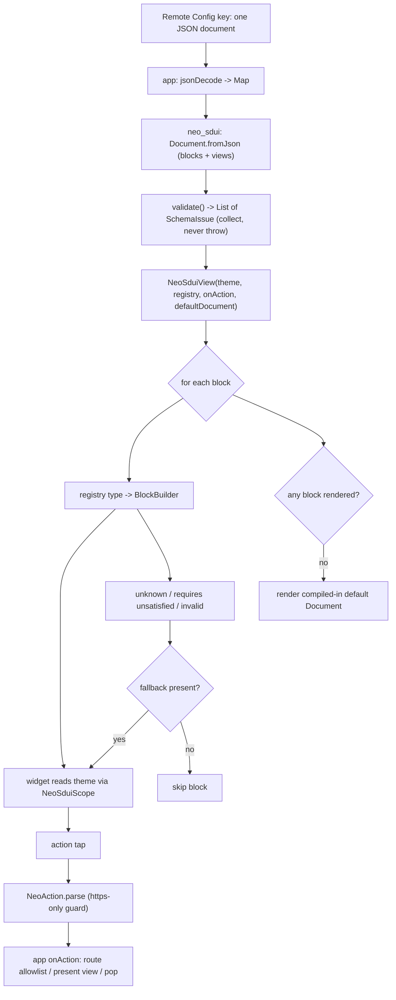

# neo_sdui Unified Guide Engine - Plan

## Goal Capsule

- **Objective:** Ship `neo_sdui` — a pure-Dart Flutter engine that renders one
  Firebase Remote Config JSON document per guide into baked, themed widgets —
  and prove it on two consumers: port the existing `how_to` guide (the
  regression gate) and build the new MCP setup guide, both from one document
  model and one block registry.
- **Product authority:** Vaibhav (lay@neosapien.xyz).
- **Execution profile:** Greenfield package, build phased A→D (engine → blocks →
  how_to port → MCP guide). Both guides render through the same engine and
  registry — unification is the load-bearing proof.
- **Stop conditions:** Surface a blocker rather than guessing when a decision
  contradicts the Product Contract or widens scope (e.g. a guide needs a block
  outside the v1 roster, or video fidelity is required before the add-on lands).
- **Open blockers:** None. `neo_ui` does not exist — the app supplies the entire
  theme to the renderer's constructor today.

---

## Product Contract

*Product Contract unchanged from the requirements-only version — planning added
the Planning Contract, Implementation Units, Verification Contract, and
Definition of Done below.*

### Summary

One JSON-driven engine renders both the `how_to` guide and the MCP setup guide,
and every guide feature that follows. The wire carries semantic block types and
token names — never pixels; the client hands the renderer a complete
`NeoSduiTheme` in its constructor and owns all styling. `how_to` is a strict
subset of the MCP guide, so a single unified document model, block roster, and
registry serve both.

### Problem Frame

`how_to` today renders remote **HTML** through `flutter_widget_from_html`
(`how_to_html_view.dart`, 471 LOC) — an untyped, unvalidated surface that also
passes a Remote-Config string straight into `launchUrl(Uri.parse(url))` with no
scheme check (`how_to_link_dispatcher.dart:90-94`). The MCP guide has no code at
all and is a larger, multi-screen flow (intro → five per-client setups → FAQ →
troubleshooting). Building it bespoke, then maintaining a second HTML surface,
duplicates work and locks pixels to today's app: with a `neo_ui` design system
coming, any styling the wire owns would have to be re-authored per document when
the design system lands. A typed, themed, JSON-driven engine removes the HTML
surface, closes the URL hole in the port, and makes the future re-skin a
one-object swap instead of a corpus rewrite.

### Key Decisions

- **Semantic blocks + a client-side registry, not rfw.** The wire names a block
  `type` and token names; the client owns layout and pixels. rfw is rejected:
  its own README scopes it against gestures, animations, and page transitions
  ("it doesn't let you *create* those widgets"), while these guides need
  accordions, tab controllers, shimmers, and video. A new block type is a
  registry entry (`type` → builder) plus an app release; add-on packages
  register their own blocks without the core importing them.
- **The app supplies the whole theme via the renderer constructor; `neo_ui`
  does not exist.** The root renderer takes a `NeoSduiTheme` (colors, text
  styles, per-component styles) in its constructor and exposes it down the tree
  via an `InheritedWidget`. The package never depends on the app's `ThemeData`
  or on `neo_ui`. `neo` fills the theme from `AppColors`/`AppStyles` today.
- **One unified document model for both features.** A document is
  `{ version, blocks[], views{ id: {present, blocks[]} } }`. `how_to`'s bottom
  sheets and the MCP guide's full-screen sub-pages are the same `views`
  mechanism, distinguished by `present: 'sheet' | 'screen'`. The `card` block
  unifies `how_to`'s list item, the MCP client-picker, and the footer nav.
- **Flat semantic envelope + reserved keywords.** Every node is
  `{ "type": …, …fields }` — no nested `data` bag (that is Editor.js's heaviest
  form; Adaptive Cards and DivKit both flatten). `type`, `version`, `blocks`,
  `views`, `present`, `requires`, `fallback`, and `action` are reserved and may
  not be block field names.
- **Absent field = compiled-in schema default.** The wire omits anything at its
  default; the renderer fills it from the block's client-side schema. This
  retires the `_injectMissingThumbDimensions` regex hack rather than porting it.
- **Version negotiation via `version` + `requires` + `fallback`.** Validated
  against Adaptive Cards: a top-level `version`, a per-block `requires`
  (feature → minimum version), and a per-block `fallback` subtree. "When a
  feature is missing or of insufficient version, fallback is triggered."
- **Resilient failure with a compiled-in default floor.** An invalid block
  renders its `fallback`, else is skipped; if zero blocks render, the engine
  falls back to the compiled-in default document. Never a blank screen or error
  page. Blast radius is one block.
- **Pure-Dart core, JSON not YAML.** Core deps are `flutter` + `meta` only — no
  `freezed`/`json_serializable`/codegen; `fromJson` is hand-written with a
  validation pass that collects errors. The wire is JSON (Dart's `loadYaml`
  admits the billion-laughs anchor-expansion primitive). The app does
  `jsonDecode` and hands the package a `Map<String, dynamic>`.

### Requirements

**Document model & schema**

- R1. One Remote Config key holds one guide document as JSON:
  `{ version:int, blocks:[…], views:{…} }`. The app decodes it; the package
  receives a `Map<String, dynamic>`.
- R2. The envelope is flat: every block is `{ type, …fields }` with no nested
  `data` object. Reserved keywords (Key Decisions) may not be block field names.
- R3. Sub-views live in `views{ id: { present: 'sheet' | 'screen', blocks:[…] } }`.
  `sheet` presents a modal (today's `how_to` bottom sheet); `screen` presents a
  full-screen push (the MCP sub-pages). One mechanism serves both features.
- R4. An absent field takes the block's compiled-in schema default; the wire
  omits anything sitting at its default. A default is a fallback, never a
  ceiling — the wire can always override.

**Block roster (v1)**

- R5. Core block roster: `header`, `text`, `card`, `media`, `steps`, `callout`,
  `cta`, `faq`, `tabs`. Each resolves to a baked widget through the registry.
- R6. `card` = icon/thumbnail + title + optional subtitle + action. One block
  serves `how_to`'s list item, the MCP client-picker, and the footer nav.
- R7. `media` = image/video reference + intrinsic ratio; raw integer dimensions
  are allowed on the wire (an asset's aspect ratio is content, not theme —
  supports `how_to`'s 2:1 and 4:3 thumbnails). Video is supplied by the
  `neo_sdui_video` add-on, not the core.
- R8. `tabs`, `faq`, and `steps` are structured/composition blocks: `tabs` =
  label + blocks per tab; `faq` = accordion of Q/A items; `steps` = numbered
  homogeneous items with per-item error isolation so one bad item cannot take
  out the run.
- R9. New block types register into an open `type` → builder registry; an add-on
  package registers its own blocks without the core importing it.

**Theming**

- R10. The root renderer accepts a complete `NeoSduiTheme` in its constructor
  (colors, text styles, per-component styles) and exposes it down the tree via
  an `InheritedWidget`. Style values on the wire are token names resolved
  against this theme; no hex, `fontSize`, or `padding` appears on the wire.
- R11. The package depends on neither the app's `ThemeData` nor `neo_ui`. The
  app supplies the entire theme today; a future `neo_ui` swaps the theme object
  with no document changes.

**Actions & navigation**

- R12. Action grammar: `https://…`, `route:<name>`, `sheet:<id>`, `screen:<id>`,
  `closeSheet`, `closeAll`. Actions are inline on the block that owns them; there
  is no `cta`-id registry.
- R13. External URLs are `https` only. Non-https schemes (`http:`, `javascript:`,
  `file:`, `intent:`, custom deep-link schemes) are rejected at the action
  boundary — this closes the unguarded `launchUrl` inherited from `how_to`.
- R14. `route:`, `screen:`, and `sheet:` resolve through allowlists, never a raw
  path. The app owns the router and its transitions; the package never imports
  `auto_route` and never touches a `Navigator`.

**Validation & failure**

- R15. The package validates the decoded map (shape, reserved keywords,
  `version`) and collects errors rather than throwing on the first one.
- R16. Version negotiation: a top-level `version`, a per-block `requires`
  (feature → minimum version), and a per-block `fallback` subtree. An unknown or
  unsatisfiable block renders its `fallback`; if none is present, it is skipped.
- R17. Failure is resilient with a compiled-in default floor: invalid block →
  `fallback` else skip; if zero blocks render, the engine renders the compiled-in
  default document instead of a blank screen or error page.

**Packaging & consumers**

- R18. The core package is pure-Dart: `flutter` + `meta` only, no
  `freezed`/`json_serializable`/codegen. `fromJson` is hand-written.
- R19. The wire is JSON, never YAML.
- R20. Port `how_to` first as the regression gate — visual-equivalence checked by
  eye once against the old HTML render, then golden-tested against the new
  renderer as a forward regression gate. Then build the MCP guide: intro +
  ChatGPT / Claude Web / Claude App / Claude Code / Other + FAQ + troubleshooting.
- R21. Native add-ons (e.g. `neo_sdui_video`) live as sibling packages in the
  same repo, pinned by one tag (mirrors `neo_ble`). Core is `--template=package`;
  native add-ons are `--template=plugin`.

### Acceptance Examples

- AE1. **Covers R16.** An unknown block `type` with a `fallback` present →
  render the `fallback` subtree in its place.
- AE2. **Covers R16, R17.** An unknown block with no `fallback` → skip that
  block, render the rest of the document normally.
- AE3. **Covers R17.** A document where every block is invalid or unknown →
  render the compiled-in default document; the user never sees a blank screen.
- AE4. **Covers R4.** A `media` block that omits its aspect ratio → the renderer
  applies the block's compiled-in default ratio.
- AE5. **Covers R13.** An action of `http://…` or `javascript:…` → rejected at
  the action boundary; nothing launches.
- AE6. **Covers R16.** A block declaring `requires: { video: "1.2" }` on a build
  without the `neo_sdui_video` add-on → render its `fallback` (e.g. a "Watch on
  web" `cta`).

### Scope Boundaries

**Deferred for later** (each has a named trigger in the ideation doc):

- Generic layout containers (`row`/`column`/`group`) for author-composed layout
  — add only when a future guide needs arrangement the block roster can't bake.
- `defs`/`ref` subtree dedupe and author-time content hashing — YAGNI until the
  corpus passes ~20 documents or a shared tail repeats across ≥3 guides.
- The `neo_sdui_video` add-on and the repo federation it triggers, wiring
  `neo → neo_sdui`, and generating the block schema from the registry.

**Deferred to Follow-Up Work** (this engine's natural next PRs, out of this plan):

- `neo_sdui_video` add-on + `git mv` core into a subdir + one-tag sibling
  packaging — closes how_to's video fidelity (this plan renders video posters).
- Wire the real `neo` app to render `how_to` and the MCP guide via `neo_sdui`
  behind a flag, replacing `HowToHtmlView`.

**Outside this product's identity:**

- rfw-style remote widget trees, expression languages, and remote-driven page
  transitions.
- The package owning a `Navigator`/router or importing `auto_route`.
- The server deciding pixels (hex, `fontSize`, `padding` on the wire).
- A `command`/copy-code block — not present in either Figma flow (MCP steps are
  pasted images); add only if a real paste-a-command step appears.
- The MCP website landing/product pages — web surface, not the app.

---

## Planning Contract

### Key Technical Decisions

- KTD1. **Sealed `Block` hierarchy + hand-written `fromJson`, no codegen.**
  `sealed class Block` with one subtype per roster entry; `Block.fromJson(map)`
  switches on `type` and returns an `UnknownBlock` (carrying the raw map and any
  `fallback`) for an unrecognized type instead of throwing. A separate
  `validate(Document)` pass returns a `List<SchemaIssue>` rather than throwing on
  the first problem. Serves R1, R2, R15, R18; the sealed switch is exhaustive at
  compile time.
- KTD2. **Registry is a `Map<String, BlockBuilder>`.** `typedef BlockBuilder =
  Widget Function(BuildContext, Block, NeoSduiScope)`. The core seeds a default
  registry; `registry.register(type, builder)` lets an add-on contribute a block
  without the core importing it — the same name→closure shape rfw uses for
  `LocalWidgetLibrary`. Serves R9.
- KTD3. **Theme via constructor + `InheritedWidget`.** `NeoSduiTheme` is an
  immutable value object of per-component style slots with `copyWith`; the root
  `NeoSduiView(theme: …)` stores it in a `NeoSduiScope extends InheritedWidget`;
  blocks read `NeoSduiScope.of(context).theme`. No `ThemeData`/`ThemeExtension`
  dependency and no `neo_ui`. Serves R10, R11.
- KTD4. **Action boundary is a pure parser + an app-supplied resolver.**
  `NeoAction.parse(String)` returns a sealed `NeoAction`
  (`ExternalUrl`/`Route`/`OpenView`/`CloseView`/`CloseAll`/`Invalid`), enforcing
  `https`-only inside `parse` (any other scheme → `Invalid`). The app passes an
  `onAction` callback (plus view-present callbacks) into the constructor; the
  package never imports `auto_route` or touches a `Navigator`. Serves R12, R13,
  R14.
- KTD5. **View presentation is app-driven.** The engine renders a view's blocks
  into a widget; `present: sheet|screen` is a hint the app's present-callback
  honors (modal vs push). Keeps the package Navigator-free. Serves R3, R14.
- KTD6. **Resilient render pipeline with a default floor.** For each block →
  build; unknown/`requires`-unsatisfied/invalid → build its `fallback`, else drop;
  if the child list ends empty → the root swaps to the compiled-in default
  `Document` passed to the constructor. Serves R16, R17.
- KTD7. **Schema defaults live in each block builder**, applied when a field is
  absent. No wire-side default injection (retires
  `_injectMissingThumbDimensions`). Serves R4.
- KTD8. **Video is deferred to the `neo_sdui_video` add-on; core `media` handles
  images only.** The how_to port renders video's poster image via core `media`
  until the add-on lands. Keeps the core pure-Dart. Serves R7 and the scope
  boundary.

### High-Level Technical Design



### Assumptions

- `neo_ui` does not exist. The app supplies the full `NeoSduiTheme` via the
  constructor, filled from `AppColors`/`AppStyles` today.
- The how_to port and its regression gate live inside `neo_sdui` (an `example/`
  app + golden tests). Wiring the real `neo` app to render guides via `neo_sdui`
  is a separate follow-up, not this plan.
- how_to's video fidelity is deferred with the `neo_sdui_video` add-on; this
  plan renders video's poster image via core `media`.
- The exact `NeoSduiTheme` slot list and per-block field names are derived from
  the two Figma flows during implementation (per unit), not pinned here. Grounding
  dossier for both flows is in the Sources section.

### Sequencing

Phase A (engine, U1–U6) → Phase B (blocks, U7–U8) → Phase C (how_to port +
goldens, U9–U10) → Phase D (MCP guide + goldens, U11–U12). Each phase depends on
the prior; blocks depend on the engine, the ports depend on the blocks.

---

## Output Structure

```text
lib/
  neo_sdui.dart                 # barrel: public exports only
  src/
    model/
      document.dart             # Document { version, blocks, views }
      block.dart                # sealed Block + subtypes + fromJson
      view.dart                 # View { present, blocks }
      validation.dart           # validate() -> List<SchemaIssue>
    theme/
      neo_sdui_theme.dart       # NeoSduiTheme value object + copyWith
      neo_sdui_scope.dart       # NeoSduiScope (InheritedWidget)
    action/
      neo_action.dart           # sealed NeoAction + parse (https guard)
    registry/
      block_registry.dart       # Map<String, BlockBuilder> + register()
    render/
      neo_sdui_view.dart        # root renderer (constructor injection)
      view_host.dart            # renders a view's blocks; present hint
    blocks/
      header.dart text.dart cta.dart callout.dart media.dart
      card.dart steps.dart faq.dart tabs.dart
example/
  how_to/                       # how_to document fixture + screen
  mcp/                          # MCP guide document fixture + screen
test/
  model/ action/ registry/ theme/ blocks/   # unit + widget tests
  golden/                       # forward regression goldens
```

The tree is a scope declaration, not a constraint — per-unit `Files:` lists are
authoritative.

---

## Implementation Units

### U1. Library skeleton and structure

- Goal: Establish the `lib/src/**` layout, the public barrel, and lints so every
  later unit lands in a settled structure.
- Requirements: R18.
- Dependencies: none.
- Files: `lib/neo_sdui.dart`, `lib/src/{model,theme,action,registry,render,blocks}/`
  (folders), `analysis_options.yaml`.
- Approach: Barrel exports only the public surface (`NeoSduiView`, `NeoSduiTheme`,
  `BlockRegistry`, `NeoAction`, model types). Keep `src/` private.
- Test Scenarios: Test expectation: none — scaffolding, no behavior.
- Verification: `fvm flutter analyze` clean; `import 'package:neo_sdui/neo_sdui.dart'`
  resolves the public types.

### U2. Document model, parsing, and validation

- Goal: Parse a decoded map into `Document { version, blocks, views }` and
  validate it, collecting issues instead of throwing.
- Requirements: R1, R2, R3, R4, R15, R16.
- Dependencies: U1.
- Files: `lib/src/model/document.dart`, `lib/src/model/block.dart`,
  `lib/src/model/view.dart`, `lib/src/model/validation.dart`,
  `test/model/document_test.dart`.
- Approach: KTD1 — `sealed class Block`, one subtype per roster entry;
  `Block.fromJson` switches on `type`, returns `UnknownBlock(raw, fallback?)` for
  an unrecognized type. Each block subtype carries optional `requires` and
  `fallback`. `validate(Document)` returns `List<SchemaIssue>` (reserved-keyword
  misuse, missing required field, bad `version`, malformed `views`).
- Test Scenarios: parse a valid document (blocks + views) → typed model; unknown
  `type` → `UnknownBlock` carrying its `fallback`; block missing a required field
  → one `SchemaIssue`, parsing continues; a block field named with a reserved
  keyword → `SchemaIssue`; `views` map with `present: sheet` and `present: screen`
  parse correctly; absent top-level `version` → `SchemaIssue`.
- Verification: `fvm flutter test test/model/document_test.dart` green.

### U3. Block registry

- Goal: A `type` → builder registry the core seeds and add-ons extend.
- Requirements: R9.
- Dependencies: U1.
- Files: `lib/src/registry/block_registry.dart`, `test/registry/block_registry_test.dart`.
- Approach: KTD2 — `Map<String, BlockBuilder>` with `register(type, builder)` and
  `builderFor(type)` returning null for unknown (the render pipeline routes null
  to fallback/skip). A `defaultRegistry()` seeds the core roster.
- Test Scenarios: known type returns its builder; unknown type returns null;
  `register` adds a new type without mutating core registrations; re-registering a
  type overrides (documented behavior for add-ons).
- Verification: `fvm flutter test test/registry/` green.

### U4. Theme and scope

- Goal: Carry an app-supplied `NeoSduiTheme` down the tree without depending on
  `ThemeData` or `neo_ui`.
- Requirements: R10, R11.
- Dependencies: U1.
- Files: `lib/src/theme/neo_sdui_theme.dart`, `lib/src/theme/neo_sdui_scope.dart`,
  `test/theme/neo_sdui_scope_test.dart`.
- Approach: KTD3 — `NeoSduiTheme` immutable value object with per-component slots
  and `copyWith`; `NeoSduiScope extends InheritedWidget` with `of(context)` and
  `updateShouldNotify`. Exact slot list is derived from the Figma token sets in
  U7/U9 — seed with the slots the leaf blocks need.
- Test Scenarios: a descendant reads the theme via `NeoSduiScope.of`; changing the
  theme instance triggers `updateShouldNotify`; `of` throws a clear error when no
  scope is present (misuse guard).
- Verification: `fvm flutter test test/theme/` green.

### U5. Action boundary

- Goal: Parse an action string into a typed action, enforcing `https`-only, with
  no navigation dependency in the package.
- Requirements: R12, R13, R14.
- Dependencies: U1.
- Files: `lib/src/action/neo_action.dart`, `test/action/neo_action_test.dart`.
- Approach: KTD4 — `NeoAction.parse` returns a sealed `NeoAction`. `https://…` →
  `ExternalUrl`; any other scheme → `Invalid`. `route:x` → `Route('x')`;
  `sheet:x`/`screen:x` → `OpenView('x', present)`; `closeSheet`/`closeAll` →
  `CloseView`/`CloseAll`. The app resolves `Route`/`OpenView` through its own
  allowlist; the package supplies no router.
- Test Scenarios: Covers AE5 — `http://…` and `javascript:…` → `Invalid`, nothing
  launches. `https://…` → `ExternalUrl`; `route:askNeo` → `Route('askNeo')`;
  `sheet:control` → `OpenView('control', sheet)`; `screen:chatgpt` →
  `OpenView('chatgpt', screen)`; `closeSheet`/`closeAll` → close actions; garbage
  string → `Invalid`.
- Verification: `fvm flutter test test/action/` green.

### U6. Root renderer, resilient pipeline, and default floor

- Goal: Render a `Document` into widgets with per-block fallback/skip and a
  compiled-in default floor, wiring taps to the app's `onAction`.
- Requirements: R3, R16, R17.
- Dependencies: U2, U3, U4, U5.
- Files: `lib/src/render/neo_sdui_view.dart`, `lib/src/render/view_host.dart`,
  `test/render/neo_sdui_view_test.dart`.
- Approach: KTD5, KTD6 — `NeoSduiView(document, theme, registry, onAction,
  defaultDocument, presentView)`. Build each block via the registry; on
  unknown/`requires`-unsatisfied/invalid → build `fallback` else drop; empty child
  list → render `defaultDocument`. `view_host` renders a named view's blocks and
  reports its `present` hint to the app callback.
- Test Scenarios: Covers AE1 — unknown block with `fallback` → renders fallback.
  Covers AE2 — unknown block without `fallback` → skipped, siblings render. Covers
  AE3 — all blocks invalid → renders `defaultDocument`. Covers AE6 — block with
  unsatisfied `requires` → renders fallback. Blocks render in document order; a
  tap on an action-bearing block invokes `onAction` with the parsed action.
- Verification: `fvm flutter test test/render/` green.

### U7. Leaf blocks: header, text, cta, callout, media

- Goal: The five leaf blocks, each reading theme slots and applying schema
  defaults for absent fields.
- Requirements: R5, R7, R4.
- Dependencies: U6.
- Files: `lib/src/blocks/header.dart`, `text.dart`, `cta.dart`, `callout.dart`,
  `media.dart`, `test/blocks/leaf_blocks_test.dart`.
- Approach: `header` (title + optional subtitle), `text` (body/variant), `cta`
  (label + inline action), `callout` (title + bullets + severity token), `media`
  (image via `Image.network` with `loadingBuilder` shimmer + `errorBuilder`;
  intrinsic ratio, default applied when absent). Each pulls colors/type from
  `NeoSduiScope`. Register all five in the default registry.
- Test Scenarios: each block renders with themed slots; Covers AE4 — `media`
  without ratio uses the default ratio; `cta` tap emits its parsed action;
  `callout` renders each bullet; `media` shows the shimmer while loading and the
  error placeholder on failure.
- Verification: `fvm flutter test test/blocks/leaf_blocks_test.dart` green.

### U8. Structured blocks: card, steps, faq, tabs

- Goal: The four composition blocks, including the unifying `card` and the
  stateful accordion/tabs.
- Requirements: R5, R6, R8.
- Dependencies: U6.
- Files: `lib/src/blocks/card.dart`, `steps.dart`, `faq.dart`, `tabs.dart`,
  `test/blocks/structured_blocks_test.dart`.
- Approach: `card` = icon/thumbnail + title + optional subtitle + inline action
  (one block for how_to list item, MCP client-picker, footer nav). `steps` =
  numbered items, each built in its own `try`/`catch` so one bad item is isolated.
  `faq` = accordion holding open state in a `Set<int>`. `tabs` = `TabController`
  over label + blocks per tab.
- Test Scenarios: `card` tap emits its action; `steps` with one malformed item
  renders the rest and shows a placeholder for the bad one; `faq` expands and
  collapses an item; `tabs` switches content on tab change; `card` renders with
  and without the optional subtitle.
- Verification: `fvm flutter test test/blocks/structured_blocks_test.dart` green.

### U9. Author the how_to document and render screen

- Goal: Reproduce today's `how_to` guide as one `neo_sdui` document + a themed
  render screen in the example app — the regression gate's subject.
- Requirements: R20, R6, R7.
- Dependencies: U7, U8.
- Files: `example/how_to/how_to_document.dart` (or `.json`),
  `example/how_to_screen.dart`, `example/how_to_theme.dart`.
- Approach: Translate the existing HTML content (index cards + bottom sheets, from
  `remote_config_defaults.dart` via the grounding dossier) into blocks (`header`,
  `card` per topic) + `views` (each sheet: `header`, `media` poster, optional
  `text`, `cta`). Fill a `NeoSduiTheme` to match `how_to_styles` (`h5`/white,
  `primary500`, subtitle grey, sheet-desc white). Video renders as its poster
  image via `media`.
- Execution note: Do the one-time by-eye visual-equivalence check against the
  current `HowToHtmlView` here; note video-poster as the known deferred gap.
- Test Scenarios: the document parses with zero `SchemaIssue`s; `sheet:` actions
  resolve to existing views; a `card` tap opens its sheet view.
- Verification: `fvm flutter test` for the example fixture parse test; manual
  by-eye comparison recorded.

### U10. how_to golden tests (forward regression gate)

- Goal: Lock the new how_to render against itself so future changes can't silently
  regress it.
- Requirements: R20.
- Dependencies: U9.
- Files: `test/golden/how_to_index_test.dart`, `test/golden/how_to_sheet_test.dart`,
  golden `.png`s.
- Approach: Golden-test the index screen and each sheet view. Stub `Image.network`
  so goldens are deterministic. The golden is the forward gate; the old-vs-new
  comparison is the one-time manual check from U9.
- Execution note: Goldens compare the new renderer to itself, not to the old HTML
  tree (per the ideation doc — cross-tree pixel diffing loses to font hinting).
- Test Scenarios: index screen matches its golden; each sheet view matches its
  golden; a deliberate theme change fails the golden (proves the gate bites).
- Verification: `fvm flutter test test/golden/` green after `--update-goldens`
  review.

### U11. Author the MCP guide document and render screens

- Goal: Build the MCP setup guide as one `neo_sdui` document exercising the full
  roster — the unification proof beyond how_to.
- Requirements: R5, R6, R8, R20.
- Dependencies: U7, U8.
- Files: `example/mcp/mcp_document.dart` (or `.json`), `example/mcp_screen.dart`,
  `example/mcp_theme.dart`.
- Approach: One document, `views` map. Intro blocks: `header`, `steps` (Pick your
  AI / Follow the guide / Ask it anything), `card` client-picker ×3 (`screen:`
  actions), `callout` note. Per-client views (`screen`): `tabs` (Web / Desktop
  App), `steps` + `media`, `callout` troubleshooting — for ChatGPT, Claude Web,
  Claude App, Claude Code, Other. `faq` view: one `faq` block (7 Q/A). Troubleshooting
  view: `callout` list + a `cta` "Contact Support".
- Test Scenarios: the document parses with zero `SchemaIssue`s; `screen:` actions
  resolve to existing views; the client-picker `card`s open their per-client views;
  the `faq` block renders all seven items.
- Verification: `fvm flutter test` for the MCP fixture parse test; example screen
  renders each view.

### U12. MCP guide golden tests

- Goal: Forward regression goldens for the MCP screens.
- Requirements: R20.
- Dependencies: U11.
- Files: `test/golden/mcp_intro_test.dart`, `test/golden/mcp_client_test.dart`,
  `test/golden/mcp_faq_test.dart`, `test/golden/mcp_troubleshooting_test.dart`,
  golden `.png`s.
- Approach: Golden the intro, one representative per-client view, the FAQ view, and
  the troubleshooting view. Stub `Image.network`.
- Test Scenarios: each screen matches its golden; the FAQ golden reflects an
  expanded item state; a per-client `tabs` golden reflects the selected tab.
- Verification: `fvm flutter test test/golden/` green after `--update-goldens`
  review.

---

## Verification Contract

| Gate | Command | Applies to |
|---|---|---|
| Static analysis | `fvm flutter analyze` (zero issues) | all units |
| Unit + widget tests | `fvm flutter test` | U2–U8, U9/U11 fixture parse |
| Golden regression | `fvm flutter test test/golden/` (after `--update-goldens` review) | U10, U12 |
| Pure-Dart core | `pubspec.yaml` dependencies stay `flutter` + `meta`; no `freezed`/`json_serializable`/`video_player` in the core package | U1, all |
| how_to fidelity | One-time by-eye comparison of the new render vs current `HowToHtmlView` | U9 |
| Unification proof | Both `example/how_to` and `example/mcp` render through the same `NeoSduiView` + default registry | U9, U11 |

---

## Definition of Done

**Global:**

- `fvm flutter analyze` clean; `fvm flutter test` (unit, widget, golden) green.
- Core `pubspec.yaml` unchanged in dependency set — `flutter` + `meta` only.
- how_to renders visually-equivalent by eye (once), with video-poster noted as the
  deferred gap; the MCP guide renders every screen (intro, five per-client, FAQ,
  troubleshooting).
- Both guide documents render through one engine and one registry — unification
  demonstrated, not just asserted.
- No dead-end or experimental code left in the diff.

**Per-unit:** each unit's Test Scenarios pass and its Verification holds.

---

## Risks & Dependencies

- **Golden brittleness across environments.** Cross-machine font hinting and line
  breaking can flake pixel goldens (ideation doc rejection #3). Mitigate: stub
  network images, run goldens on a pinned CI image or gate them local-only, and
  rely on the by-eye check for old-vs-new — goldens only guard new-vs-new.
- **Video-poster gap in the how_to port.** Until `neo_sdui_video` lands, how_to's
  sheet videos show a poster image. Accepted, tracked as follow-up; `requires` +
  `fallback` (AE6) is the mechanism that keeps old builds correct once it exists.
- **`NeoSduiTheme` slot churn.** The slot list firms up as U7/U9/U11 read the Figma
  tokens; treat early slots as provisional and consolidate before the MCP theme.

---

## Sources / Research

- Requirements origin: this file's Product Contract (`product_contract_source:
  ce-brainstorm`), enriched in place.
- Ideation: `docs/ideation/neo-sdui-pixel-authority-and-wire-economy.md`.
- Grounding dossier (how_to code + both Figma flows): captured during brainstorm —
  `how_to_html_view.dart`, `how_to_link_dispatcher.dart`, `how_to_*.model.dart`,
  `remote_config_defaults.dart`; Figma how_to node 11937-52459, MCP guide node
  4146-13439 (intro, five per-client setups, FAQ, troubleshooting).
- Adaptive Cards Universal Action Model — `version` + `requires` + `fallback`
  semantics (learn.microsoft.com/adaptive-cards).
- rfw README — `LocalWidgetLibrary` name→builder registry and its explicit scope
  against animation/gestures/transitions (validates the rfw rejection and KTD2).
- Stac (pub.dev/packages/stac) — client-supplied `StacThemeData` and server-driven
  navigation validate the constructor theme (KTD3) and `sheet:`/`screen:` actions.
