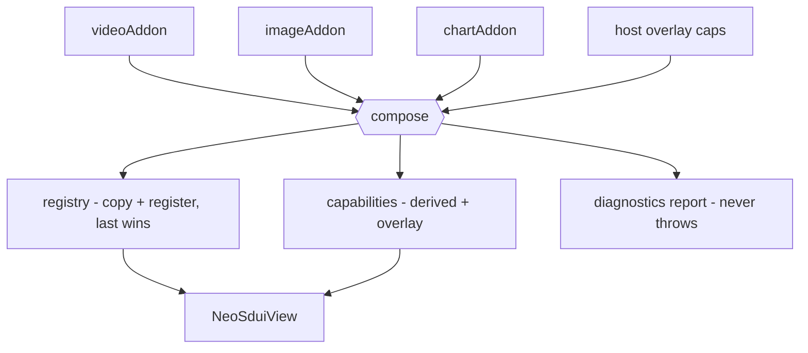
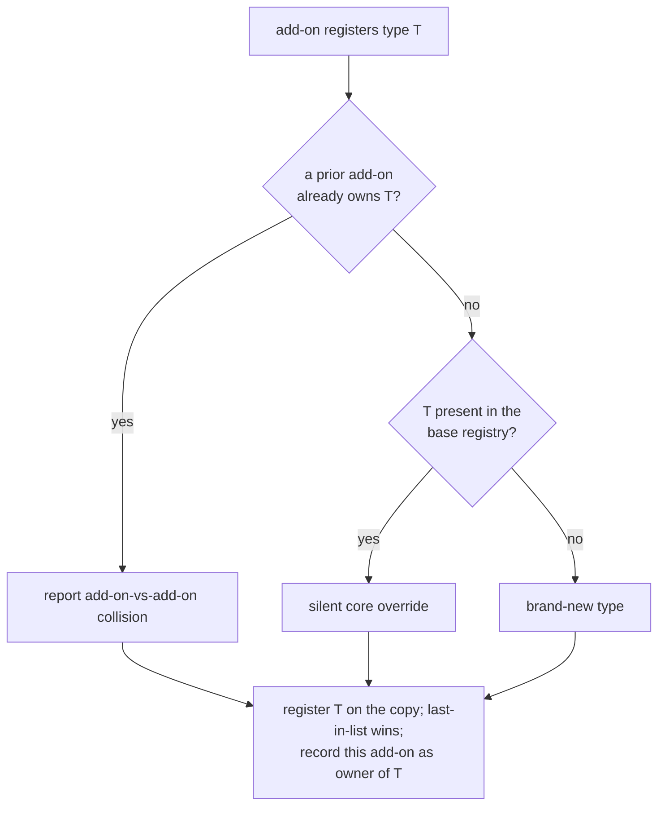
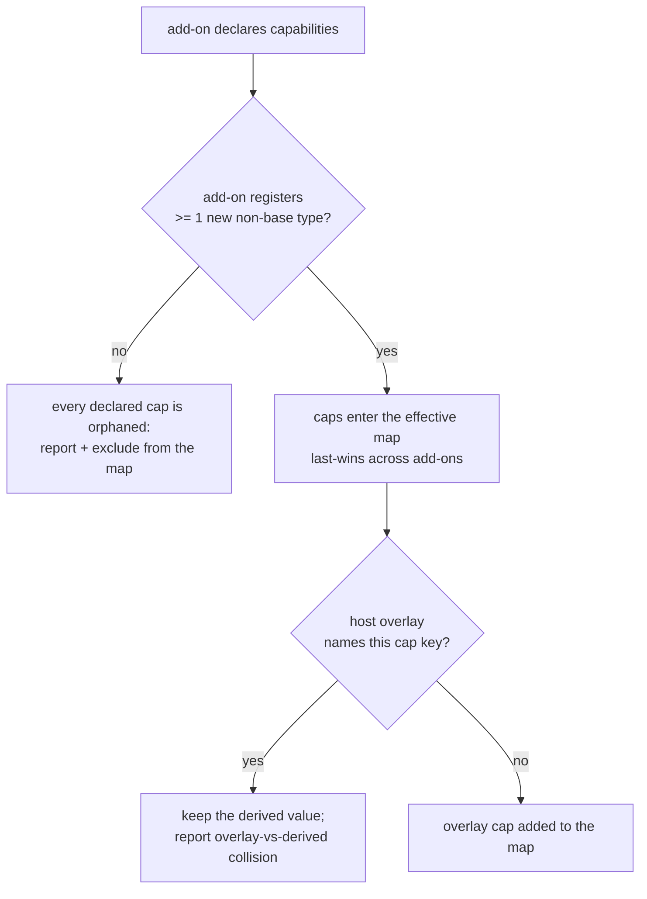

# neo_sdui Add-on Compose - Plan

## Goal Capsule

- **Objective:** One `compose()` call that folds a list of per-add-on value objects into the `{registry, capabilities}` a `NeoSduiView` already consumes — deriving capabilities from the same declarations that register the builders, and returning a never-throws diagnostics report.
- **Product authority:** This plan (from ce-brainstorm) and `docs/ideation/2026-07-11-neo-sdui-addon-architecture-ideation.html`, idea "NeoSduiAddon manifest + compose() spine".
- **Open blockers:** None.

---

## Product Contract

_Product Contract unchanged from ce-brainstorm — text and R/AE IDs preserved verbatim; ce-plan added the Planning Contract, Implementation Units, Verification Contract, and Definition of Done below._

### Summary

Introduce a `NeoSduiAddon` value object — one per add-on, bundling the block types it registers, the capabilities it provides, and an optional theme extension — and a `compose()` that folds a list of them into the `{registry, capabilities}` a `NeoSduiView` already takes. `compose()` derives the capability map from the same declarations that register the builders (so the two cannot drift), and returns a never-throws diagnostics report. It replaces today's manual per-add-on wiring and the separately hand-maintained capabilities map.

### Problem Frame

An add-on is wired in two disconnected places today. The host `copy()`+`register()`s the builder into the registry, then separately hand-populates the `Map<String,int>` capabilities the view checks against each block's `requires`. Nothing binds the two, so an add-on can register a block while the host forgets to declare its capability — the block then silently renders its `fallback` (or nothing), with no error to trace. Each add-on is also wired by hand with no aggregation helper, and `register` is a silent last-wins clobber, so two add-ons claiming the same `type` collide invisibly. The upcoming MCP setup guide pushes block-type and package count up, turning both failure modes from rare into routine.

### Key Decisions

- **Capabilities are derived, not declared twice.** `compose()` computes the capability map from the add-on declarations that also register the builders, so registration *is* the capability declaration and the two cannot drift. This is the core value.
- **Add-only host overlay.** The host may still pass capabilities it provides directly (app-level features not tied to any block); the overlay adds to the derived set but never lowers or overrides the version of a capability already derived from an add-on.
- **Collisions are judged by origin.** An add-on replacing a *core* block type is intended (the image-swap enhancer) and stays silent; two add-ons claiming the same type is reported. Last-in-list wins in every case.
- **Overrides carry no capability.** Capabilities attach to *new* block types only. An add-on that only replaces a core block advertises none, so an override is never reported as an orphaned capability.
- **Never throws; reports.** `compose()` always returns a structured diagnostics report. In debug it additionally surfaces real problems (add-on-vs-add-on collisions, orphaned capabilities) through an assert/error channel so they are not silently ignored; in release it stays silent and only the returned report carries them. This matches the engine's existing never-throws validator posture.
- **No wire or core-dependency change.** `compose()` only produces the `{registry, capabilities}` `NeoSduiView` already accepts. Core stays `flutter` + `meta`, no codegen — the feature is a value object plus a fold.



### Requirements

**The add-on bundle**

- R1. An add-on is expressed as a single `NeoSduiAddon` value object bundling the block types it contributes (type to builder), the capabilities it provides, and optionally a theme extension.
- R2. An add-on may contribute zero capabilities — for example one that only replaces an existing core block.

**The compose fold**

- R3. A single `compose()` call accepts an ordered list of `NeoSduiAddon`s and produces the `{registry, capabilities}` that `NeoSduiView` consumes, with no other host wiring required.
- R4. Composition applies add-ons in list order; when more than one contributes the same block type, the last in the list wins.
- R5. `compose()` derives the effective capability map from the composed add-ons; the host does not maintain a separate capabilities map for add-on-provided features.

**Capabilities**

- R6. The derived capability map binds each provided capability to the same add-on declaration that registers its block.
- R7. The host may pass an optional overlay of app-level capabilities it provides directly; the overlay adds capabilities to the derived set.
- R8. An overlay entry naming a capability already derived from an add-on does not override it — the derived value is kept and the collision is noted in the report.

**Diagnostics**

- R9. `compose()` returns a structured, never-throws diagnostics report cataloguing add-on-vs-add-on type collisions, orphaned capabilities (a declared capability with no corresponding new-type builder), overlay-vs-derived capability collisions, and the final applied order.
- R10. Replacing a core block type is not reported as a collision; only add-on-vs-add-on type collisions are.
- R11. In debug builds, `compose()` surfaces add-on-vs-add-on collisions and orphaned capabilities through an assert/error channel so they are visible without inspecting the report; in release it stays silent and only the returned report carries them.

**Invariants**

- R12. `compose()` never throws, for any combination of inputs including an empty list.
- R13. The feature adds no dependency beyond `flutter` + `meta`, requires no codegen, and puts nothing new on the wire.

### Acceptance Examples

- AE1. Covers R4, R10. Given add-on A registers a richer `media` builder (a core type) and no other add-on registers `media`, when composed, then `media` uses A's builder and the report shows no collision.
- AE2. Covers R4, R9. Given add-ons A and B both register a `chart` builder and the list order is `[A, B]`, when composed, then `chart` uses B's builder and the report lists an add-on-vs-add-on collision on `chart`.
- AE3. Covers R2, R6. Given add-on V registers a `video` builder and declares capability `video: 1`, when composed, then the derived capabilities include `video: 1` without the host declaring it.
- AE4. Covers R7. Given the host passes an overlay `{deeplink: 2}` for a feature it provides itself, when composed, then the effective capabilities include `deeplink: 2` alongside the derived ones.
- AE5. Covers R8. Given add-on V derives `video: 2` and the host overlay also names `video: 1`, when composed, then the effective `video` stays `2` and the report notes the overlay-vs-derived collision.
- AE6. Covers R9. Given add-on X declares capability `x: 1` but registers no new block type, when composed, then the report lists an orphaned capability `x`.
- AE7. Covers R12. Given an empty add-on list, when composed, then it returns the core registry, an empty derived capability set (plus any overlay), and an empty report — with no throw.

### Scope Boundaries

**Deferred for later**

- Inter-add-on dependency / load-order declaration (a `dependsOn` between add-ons). Last-in-list ordering is sufficient for v1.
- Exposing the derived capability manifest for the app to report to the MCP server so it authors only-supported blocks. The derivation makes it possible; the transport is app-owned and out of this package.

**Outside this change**

- The sibling add-on directions from ideation — the `neo_sdui_contract` package split, the `ThemeExtension` bag mechanics, the version handshake, and the degrade-conformance harness — are each their own brainstorm. The `themeExtension` slot on `NeoSduiAddon` is carried here only as a passthrough field; how it merges into the theme is not designed here.
- No change to the wire, to `NeoSduiView`'s existing constructor inputs, or to the core dependency set.

### Dependencies / Assumptions

- Assumes the current seams hold and are unchanged by this work: the registry's `copy()`+`register()` last-wins behavior (`lib/src/registry/block_registry.dart`), the capabilities map consumed by `_requiresMet` (`lib/src/render/neo_sdui_view.dart`), and `NeoSduiView` taking `registry` + `capabilities`. Verified against the current tree.

### Sources / Research

- Ideation: `docs/ideation/2026-07-11-neo-sdui-addon-architecture-ideation.html` (idea 1, the compose spine; sibling ideas 2-7 for the deferred directions).
- Prior art that shaped the decisions: VS Code's static `contributes` manifest (host reads the declaration before running code), Sentry's opt-in `integrations: []` array, and Adaptive Cards' `requires`/`fallback`/`version` — the capability-gating model neo_sdui already mirrors.
- Code anchors: `lib/src/registry/block_registry.dart`, `lib/src/render/neo_sdui_view.dart` (capabilities, `_requiresMet`, `_buildOne`), `lib/src/model/block_node.dart` (`requires`/`fallback`), `lib/src/model/validation.dart` (the never-throws posture R9/R12 follow).

---

## Planning Contract

**Product Contract preservation:** Product Contract unchanged — no R/AE IDs altered; enrichment is HOW-only.

### Key Technical Decisions

- **KTD1 — `NeoSdui.compose()` entry + `NeoSduiComposition` result; no seam changes.** A new `NeoSdui` namespace class exposes a static `compose(addons, {base, capabilities})` that returns a `NeoSduiComposition` bundling `{registry, capabilities, report}` (and the passthrough `themeExtensions`, KTD7). The host feeds `composition.registry` and `composition.capabilities` into the *existing* `NeoSduiView` constructor params — so `BlockRegistry`, `NeoSduiView`, and the wire are untouched (R3, R13). `compose()` builds on the existing registry API only: `copy()`, `register()`, `contains()`.
- **KTD2 — required `name` on `NeoSduiAddon`.** Each add-on carries a required human name. Diagnostics identify collisions and orphans by add-on name ("videoAddon vs chartAddon"), not list index — the report is only actionable if a reader can name the offending add-on (R9, R11).
- **KTD3 — collision-by-origin via base membership + an ownership map.** Keep a reference to the *unmutated* base registry and mutate a `copy()`. For each type an add-on registers, in list order: if a prior add-on already owns it → add-on-vs-add-on collision (reported, R9); else if `base.contains(type)` → silent core override (R10); else → brand-new type. Always `register()` (last-in-list wins, R4) and record the add-on as the new owner. No new registry accessor is needed — `base.contains` on the original plus a local `Map<String,String> owner` suffice.
- **KTD4 — capability derivation gated on a new-type contribution.** An add-on's declared capabilities enter the effective map only if the add-on registers at least one *new* (non-base) type; otherwise every one of its declared capabilities is orphaned — reported **and excluded** from the effective map (K "Overrides carry no capability", R9, AE6). There is no per-capability→per-type structural match, because capability keys (`video`) and type names are not 1:1 and a block's `requires` references a capability, not a type. Excluding orphaned caps is what prevents a phantom capability from silently satisfying another block's `requires`. Cross-add-on capability-key collisions (two add-ons both declaring `video` at different versions) last-win silently — they are **not** in R9's closed catalog, so they are not reported.
- **KTD5 — add-only host overlay.** After derivation, apply the host `capabilities` overlay: a key not yet derived is added (R7, AE4); a key already derived is kept at the derived value and the overlay-vs-derived collision is recorded (R8, AE5). The overlay never lowers or replaces a derived version.
- **KTD6 — non-throwing debug channel (confirmed this session).** R11's debug surfacing uses the `assert(() { …debugPrint(report)…; return true; }())` idiom: the closure runs only in debug (asserts stripped in release), emits the report's add-on-vs-add-on collisions and orphaned capabilities, and returns `true` so the assert never fails. This keeps R12 literally true — `compose()` never throws on any input, including a colliding-but-valid config. **Rejected:** a hard `assert(report.isClean, …)` — it would make `compose()` throw in debug whenever add-ons collide, contradicting R12 and the engine's collect-and-return validator posture (`lib/src/model/validation.dart`). Overlay-vs-derived collisions are benign and appear only in the returned report, not the debug channel (R11 names only the two real-problem classes).
- **KTD7 — `themeExtension` passthrough only.** `NeoSduiAddon` carries an `Object? themeExtension` slot (R1). `NeoSduiComposition` exposes the collected non-null extensions in applied order as a passthrough `List<Object> themeExtensions` so a host can read them without re-walking the add-on list. No merge into `NeoSduiTheme` is designed here — that is a separate brainstorm (Scope Boundaries).
- **KTD8 — immutable value types mirroring existing conventions.** `NeoSduiAddon`, `NeoSduiComposition`, `NeoComposeReport`, and the collision entry types are `@immutable` with `const` constructors, matching `BlockNode` (`lib/src/model/block_node.dart`) and `SchemaIssue` (`lib/src/model/validation.dart`). Report-entry types carry a `toString()` like `SchemaIssue` so the debug channel prints legibly. `NeoComposeReport` exposes an `isClean` getter (no collisions, no orphans).

### Assumptions

None outstanding — scope and the debug-channel decision were confirmed interactively before plan-write.

---

## High-Level Technical Design

`compose()` is a single fold over the add-on list. Two decision points carry the subtlety: how each registered *type* is routed (collision vs override vs new), and how each add-on's *capabilities* are admitted or orphaned. Both are directional guidance, not implementation specification.

**Per-type routing (during the registry fold):**



**Capability admission (per add-on, then the host overlay):**



---

## Output Structure

```text
lib/src/compose/
  neo_sdui_addon.dart      # NeoSduiAddon value object (U1)
  neo_compose_report.dart  # NeoComposeReport + collision entry types (U1)
  neo_compose.dart         # NeoSdui.compose + NeoSduiComposition (U2)
test/compose/
  compose_test.dart        # AE1-AE7, empty-list, debug-no-throw (U2)
```

Plus edits to `lib/neo_sdui.dart` to export the new public surface.

---

## Implementation Units

### U1. Add-on value object + composition/report types

- **Goal:** Ship the public data surface the fold produces and consumes — `NeoSduiAddon`, `NeoComposeReport`, and the three collision-entry types — plus their library exports. (`NeoSduiComposition`, the fold's result, ships with `compose()` in U2.) No fold logic yet.
- **Requirements:** R1, R2 (the bundle and its zero-capability case), and the shape half of R9 (the report and its categories).
- **Dependencies:** none.
- **Files:**
  - Create `lib/src/compose/neo_sdui_addon.dart` — `NeoSduiAddon({required String name, Map<String, BlockBuilder> blocks, Map<String, int> capabilities, Object? themeExtension})`, `@immutable`, `const`, map defaults `const {}`. Imports `BlockBuilder` from `../registry/block_registry.dart`.
  - Create `lib/src/compose/neo_compose_report.dart` — `NeoComposeReport` (lists of the three entry types + `List<String> appliedOrder`, `bool get isClean`, `toString()`); the entry types: a type-collision entry (`type`, losing add-on name, winning add-on name), an orphaned-capability entry (`capability`, add-on name), an overlay-vs-derived entry (`capability`, kept derived version, ignored overlay version). Each `@immutable` with a `toString()` mirroring `SchemaIssue`.
  - Modify `lib/neo_sdui.dart` — export both new files (a `// Compose` section alongside the existing groups).
- **Approach:** Pure value types, no logic beyond `isClean`/`toString`. `NeoSduiComposition` is intentionally **not** here — it is the fold's result and lives with `compose()` in U2 so U1 and U2 touch disjoint source files.
- **Patterns to follow:** `BlockNode` (`lib/src/model/block_node.dart`) for `@immutable` + `const` + defaulted `const {}` fields; `SchemaIssue` (`lib/src/model/validation.dart`) for the small-record-with-`toString` entry shape.
- **Test scenarios:** `Test expectation: none` — pure value types with `const` constructors and trivial getters; their behavior is exercised end-to-end by U2's compose suite (a standalone construction test would duplicate that coverage without adding signal).
- **Verification:** `fvm flutter analyze` is clean; the new types are exported and resolve from `package:neo_sdui/neo_sdui.dart`.

### U2. `NeoSdui.compose()` fold + diagnostics + tests

- **Goal:** Implement the fold that turns an ordered `List<NeoSduiAddon>` (+ optional base registry and host capability overlay) into a `NeoSduiComposition` — registry with collision-by-origin, derived capabilities, add-only overlay, orphaned-capability detection, the diagnostics report, and the non-throwing debug channel.
- **Requirements:** R3, R4, R5, R6, R7, R8, R9, R10, R11, R12, R13.
- **Dependencies:** U1.
- **Execution note:** Implement test-first against the seven acceptance examples — write `test/compose/compose_test.dart` and watch AE1-AE7 fail before filling in `compose()`. The AE suite is the acceptance bar.
- **Files:**
  - Create `lib/src/compose/neo_compose.dart` — `NeoSduiComposition({required BlockRegistry registry, required Map<String, int> capabilities, required NeoComposeReport report, List<Object> themeExtensions})` and `abstract final class NeoSdui { static NeoSduiComposition compose(List<NeoSduiAddon> addons, {BlockRegistry? base, Map<String, int> capabilities = const {}}) }`.
  - Modify `lib/neo_sdui.dart` — export `neo_compose.dart`.
  - Test: create `test/compose/compose_test.dart`.
- **Approach:** `base = base ?? defaultRegistry()`; `registry = base.copy()`. Fold add-ons in list order following the two HTD decision flows — a local `Map<String,String> owner` for add-on-owned types, `base.contains(type)` (on the unmutated base) to tell core from new. Derive capabilities gated on "registers ≥1 non-base type" (KTD4), then apply the host overlay add-only (KTD5). Assemble `NeoComposeReport` (type collisions, orphaned caps, overlay collisions, `appliedOrder = addons.map((a) => a.name)`), collect non-null `themeExtension`s in order, and emit the debug channel via the `assert(() {…; return true;}())` idiom (KTD6). Every path is pure map/list work over well-typed inputs, so R12 holds by construction for any input including the empty list.
- **Technical design (directional):** the registry fold and capability admission follow the two flowcharts in High-Level Technical Design above; the debug channel is `assert(() { if (!report.isClean) debugPrint(report.toString()); return true; }())` — never a throwing assert.
- **Patterns to follow:** `defaultRegistry()` (`lib/src/blocks/default_registry.dart`) for the base roster; `BlockRegistry.copy()`/`register()`/`contains()` (`lib/src/registry/block_registry.dart`) for the last-wins registration; `validateDocument` (`lib/src/model/validation.dart`) for the collect-all-then-return, never-throw posture.
- **Test scenarios:**
  - `Covers AE1.` Add-on A registers a `media` builder (core type), no other add-on registers `media`; compose → `registry.builderFor('media')` is A's builder (identity), and `report.typeCollisions` is empty.
  - `Covers AE2.` Add-ons A and B each register a `chart` builder (new type), order `[A, B]`; compose → `registry.builderFor('chart')` is B's builder, and `report.typeCollisions` has exactly one entry on `chart` (A loses to B).
  - `Covers AE3.` Add-on V registers a `video` builder (new type) and declares `video: 1`; compose with no host overlay → effective `capabilities['video'] == 1`.
  - `Covers AE4.` Host overlay `{deeplink: 2}`, no add-on derives `deeplink`; compose → effective `capabilities['deeplink'] == 2` and no overlay collision.
  - `Covers AE5.` Add-on V registers a new type and declares `video: 2`; host overlay `{video: 1}`; compose → effective `capabilities['video'] == 2` and `report.overlayCollisions` has one entry on `video` (kept 2, ignored 1).
  - `Covers AE6.` Add-on X declares `x: 1` but registers no new block type (empty `blocks`, or only a core override); compose → `report.orphanedCapabilities` lists `x` (attributed to X) and effective `capabilities` does **not** contain `x`.
  - `Covers AE7.` Empty add-on list; compose → registry contains every core type (e.g. `contains('card')`, `contains('media')`), derived capabilities empty (plus overlay if passed), `report.isClean` is true / all lists empty, and `expect(() => NeoSdui.compose([]), returnsNormally)`.
  - Never-throws under debug asserts: compose a list with both an add-on-vs-add-on collision and an orphaned capability under `flutter test` (asserts enabled) → `returnsNormally` (the debug channel logs but does not throw).
  - Applied order: `report.appliedOrder` equals the add-on names in list order.
  - Override carries no capability (R10 + K "overrides carry no capability"): an add-on that only overrides core `media` (no new type) and declares a capability → that capability is orphaned, not derived; `media` is still overridden and no type collision is reported.
- **Verification:** `fvm flutter test test/compose/` is green with all AE cases and the never-throws/order/override scenarios passing; `fvm flutter analyze` is clean.

---

## Verification Contract

- **Analyzer:** `fvm flutter analyze` reports no issues.
- **New suite:** `fvm flutter test test/compose/` green — AE1-AE7 plus empty-list, debug-no-throw, applied-order, and override-carries-no-capability.
- **No regression:** the full `fvm flutter test` remains green (existing block, example, and golden suites untouched).
- **Invariant — core deps (R13):** `pubspec.yaml` `dependencies` stays `flutter` + `meta` only; no codegen added.
- **Invariant — wire (R13):** `lib/src/model/validation.dart` and the document schema are unchanged; `compose()` adds nothing to the JSON.
- **Invariant — seams:** `lib/src/registry/block_registry.dart` and `lib/src/render/neo_sdui_view.dart` are unchanged; the composition feeds their existing `registry`/`capabilities` params.

## Definition of Done

- All seven acceptance examples pass exactly as enumerated in U2's test scenarios.
- `compose()` never throws for any input — empty list, colliding add-ons, orphaned capabilities — with debug asserts enabled (R12).
- Effective capabilities are derived from add-on declarations; the host maintains no separate add-on-capability map (R5, R6); orphaned capabilities are excluded from the map, not just reported (KTD4).
- The diagnostics report catalogs all three categories plus applied order (R9); the debug channel surfaces the two real-problem categories without throwing (R11).
- `NeoSduiView` consumes `composition.registry` + `composition.capabilities` through its existing constructor with no changes to the view, the registry, or the wire (R3, R13).
- Core dependencies unchanged; no codegen; nothing new on the wire (R13).
- `NeoSdui.compose`, `NeoSduiAddon`, `NeoSduiComposition`, and `NeoComposeReport` are exported from `package:neo_sdui/neo_sdui.dart`.
