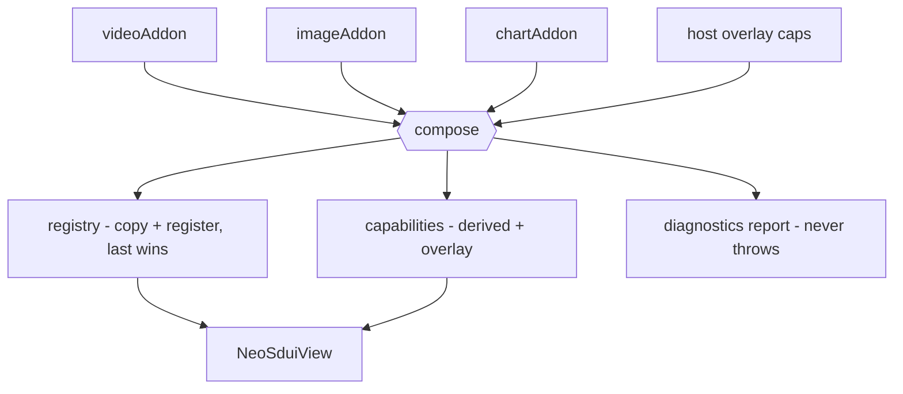

# neo_sdui Add-on Compose - Plan

## Goal Capsule

- **Objective:** One `compose()` call that folds a list of per-add-on value objects into the `{registry, capabilities}` a `NeoSduiView` already consumes — deriving capabilities from the same declarations that register the builders, and returning a never-throws diagnostics report.
- **Product authority:** This plan (from ce-brainstorm) and `docs/ideation/2026-07-11-neo-sdui-addon-architecture-ideation.html`, idea "NeoSduiAddon manifest + compose() spine".
- **Open blockers:** None.

---

## Product Contract

### Summary

Introduce a `NeoSduiAddon` value object — one per add-on, bundling the block types it registers, the capabilities it provides, and an optional theme extension — and a `compose()` that folds a list of them into the `{registry, capabilities}` a `NeoSduiView` already takes. `compose()` derives the capability map from the same declarations that register the builders (so the two cannot drift), and returns a never-throws diagnostics report. It replaces today's manual per-add-on wiring and the separately hand-maintained capabilities map.

### Problem Frame

An add-on is wired in two disconnected places today. The host `copy()`+`register()`s the builder into the registry, then separately hand-populates the `Map<String,int>` capabilities the view checks against each block's `requires`. Nothing binds the two, so an add-on can register a block while the host forgets to declare its capability — the block then silently renders its `fallback` (or nothing), with no error to trace. Each add-on is also wired by hand with no aggregation helper, and `register` is a silent last-wins clobber, so two add-ons claiming the same `type` collide invisibly. The upcoming MCP setup guide pushes block-type and package count up, turning both failure modes from rare into routine.

### Key Decisions

- **Capabilities are derived, not declared twice.** `compose()` computes the capability map from the add-on declarations that also register the builders, so registration *is* the capability declaration and the two cannot drift. This is the core value.
- **Add-only host overlay.** The host may still pass capabilities it provides directly (app-level features not tied to any block); the overlay adds to the derived set but never lowers or overrides the version of a capability already derived from an add-on.
- **Collisions are judged by origin.** An add-on replacing a *core* block type is intended (the image-swap enhancer) and stays silent; two add-ons claiming the same type is reported. Last-in-list wins in every case.
- **Overrides carry no capability.** Capabilities attach to *new* block types only. An add-on that only replaces a core block advertises none, so an override is never reported as an orphaned capability.
- **Never throws; reports.** `compose()` always returns a structured diagnostics report. In debug it additionally surfaces real problems (add-on-vs-add-on collisions, orphaned capabilities) through an assert/error channel so they are not silently ignored; in release it stays silent and only the returned report carries them. This matches the engine's existing never-throws validator posture.
- **No wire or core-dependency change.** `compose()` only produces the `{registry, capabilities}` `NeoSduiView` already accepts. Core stays `flutter` + `meta`, no codegen — the feature is a value object plus a fold.

### Requirements

**The add-on bundle**

- R1. An add-on is expressed as a single `NeoSduiAddon` value object bundling the block types it contributes (type to builder), the capabilities it provides, and optionally a theme extension.
- R2. An add-on may contribute zero capabilities — for example one that only replaces an existing core block.

**The compose fold**

- R3. A single `compose()` call accepts an ordered list of `NeoSduiAddon`s and produces the `{registry, capabilities}` that `NeoSduiView` consumes, with no other host wiring required.
- R4. Composition applies add-ons in list order; when more than one contributes the same block type, the last in the list wins.
- R5. `compose()` derives the effective capability map from the composed add-ons; the host does not maintain a separate capabilities map for add-on-provided features.

**Capabilities**

- R6. The derived capability map binds each provided capability to the same add-on declaration that registers its block.
- R7. The host may pass an optional overlay of app-level capabilities it provides directly; the overlay adds capabilities to the derived set.
- R8. An overlay entry naming a capability already derived from an add-on does not override it — the derived value is kept and the collision is noted in the report.

**Diagnostics**

- R9. `compose()` returns a structured, never-throws diagnostics report cataloguing add-on-vs-add-on type collisions, orphaned capabilities (a declared capability with no corresponding new-type builder), overlay-vs-derived capability collisions, and the final applied order.
- R10. Replacing a core block type is not reported as a collision; only add-on-vs-add-on type collisions are.
- R11. In debug builds, `compose()` surfaces add-on-vs-add-on collisions and orphaned capabilities through an assert/error channel so they are visible without inspecting the report; in release it stays silent and only the returned report carries them.

**Invariants**

- R12. `compose()` never throws, for any combination of inputs including an empty list.
- R13. The feature adds no dependency beyond `flutter` + `meta`, requires no codegen, and puts nothing new on the wire.

### Acceptance Examples

- AE1. Covers R4, R10. Given add-on A registers a richer `media` builder (a core type) and no other add-on registers `media`, when composed, then `media` uses A's builder and the report shows no collision.
- AE2. Covers R4, R9. Given add-ons A and B both register a `chart` builder and the list order is `[A, B]`, when composed, then `chart` uses B's builder and the report lists an add-on-vs-add-on collision on `chart`.
- AE3. Covers R2, R6. Given add-on V registers a `video` builder and declares capability `video: 1`, when composed, then the derived capabilities include `video: 1` without the host declaring it.
- AE4. Covers R7. Given the host passes an overlay `{deeplink: 2}` for a feature it provides itself, when composed, then the effective capabilities include `deeplink: 2` alongside the derived ones.
- AE5. Covers R8. Given add-on V derives `video: 2` and the host overlay also names `video: 1`, when composed, then the effective `video` stays `2` and the report notes the overlay-vs-derived collision.
- AE6. Covers R9. Given add-on X declares capability `x: 1` but registers no new block type, when composed, then the report lists an orphaned capability `x`.
- AE7. Covers R12. Given an empty add-on list, when composed, then it returns the core registry, an empty derived capability set (plus any overlay), and an empty report — with no throw.

### Scope Boundaries

**Deferred for later**

- Inter-add-on dependency / load-order declaration (a `dependsOn` between add-ons). Last-in-list ordering is sufficient for v1.
- Exposing the derived capability manifest for the app to report to the MCP server so it authors only-supported blocks. The derivation makes it possible; the transport is app-owned and out of this package.

**Outside this change**

- The sibling add-on directions from ideation — the `neo_sdui_contract` package split, the `ThemeExtension` bag mechanics, the version handshake, and the degrade-conformance harness — are each their own brainstorm. The `themeExtension` slot on `NeoSduiAddon` is carried here only as a passthrough field; how it merges into the theme is not designed here.
- No change to the wire, to `NeoSduiView`'s existing constructor inputs, or to the core dependency set.

### Dependencies / Assumptions

- Assumes the current seams hold and are unchanged by this work: the registry's `copy()`+`register()` last-wins behavior (`lib/src/registry/block_registry.dart`), the capabilities map consumed by `_requiresMet` (`lib/src/render/neo_sdui_view.dart`), and `NeoSduiView` taking `registry` + `capabilities`. Verified against the current tree.

### Sources / Research

- Ideation: `docs/ideation/2026-07-11-neo-sdui-addon-architecture-ideation.html` (idea 1, the compose spine; sibling ideas 2-7 for the deferred directions).
- Prior art that shaped the decisions: VS Code's static `contributes` manifest (host reads the declaration before running code), Sentry's opt-in `integrations: []` array, and Adaptive Cards' `requires`/`fallback`/`version` — the capability-gating model neo_sdui already mirrors.
- Code anchors: `lib/src/registry/block_registry.dart`, `lib/src/render/neo_sdui_view.dart` (capabilities, `_requiresMet`, `_buildOne`), `lib/src/model/block_node.dart` (`requires`/`fallback`), `lib/src/model/validation.dart` (the never-throws posture R9/R12 follow).
