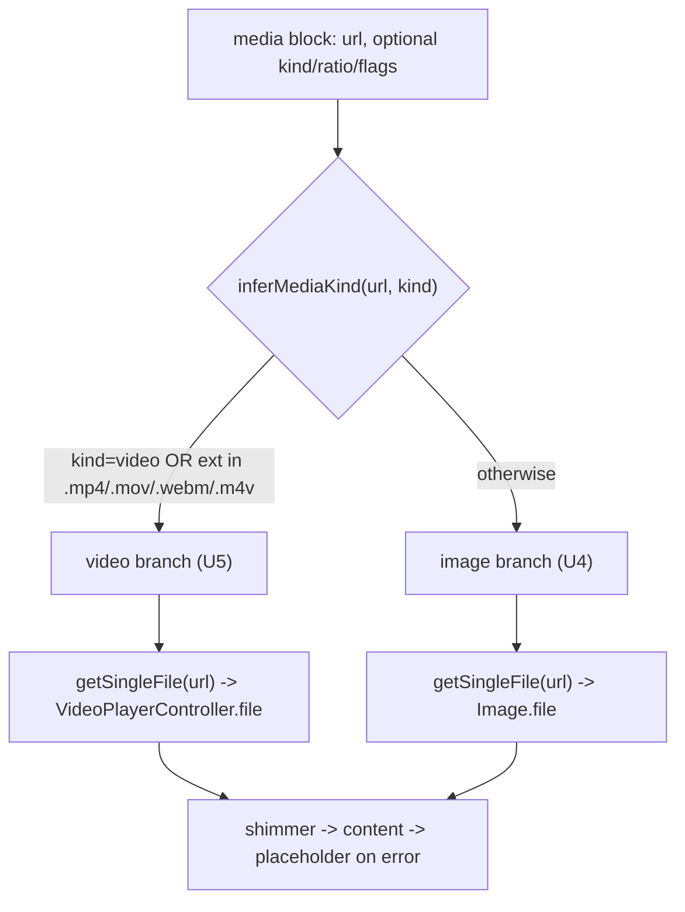
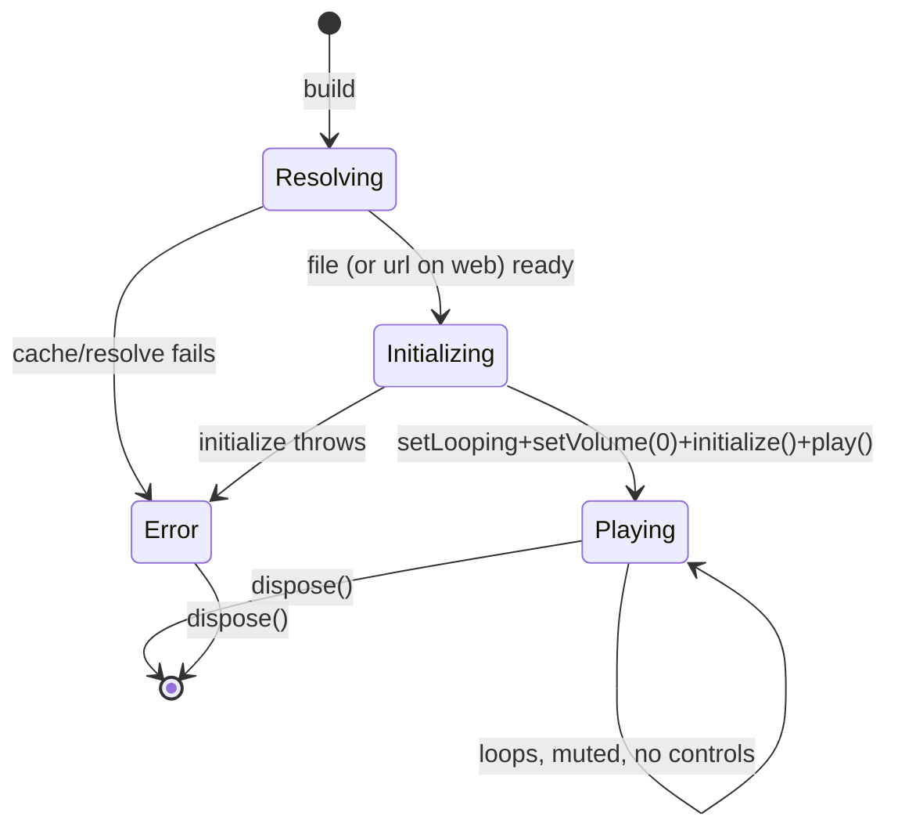

# neo_sdui Media Add-on - Plan

## Goal Capsule

- **Objective:** One `neo_sdui_media` add-on that overrides the core `media` block with a builder that infers image-vs-video from the URL and renders each accordingly — both disk-cached through a single `flutter_cache_manager` — so a host gains video by composing it and degrades to image-only `media` without it.
- **Product authority:** This plan (from ce-brainstorm). Grounded in the on-main compose spine and neo's existing how_to media pipeline.
- **Open blockers:** None.

> **Product Contract preservation:** Product Contract unchanged except aligning the illustrative install symbol `mediaAddon` → `neoSduiMediaAddon` to match the concrete export (naming only, no scope change). This enrichment adds the Planning Contract, Implementation Units, Verification Contract, and Definition of Done. All R/AE IDs and product scope are carried verbatim from the ce-brainstorm requirements.

---

## Product Contract

### Summary

`neo_sdui_media` is a separate add-on package that **overrides the core `media` block** with a smarter builder. The builder infers whether a URL is an image or a video (by extension, with an optional `kind` override) and renders each accordingly — images cover-fit and aspect-locked, videos looping/muted/autoplaying like neo's how_to — with both fetched through one `flutter_cache_manager` so repeat views serve from disk. A host installs it via `NeoSdui.compose([neoSduiMediaAddon])`; without it, the core image-only `media` block remains and video URLs degrade to a placeholder box rather than crashing.

### Problem Frame

The core `media` block renders images only (`Image.network`, memory cache — `lib/src/blocks/media.dart`), and neo's guides mix images and videos. In the neo app that mix is resolved by HTML tag (`` vs `<video>` in `how_to_html_view.dart`), but neo_sdui's JSON wire has no tag and core can't play video at all. Without an add-on, an author would have to know image-vs-video up front and reach for different block types, and image loads aren't disk-cached so revisiting a guide refetches every asset. The upcoming MCP setup guide pushes media count up. The want: one `media` block that just works — infers the type, plays video when the add-on is present, stays an image otherwise, and disk-caches both.

### Key Decisions

- **Override the core `media` block (one unified block).** The add-on replaces core's `media` builder rather than adding a separate `video` type. The wire stays dumb — a `media` block with a `url` — and the brains live in the add-on. Because a core override carries no capability (per the compose spine), there is no capability gating: add-on present → image-or-video; absent → core image-only.
- **Infer type from URL extension, with a `kind` override.** A recognized video extension (`.mp4`/`.mov`/`.webm`/`.m4v`) → video; otherwise image. An optional `kind: image|video` on the block overrides inference for extensionless or signed URLs.
- **Disk-cache both paths through one `flutter_cache_manager`.** The image branch resolves a cached file then renders it; the video branch resolves a cached file then plays it. This upgrades core's memory-only image cache to disk.
- **Video mirrors neo's how_to.** Looping, muted, autoplay, no player controls. A shimmer placeholder shows while loading; a failed load shows the placeholder box, never a raw error or a crash.
- **No poster.** Degrade and loading both land on shimmer. With the add-on absent, a video URL renders the core placeholder box — accepted in place of a still-frame fallback.
- **Separate package; core stays pure.** `neo_sdui_media` depends on `neo_sdui` + `video_player` + `flutter_cache_manager`. `neo_sdui` core stays `flutter` + `meta` only.

### Requirements

**Inference**

- R1. The add-on exports a `NeoSduiAddon` that registers a builder for the existing `media` block type, replacing core's; a host installs it via `NeoSdui.compose([neoSduiMediaAddon])`.
- R2. The builder infers image vs video from the media URL: a recognized video extension (`.mp4`/`.mov`/`.webm`/`.m4v`) means video; anything else is treated as an image.
- R3. An optional `kind` field on the block (`image` or `video`) overrides the inferred type.

**Rendering**

- R4. A video renders looping, muted, autoplaying, with no player controls — matching neo's how_to video.
- R5. An image renders aspect-locked and cover-fit, matching core `media`'s current image behavior.
- R6. Both show a shimmer placeholder while loading, and a failed load (missing/broken asset) shows the placeholder box — never a raw error or a thrown exception.
- R7. Aspect ratio is taken from the wire (`ratio`, or `width`/`height`) when present; otherwise a per-kind default (video and image may differ).
- R8. Corner radius, shimmer colors, and motion come from `NeoSduiTheme`, not hardcoded values.

**Caching**

- R9. Both the image and video paths fetch through a single `flutter_cache_manager`, so a repeat view of the same URL serves from disk cache instead of refetching.

**Degrade**

- R10. With the add-on absent, a `media` block still renders images via the core builder; a video URL degrades to the core placeholder box, never a crash.
- R11. A `media` block authored for video (a `url` plus optional `kind`) is still a valid core `media` block — the add-on adds nothing to the wire that core cannot ignore.

**Invariants**

- R12. The add-on is a separate package depending on `neo_sdui` + `video_player` + `flutter_cache_manager`; `neo_sdui` core stays `flutter` + `meta` only, no codegen.
- R13. The wire carries semantics only (`url`, optional `kind`/`ratio`/`width`/`height`); no hex, pixel, or font-size values.
- R14. The builder renders inline like every other block — Navigator-free.

### Acceptance Examples

- AE1. Covers R2, R4. Given a `media` block whose `url` ends in `.mp4` and the add-on is composed, when rendered, then the video plays looping, muted, and autoplaying.
- AE2. Covers R2, R5. Given a `media` block whose `url` ends in `.png` and the add-on is composed, when rendered, then the image renders cover-fit and aspect-locked.
- AE3. Covers R3. Given a `media` block with an extensionless `url` and `kind: video`, when rendered with the add-on, then it is treated as a video.
- AE4. Covers R6. Given a `media` block whose `url` fails to load, when rendered with the add-on, then the shimmer/placeholder box shows and no error is thrown.
- AE5. Covers R9. Given the same image `url` rendered twice, when rendered with the add-on, then the second render serves from disk cache without a refetch.
- AE6. Covers R10. Given a `media` block with a `.mp4` `url` and the add-on **not** composed, when rendered, then core shows its placeholder box with no crash.
- AE7. Covers R10, R11. Given a `media` block with a `.png` `url` and the add-on **not** composed, when rendered, then core renders the image exactly as it does today.

### Scope Boundaries

**Deferred for later**

- gif / lottie / other animated formats, and audio. v1 is image + video.
- Video controls: scrubbing, sound toggle, fullscreen, play/pause UI. Videos are silent looping demos, as in neo.
- A poster / thumbnail field for a still-frame fallback. Shimmer covers loading and degrade for now.
- Content-type or byte sniffing for extensionless URLs. The `kind` override covers that case for v1.
- A web code path (`kIsWeb` file/network fallback). Phones-only for v1; neo ships no web target, so a web branch couldn't be tested — added when web is real.

**Outside this change**

- The earlier separate `neo_sdui_video` / `neo_sdui_image` package split — folded into this one add-on. Host-injected image caching for the pure-core path stays a separate, unchanged lever.
- No change to the core `media` block's own behavior, to `NeoSduiView`, or to the wire schema.

### Dependencies / Assumptions

- Assumes the compose spine on `main` — `NeoSdui.compose`, `NeoSduiAddon`, and its core-override semantics (an add-on may replace a core block; overrides carry no capability). Verified.
- Assumes the core `media` block reads `url` plus `ratio`/`width`/`height` and shows a shimmer/placeholder on load and error (`lib/src/blocks/media.dart`). Verified.
- Assumes neo's guide videos carry recognizable extensions (`.mp4`, etc.); extensionless or signed video URLs would need `kind: video` on the wire. Not verified across all Remote Config entries — recorded as an assumption the extension+override design accommodates.
- Mirrors neo's implementation: `HowToVideoBlock` (`flutter_cache_manager` `getSingleFile` → `video_player`, loop/mute/autoplay) and `_HowToMediaImage` (`Image.network` cover-fit + `_MediaShimmer`). The `ble_banner` itself carries no media (text/icon/action only); the bottom sheet it opens is a how_to guide and reuses the same media pipeline.

### Sources / Research

- neo app: `lib/view/widgets/common/how_to/how_to_video_block.dart`, `lib/view/widgets/common/how_to/how_to_html_view.dart` (the ``/`<video>` tag dispatch, `_HowToMediaImage`, `_MediaShimmer`), `lib/view/widgets/common/video_widget.dart`, `lib/domain/models/local/ble/ble_banner.model.dart` (banner has no media).
- neo_sdui: `lib/src/blocks/media.dart` (core image `media`), the compose spine (`lib/src/compose/*`) and its core-override / no-capability semantics.

---

## Planning Contract

### Key Technical Decisions

- **KTD1 — Install seam is the compose spine (R1).** The add-on ships a top-level `NeoSduiAddon neoSduiMediaAddon` with `blocks: {'media': buildMediaBlock}`. A host composes it: `NeoSdui.compose([neoSduiMediaAddon])`. Because `media` already exists in `defaultRegistry()`, this is a **core override** — the compose spine registers it silently, carries no capability, and reports no collision (verified: `compose_test.dart` AE1/R10 on `main`). No new capability is declared.
- **KTD2 — Inference is a pure function (R2, R3).** `MediaKind inferMediaKind(String url, {String? kind})`: an explicit `kind` of `video`/`image` wins; otherwise lowercase the URL path, strip query/fragment, and match a trailing video-extension allowlist (`.mp4`, `.mov`, `.webm`, `.m4v`) → video; else image. Pure, synchronous, unit-tested in isolation. Extension allowlist is a `const Set<String>`.
- **KTD3 — One shared cache manager (R9).** A single module-level `CacheManager(Config('neo_sdui_media'))` instance, reused by both branches. It uses the **unique key `neo_sdui_media`** — not `DefaultCacheManager()`, whose shared default key a host could collide with, defeating the whole point. Industry guidance is explicit: never construct two `CacheManager`s with the same key (they corrupt each other). Exposed as a mutable `mediaCacheManager` so tests can swap in a fake (with per-test reset).
- **KTD4 — Cache-then-render, blocking first load (R6, R9).** Both branches `await mediaCacheManager.getSingleFile(url)` → a `File`, then render from it (`Image.file` / `VideoPlayerController.file`). First view waits for the download; the shimmer covers that wait. This follows neo's how_to (single download, simplest) rather than the stream-while-cache pattern (see Alternatives) — proven in-app and half the network cost.
- **KTD5 — Phones-only for v1; web deferred (R6).** neo ships only android/ios (no web target), so the add-on carries **no web code path** — `VideoPlayerController.file` + disk caching assume `dart:io`, which is fine on mobile. If neo adopts web later, add a `kIsWeb` fallback then (image → `Image.network`, video → `VideoPlayerController.networkUrl`, no disk cache), where it can finally be tested against a real web build. Deferred, not shipped blind.
- **KTD6 — Video is a self-contained `StatefulWidget` (R4).** Lifecycle: resolve file/url → construct controller → `setLooping(true)` → `setVolume(0)` → `initialize()` → `play()`; dispose the controller in `dispose()`; guard every post-await `setState` with `mounted`. When `theme.reduceMotion` is true, `initialize()` but **skip `play()`/`setLooping`** — show a static first frame, mirroring how the image fade is skipped for that setting (R8). No `VideoControllerService`/DI abstraction, but the widget takes an optional `VideoPlayerController Function(File file, {bool isWeb, String url})? controllerFactory` param (defaults to the real constructors) — a one-line seam so tests inject a fake controller / register a `FakeVideoPlayerPlatform` without a full DI layer. The single `mediaCacheManager` seam only yields the `File`, so this factory is the controller-side seam. Render the player inside the **same** ratio box as the shimmer (see KTD7) so nothing resizes on load.
- **KTD7 — Look and ratio from theme + node, mirroring core (R5, R7, R8).** Theme reached via `NeoSduiScope.of(context).theme` (re-exported from `neo_sdui`): `radiusMd` for corners, `shimmerBase`/`shimmerHighlight` for the placeholder gradient, `motionDuration`/`motionCurve`/`reduceMotion` for the image fade **and** the video autoplay gate (KTD6). **One ratio rule, resolved once and used for every state** (shimmer, ready, error) so the box never resizes: `fields['ratio']` as `num > 0` → `width`/`height` ints → (**video only**) `controller.value.aspectRatio` once known → **per-kind default** (image `358/221`, video `16/9`). Both the shimmer and the initialized `VideoPlayer` sit inside the *same* `AspectRatio` at this resolved ratio; the player fills it (`BoxFit.cover`) rather than the widget switching to the controller's ratio on load. The image branch reproduces core's exact look (aspect → `ClipRRect(radiusMd)` → cover-fit → gradient placeholder → `ColoredBox` error) but sources a **cached File** instead of the network.
- **KTD8 — Monorepo via melos (R12).** Restructure the repo into a melos workspace: core moves to `packages/neo_sdui/` unchanged (still `flutter` + `meta`), the add-on lands at `packages/neo_sdui_media/` with a path dependency on the core package. Root `melos.yaml` + root `pubspec.yaml` (dev-dep `melos`). The move is behavior-preserving — the existing test suite is the gate.

### Reading `BlockNode` from a separate package (verified)

`BlockNode.fields` is a **public** `Map<String, Object?>`, and `stringOr`/`intOr`/`boolOr` are public — all reachable from the add-on package. The builder reads:

| Wire field | Access | Notes |
|---|---|---|
| `url` | `node.stringOr('url', '')!` | same as core |
| `kind` | `node.stringOr('kind')` | optional; feeds `inferMediaKind` |
| `ratio` | `node.fields['ratio']` (`num`) | mirror core `_ratioOf` |
| `width`/`height` | `node.intOr('width')` / `node.intOr('height')` | fallback ratio |
| `loop`/`mute`/`autoplay` | `node.boolOr('loop', or: true)` etc. | defaults match neo: loop=true, mute=true, autoplay=true |

No new accessor is added to core.

---

## High-Level Technical Design

**Builder routing** — one `media` block in, one widget out; every branch resolves to the same three visual states (shimmer → content → placeholder-on-error).



**Video controller lifecycle** (U5) — autoplay loop, muted, disposed cleanly; any failure lands on the placeholder, never a throw.



---

## Output Structure

Post-restructure layout (melos workspace). Core is moved unchanged; the add-on and workspace files are new.

```
neo_sdui/                              repo root (melos workspace)
├── melos.yaml                         NEW — workspace config
├── pubspec.yaml                       NEW — root, dev_dependencies: melos
├── packages/
│   ├── neo_sdui/                      core, MOVED here unchanged (flutter + meta)
│   │   ├── lib/
│   │   ├── test/
│   │   ├── example/
│   │   └── pubspec.yaml
│   └── neo_sdui_media/                NEW add-on package
│       ├── lib/
│       │   ├── neo_sdui_media.dart            barrel: exports the add-on
│       │   └── src/
│       │       ├── media_addon.dart           NeoSduiAddon + buildMediaBlock (U6)
│       │       ├── media_kind.dart            inferMediaKind (U3)
│       │       ├── media_cache.dart           shared CacheManager (U3)
│       │       ├── cached_image.dart          image branch widget (U4)
│       │       └── cached_video.dart          video branch widget (U5)
│       ├── test/
│       │   ├── media_kind_test.dart           (U3)
│       │   └── media_addon_test.dart          AE1–AE7 (U7)
│       ├── example/                           (U7)
│       └── pubspec.yaml                       deps: neo_sdui, video_player, flutter_cache_manager
└── docs/plans/                        this plan
```

The tree is a scope declaration, not a constraint — the implementer may adjust file boundaries. Per-unit `**Files:**` are authoritative.

---

## Implementation Units

### U1. Melos monorepo restructure

- **Goal:** Turn the single-package repo into a melos workspace so a sibling add-on package can path-depend on the core, with zero behavior change to core.
- **Requirements:** R12 (enabler).
- **Dependencies:** none.
- **Files:**
  - `melos.yaml` (new — `packages: packages/**`), `pubspec.yaml` (new root — `dev_dependencies: melos`)
  - Move `lib/`, `test/`, `example/`, `pubspec.yaml`, `analysis_options.yaml` → `packages/neo_sdui/`
  - `packages/neo_sdui/lib/src/blocks/media.dart` — fix stale doc comment: `neo_sdui_video` add-on → `neo_sdui_media` overrides this block
  - CI/config referencing the old root paths (`.github/workflows/*` if present)
- **Approach:** `git mv` the core tree into `packages/neo_sdui/` (preserves history). Add root `melos.yaml` + root `pubspec.yaml`. `melos bootstrap`. Core's own `pubspec.yaml` is unchanged (`flutter` + `meta`). No source edits except the one doc-comment correction. Confirm `example/` still resolves against the moved core.
- **Execution note:** Behavior-preserving move — do not touch core logic. Proof is the existing suite, not new tests: run the full core `flutter test` suite from its new location and confirm all green, plus `flutter analyze` clean. Golden tests are the move's most fragile gate (asset/path resolution is package-root-sensitive) — verify them explicitly.
- **Patterns to follow:** standard melos layout (`packages/**`); keep per-package `pubspec.yaml` self-contained.
- **Test scenarios:** `Test expectation: none — behavior-preserving restructure.` Smoke/verification: `melos bootstrap` succeeds; `packages/neo_sdui` `flutter analyze` clean; full existing `flutter test` suite green from the new path; `git log --follow` shows preserved history on a moved file.
- **Verification:** The existing test suite passes unchanged from `packages/neo_sdui/` (goldens included); core `pubspec.yaml` still lists only `flutter` + `meta`.

### U2. Scaffold `neo_sdui_media` package

- **Goal:** An empty, analyzable add-on package wired to its three dependencies.
- **Requirements:** R12.
- **Dependencies:** U1.
- **Files:**
  - `packages/neo_sdui_media/pubspec.yaml` (new — `name: neo_sdui_media`, sdk constraints matching core, `dependencies: neo_sdui (path: ../neo_sdui), video_player, flutter_cache_manager, flutter`; `dev_dependencies: flutter_test, mocktail` for the `FakeVideoPlayerPlatform` / fake cache manager)
  - `packages/neo_sdui_media/lib/neo_sdui_media.dart` (new — barrel, initially exporting nothing until U6)
  - `packages/neo_sdui_media/analysis_options.yaml` (new — mirror core's lints)
  - `packages/neo_sdui_media/README.md` (new — one-paragraph install/compose snippet)
- **Approach:** Pin `video_player` and `flutter_cache_manager` to their current stable majors at implementation time (resolve via `flutter pub add`; do not hand-guess versions). Path-depend on core. Barrel file exists but stays thin until U6.
- **Execution note:** Mostly packaging; prefer resolve/analyze smoke over unit coverage.
- **Test scenarios:** `Test expectation: none — scaffold.` Smoke: `flutter pub get` resolves all three deps; empty package `flutter analyze` clean.
- **Verification:** `neo_sdui_media` resolves and analyzes clean; its `pubspec.yaml` lists exactly `neo_sdui` + `video_player` + `flutter_cache_manager` (+ `flutter`).

### U3. Media-type inference + shared cache manager

- **Goal:** The pure inference function and the single shared cache manager both branches use.
- **Requirements:** R2, R3, R9.
- **Dependencies:** U2.
- **Files:**
  - `packages/neo_sdui_media/lib/src/media_kind.dart` (new — `enum MediaKind { image, video }`, `MediaKind inferMediaKind(String url, {String? kind})`, `bool hasRecognizedExtension(String url)`, `const Set<String> _videoExtensions` + `_imageExtensions`)
  - `packages/neo_sdui_media/lib/src/media_cache.dart` (new — `CacheManager mediaCacheManager = CacheManager(Config('neo_sdui_media'))`; mutable so tests inject a fake)
  - `packages/neo_sdui_media/test/media_kind_test.dart` (new)
- **Approach:** `inferMediaKind` lowercases the URL, strips `?`/`#`, matches a trailing extension against the video allowlist; `kind` of `video`/`image` (case-insensitive) short-circuits. `hasRecognizedExtension` checks the video ∪ image extension sets — U6's debug guard uses it to spot the ambiguous "no extension, no `kind`" case. Cache manager is the keyed `CacheManager(Config('neo_sdui_media'))` (KTD3 — **not** `DefaultCacheManager()`), exposed mutably so tests inject a fake.
- **Execution note:** Implement `inferMediaKind` test-first — it is the pure heart of the add-on.
- **Test scenarios:**
  - Covers AE1. `.mp4`/`.mov`/`.webm`/`.m4v` (and uppercase `.MP4`) → `MediaKind.video`.
  - Covers AE2. `.png`/`.jpg`/`.webp`/extensionless → `MediaKind.image`.
  - Covers AE3. `kind: 'video'` on an extensionless URL → video; `kind: 'image'` on a `.mp4` URL → image (override beats extension).
  - Edge: URL with query string (`.../clip.mp4?token=abc`) → video (query stripped before match); empty URL → image (default); unknown `kind` value → falls back to extension inference.
  - `hasRecognizedExtension`: `.png`/`.jpg`/`.mp4` → true; extensionless or opaque/tokenized URL → false.
  - `mediaCacheManager` is a stable singleton (two reads return the same instance).
- **Verification:** `media_kind_test.dart` green; inference has no Flutter/IO imports (pure Dart + no `dart:io`).

### U4. Cached image branch widget

- **Goal:** Render an image from the disk cache, matching core `media`'s look, with shimmer/error states.
- **Requirements:** R5, R6, R7, R8, R9.
- **Dependencies:** U3.
- **Files:**
  - `packages/neo_sdui_media/lib/src/cached_image.dart` (new — a widget taking `url` + parsed `ratio`)
  - covered by `media_addon_test.dart` (U7)
- **Approach:** `FutureBuilder` over `mediaCacheManager.getSingleFile(url)` → `Image.file(file, fit: BoxFit.cover, ...)`; while pending → gradient shimmer; on error (future or `errorBuilder`) → `ColoredBox` placeholder. Wrap in `AspectRatio(ratio) → ClipRRect(theme.radiusMd)`. Reproduce core's `frameBuilder` fade (`AnimatedOpacity` with `theme.motionDuration`/`motionCurve`, skipped when `reduceMotion`). Image default ratio `358/221`.
- **Patterns to follow:** `packages/neo_sdui/lib/src/blocks/media.dart` (`_ratioOf`, `_placeholder`, `_error`, the `frameBuilder` fade) — reproduce its structure, swapping the network source for a cached `File`.
- **Test scenarios:** (exercised via U7 with a fake cache manager)
  - Covers AE2. Image URL renders inside an `AspectRatio` at the wire ratio, `BoxFit.cover`, `ClipRRect` at `radiusMd`.
  - Covers AE4. Cache/`getSingleFile` failure → placeholder box shown, no exception thrown.
  - Loading state shows the shimmer key before the file resolves.
  - Ratio: explicit `ratio` wins; else `width`/`height`; else `358/221`.
- **Verification:** With a fake cache manager returning a known file, the image renders; with one that throws, the placeholder shows and no error propagates.

### U5. Cached video branch widget

- **Goal:** Autoplay a looping, muted video from the disk cache, mirroring neo's how_to, with shimmer/error states and a clean lifecycle.
- **Requirements:** R4, R6, R7, R8, R9.
- **Dependencies:** U3.
- **Files:**
  - `packages/neo_sdui_media/lib/src/cached_video.dart` (new — `StatefulWidget` taking `url`, parsed `ratio`, and `loop`/`mute`/`autoplay` flags)
  - covered by `media_addon_test.dart` (U7)
- **Approach:** In `initState`/post-frame: `await mediaCacheManager.getSingleFile(url)` → build the controller via the injected `controllerFactory` (default `VideoPlayerController.file(file)`). Then `setLooping(loop)`, `setVolume(mute ? 0 : 1)`, `initialize()`, and `play()` **only when `!theme.reduceMotion`** (reduce-motion → initialize to a static first frame, no loop/play) — each guarded by `mounted`. Render a **single** `AspectRatio(resolvedRatio) → ClipRRect(radiusMd)` whose child is the shimmer (pre-init), the `VideoPlayer` at `BoxFit.cover` (ready), or the placeholder box (error) — the box never changes size across states. `resolvedRatio` = wire ratio → `controller.value.aspectRatio` once known → `16/9`. `dispose()` disposes the controller. Wrap resolve+init in try/catch → error state (R6, never throw).
- **Patterns to follow:** `../neo/lib/view/widgets/common/how_to/how_to_video_block.dart` (controller lifecycle: `setLooping(true)`, `setVolume(0.0)`, `initialize()`, `play()`, `dispose()`; loading/error/ready states) and `video_widget.dart` (`kIsWeb` skip, `mounted` guards, dispose discipline).
- **Test scenarios:**
  - Covers AE1. `.mp4` URL → the fake controller (via `controllerFactory`) or a registered `FakeVideoPlayerPlatform` records `setLooping(true)` + `setVolume(0)` + `play()`; widget shows the player once initialized. Assert the recorded lifecycle calls, not real playback.
  - Covers AE4. Cache/init failure → placeholder box, no thrown exception.
  - Loading (pre-initialize) shows the shimmer.
  - Reduce-motion: with `theme.reduceMotion` true, the fake records `initialize()` but **not** `play()`/`setLooping` — a static first frame, no autoplay.
  - Dispose path: unmounting disposes the controller (no leak / no post-dispose `setState`).
  - Ratio / no-resize: the `AspectRatio` value is identical in the shimmer state and the ready state (wire ratio when given, else `16/9` pre-init) — the box does not jump when the controller initializes.
- **Verification:** With a fake cache manager + injected controller, the video widget reaches the player state with loop+mute set; failures land on the placeholder; unmount disposes cleanly.

### U6. Media builder + add-on export

- **Goal:** The `media` builder that routes to the two branches, plus the exported `NeoSduiAddon`.
- **Requirements:** R1, R2, R3, R7, R13, R14.
- **Dependencies:** U4, U5.
- **Files:**
  - `packages/neo_sdui_media/lib/src/media_addon.dart` (new — `Widget buildMediaBlock(BuildContext, BlockNode)` + `final NeoSduiAddon neoSduiMediaAddon`)
  - `packages/neo_sdui_media/lib/neo_sdui_media.dart` (edit — export `media_addon.dart`)
- **Approach:** `buildMediaBlock` reads `url`/`kind` off the node. **Empty/absent `url` → `SizedBox.shrink()`** — a blank block collapses rather than reserving a gray placeholder box. Otherwise calls `inferMediaKind`, parses ratio (mirror core `_ratioOf`, per-kind default), reads `loop`/`mute`/`autoplay` (defaults true/true/true), and returns `CachedVideo(...)` or `CachedImage(...)`. **Debug guard (R13-adjacent):** when `kind` is null and `!hasRecognizedExtension(url)`, `assert`/`debugPrint` one line — `'media: extensionless url inferred as image; add kind:video if this is a video'` — so a mis-authored video surfaces loudly instead of as a silent placeholder (closure stripped in release, never throws). Export `neoSduiMediaAddon = NeoSduiAddon(name: 'neo_sdui_media', blocks: {'media': buildMediaBlock})` — no capabilities (core override). Inline widget, no Navigator (R14). Reads only semantic wire fields (R13).
- **Patterns to follow:** the compose spine's override semantics (`packages/neo_sdui/lib/src/compose/*`, `compose_test.dart` AE1/R10).
- **Test scenarios:** (via U7)
  - Covers AE1/AE2/AE3. Routing: `.mp4` → video branch; `.png` → image branch; extensionless + `kind: video` → video branch.
  - Empty/absent `url` → `buildMediaBlock` returns `SizedBox.shrink()` (no shimmer, no placeholder box).
  - Debug guard: an extensionless url with no `kind` fires the debug warning once and still renders the image branch (assert-on; `tester.takeException()` null).
  - `neoSduiMediaAddon.blocks` contains exactly `{'media'}` and declares no capabilities.
  - `NeoSdui.compose([neoSduiMediaAddon]).registry.builderFor('media')` is the add-on builder, with no collision reported.
- **Verification:** Composing the add-on replaces `media`; routing picks the correct branch per URL/kind.

### U7. Widget + degrade tests + example

- **Goal:** Prove AE1–AE7 end to end, including the add-on-absent degrade path, and give a runnable example.
- **Requirements:** R1, R4, R5, R6, R9, R10, R11.
- **Dependencies:** U6.
- **Files:**
  - `packages/neo_sdui_media/test/media_addon_test.dart` (new — AE1–AE7)
  - `packages/neo_sdui_media/example/` (new — minimal app composing `NeoSdui.compose([neoSduiMediaAddon])` over a how_to-style document with an image and a video block)
- **Approach:** Use `WidgetTester` under a `NeoSduiScope` with a test theme. Swap `mediaCacheManager` for a fake (returns a known asset File, records calls; reset per test) and register a `FakeVideoPlayerPlatform` / pass a fake `controllerFactory` so tests are hermetic (no network, no real codec). Degrade tests compose **without** the add-on (`NeoSdui.compose([])`) and assert core behavior. **AE5 is a wiring + dedup assertion, in two parts:** (a) both branches call the single `mediaCacheManager.getSingleFile` with the block URL (routing through one manager); (b) to actually prove no-refetch, back the test with a real `CacheManager` over a temp dir plus a counting file-fetcher double and assert the fetcher fires once across two mounts. The naive "getSingleFile called once across two renders of a returns-a-File fake" does not hold — the branch calls `getSingleFile` on every mount, and fcm's disk dedup is what the real cache proves.
- **Execution note:** Start from the AE list — one test per AE, named `Covers AEn.` Before relying on extension inference in production, audit neo's Remote Config video URLs for recognizable extensions and tag any extensionless/signed ones with `kind: video`.
- **Test scenarios:**
  - Covers AE1. `.mp4` + add-on → video branch, fake records looping+muted+play.
  - Covers AE2. `.png` + add-on → image branch, cover-fit, aspect-locked.
  - Covers AE3. extensionless + `kind: video` + add-on → video branch.
  - Covers AE4. failing URL + add-on → placeholder box, `tester.takeException()` is null.
  - Covers AE5. (a) both branches call the single `mediaCacheManager.getSingleFile` with the block URL; (b) with a real temp-dir `CacheManager` + counting fetcher, the same URL mounted twice fetches once.
  - Covers AE6. `.mp4` + **no** add-on → core placeholder box (`media-error` / `media-shimmer` key), no crash.
  - Covers AE7. `.png` + **no** add-on → core `Image.network` renders exactly as today (unchanged widget tree).
- **Verification:** All seven AE tests green; `tester.takeException()` null on every degrade/error case; example app builds.

---

## Verification Contract

Gates the plan must satisfy before it is done:

1. `melos bootstrap` succeeds at repo root.
2. `packages/neo_sdui`: `flutter analyze` clean; the full existing `flutter test` suite (goldens included) green from the new path — no regressions from the move.
3. `packages/neo_sdui_media`: `flutter analyze` clean; `flutter test` green (inference + AE1–AE7).
4. **Invariant — core stays pure:** `packages/neo_sdui/pubspec.yaml` `dependencies:` is exactly `flutter` + `meta`. No codegen added.
5. **Invariant — add-on deps bounded:** `packages/neo_sdui_media/pubspec.yaml` `dependencies:` is exactly `neo_sdui` (path) + `video_player` + `flutter_cache_manager` (+ `flutter`).
6. **Invariant — wire stays semantic (R13):** no hex/px/fontSize introduced anywhere; the builder reads only `url`/`kind`/`ratio`/`width`/`height`/`loop`/`mute`/`autoplay`.
7. **Resilience (R6, R10):** every error/degrade test asserts `tester.takeException()` is null — no path throws.
8. **AE trace:** AE1–AE7 each map to a named `Covers AEn.` test.

---

## Definition of Done

- Repo is a melos workspace; core lives at `packages/neo_sdui/` with history preserved and all prior tests green.
- `neo_sdui_media` package exists, depends only on `neo_sdui` + `video_player` + `flutter_cache_manager`, analyzes clean.
- `NeoSdui.compose([neoSduiMediaAddon])` overrides `media`; a `.mp4` plays (looping, muted, autoplay), a `.png` renders cover-fit aspect-locked; `kind` overrides extension inference.
- Both branches disk-cache through one shared `flutter_cache_manager`; a repeat view of the same URL serves from cache (AE5).
- Loading and failed loads show shimmer/placeholder; nothing throws (AE4).
- Without the add-on, images render as today and a video URL shows the core placeholder box — no crash (AE6, AE7).
- All Verification Contract gates pass; AE1–AE7 are covered by named tests.

---

## Alternatives Considered

- **Stream-while-cache (honesdev pattern)** — on a cache miss, stream via `VideoPlayerController.network(url)` immediately while `downloadFile` populates the cache in the background; on a hit, use `.file`. Removes the first-load wait but downloads the video twice and adds state complexity. **Rejected for v1:** neo's blocking `getSingleFile` + shimmer is proven in-app, single-download, and simpler; revisit only if first-load latency becomes a real complaint.
- **Separate `video` / `image` block types** instead of overriding `media`. **Rejected** by the brainstorm: it pushes type-knowledge onto the wire/author; the whole point is a dumb `media` block whose brains live in the add-on.
- **`VideoControllerService` / DI abstraction** for controller construction (the common "clean" pattern). **Deferred:** justified when multiple call sites or multiple caching strategies exist; one add-on with one strategy doesn't need it. The shared `mediaCacheManager` seam already gives tests their injection point.
- **Package location: sibling folder vs melos monorepo.** User chose **melos monorepo** (`packages/neo_sdui` + `packages/neo_sdui_media`) over a sibling folder — forward-looking as more add-ons arrive, at the cost of a one-time restructure (U1).

---

## Risks & Dependencies

- **Melos restructure breaks imports/CI (U1).** Mitigation: behavior-preserving `git mv`, core `pubspec` untouched, existing suite is the gate; fix any path references in CI in the same unit.
- **Web deferred (KTD5).** v1 is phones-only; no `kIsWeb` path ships. A web target would need a `networkUrl` fallback (no `dart:io` File on web), added when web actually exists and can be tested.
- **Cache-key collision corrupts the store (KTD3).** Mitigation: one shared `CacheManager` with a unique `neo_sdui_media` key; never a second instance with the same key.
- **First-load latency on large videos (KTD4).** Mitigation: shimmer covers it; stream-while-cache is the documented upgrade path if needed.
- **Extensionless / signed video URLs infer as image (R2/R3).** Mitigation: `kind: video` override; documented assumption — neo Remote Config video URLs not yet audited for extensions.
- **Hermetic video testing.** `VideoPlayerController` is concrete and `initialize()` calls into `VideoPlayerPlatform`, which is absent in widget tests — a plain fake cache manager is not enough. Mitigation: the `controllerFactory` seam (KTD6) plus a registered `FakeVideoPlayerPlatform` (via `mocktail`) let tests assert the lifecycle without real playback; `mediaCacheManager` must be reset between tests so a fake doesn't leak.

---

## Sources & Research (Planning)

- **Repo grounding (verified this session):** `packages/neo_sdui/lib/src/blocks/media.dart` (`_ratioOf`, `_placeholder`, `_error`, `frameBuilder` fade, `_defaultRatio = 358/221`); `lib/src/model/block_node.dart` (public `fields`, `stringOr`/`intOr`/`boolOr`); `lib/src/registry/block_registry.dart` (`register`/`copy`/`contains`/`builderFor`, `BlockBuilder` typedef); `lib/src/theme/neo_sdui_theme.dart` (`radiusMd`, `shimmerBase`/`shimmerHighlight`, `motionDuration`/`motionCurve`/`reduceMotion`); `lib/src/theme/neo_sdui_scope.dart` (`NeoSduiScope.of(context).theme`); `lib/src/compose/*` + `test/compose/compose_test.dart` (core-override / no-capability semantics).
- **neo reference app:** `how_to_video_block.dart` (controller lifecycle: `setLooping(true)`, `setVolume(0.0)`, `initialize()`, `play()`, `dispose()`), `how_to_html_view.dart` (`_HowToMediaImage`, `_MediaShimmer`), `video_widget.dart` (`kIsWeb` skip, `mounted` guards).
- **Context7 — `video_player` (`/websites/pub_dev_video_player`):** `VideoPlayerController.file(File)` and `.networkUrl(Uri)`; `initialize()` → `isInitialized`; render via `AspectRatio(controller.value.aspectRatio)`; `dispose()` idempotent; web options gated on `kIsWeb`.
- **Context7 — `flutter_cache_manager` (`/baseflow/flutter_cache_manager`):** `DefaultCacheManager().getSingleFile(url)` returns cached file when valid else downloads; custom `CacheManager(Config(key, stalePeriod, maxNrOfCacheObjects))`; **unique key per manager** is mandatory.
- **Industry — caching + video_player:** [honesdev — Playing (and caching) Online Videos In Flutter](https://honesdev.com/playing-and-caching-videos-in-flutter/) (stream-while-cache pattern + `VideoControllerService` abstraction, the alternatives we rejected/deferred); [Download and Cache Your Files using Flutter Cache Manager](https://medium.com/flutter-community/download-and-cache-your-files-using-flutter-cache-manager-867c39ca22ac); [flutter_cache_manager (pub.dev)](https://pub.dev/packages/flutter_cache_manager); [flutter_video_caching (pub.dev)](https://pub.dev/packages/flutter_video_caching) (HLS/m3u8 + simultaneous play-and-cache — noted for a future streaming-format scope).
