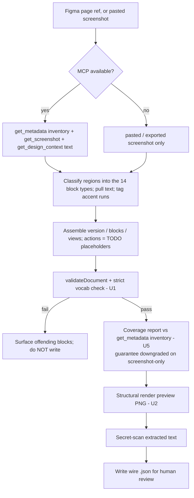

# Figma to neo_sdui Wire Generator Skill - Plan

## Goal Capsule

- **Objective:** A Claude skill that turns one Figma page into one neo_sdui-compliant wire document (`{version, blocks, views}`), semantics-only, written to a file for review — so guide screen structure and content stop being hand-transcribed (navigation actions are still hand-wired; see R8).
- **Product authority:** lay (owner of neo_sdui). Mirror skill to `neofig`, which owns the inverse (Figma → Flutter *look*).
- **Open blockers:** none. All scope forks resolved in dialogue; remaining unknowns are implementation-level (deferred to implementation).
- **Product Contract preservation:** unchanged except R4a (Figma token handling), added during document review.

---

## Product Contract

### Summary

A Claude skill, invoked with a Figma page reference, that classifies the page's regions into the fixed 14-type neo_sdui block vocabulary, pulls their text, tags accent text as `tone:"accent"`, and emits a validated whole-page wire document with a coverage report and a structural render preview for human sign-off. It reads the design via the Figma MCP, degrading to a pasted/exported screenshot; it never puts colors, fonts, gradients, or spacing on the wire.

### Problem Frame

neo_sdui guide screens are wire JSON documents authored by hand today. Each Figma page must be transcribed block by block into the wire vocabulary — slow, and error-prone on exactly the parts that must be verbatim (`code`/URL content). The design already exists in Figma; the semantic structure is recoverable. What is missing is a repeatable path from a page to its wire document that a human can trust without re-reading every block. This skill is the semantic half of the Figma pipeline whose look half (`neofig`) already exists.

### Key Decisions

- **MCP-first ingestion, screenshot as the free fallback.** Chosen for now over REST-first despite REST's better per-page efficiency (1 call vs 2–3). On the current Figma seat both APIs hit the same ~6/month wall, and a pasted/exported screenshot is the only unlimited path — so it is the real workhorse for iteration. In practice the screenshot is the *default operating mode* and MCP/REST are a scarce high-fidelity pass (~2 pages/month before the wall); the plan therefore invests exact-text capture and drop-detection in a path that is operationally rare, which R9/R11 and the Outstanding Questions now account for rather than assume away.
- **Semantics-only wall is a hard skill invariant.** The skill refuses to emit look. This keeps generation aligned with the wire's resilience model (unknown look degrades because look is client-owned) and mirrors `neofig`'s inverse "no raw hex/font in a widget" rule.
- **Verify, don't trust.** Three gates: (a) a 14-type allowlist + per-block required-field check layered on the package's `validateDocument` — `validateDocument` alone only checks `type` is a non-empty string and the renderer silently drops unknown types, so the roster/field check is what actually rejects an off-vocabulary or malformed block that would otherwise pass as "validated" and vanish; (b) a coverage report computed against an *independent* node inventory; (c) a structural render preview. Silent element drop / mis-bucketing is the dominant failure mode of this class of tool; these gates catch it only to the extent each gate's inputs are available (see R10–R12).
- **Fixed 14-type vocabulary as the classification target.** A small closed alphabet with no pixel decisions is why this is tractable where general design-to-code is not. The vocabulary + field shapes are encoded as a skill reference so classification aims at a versioned contract.
- **Navigation left to the human.** Figma carries no signal for app route names or sheet-vs-screen intent. The skill emits `action` TODO placeholders rather than hallucinating an action grammar the app must honor; lay wires them once all pages exist.

### Requirements

**Ingestion**

- R1. The skill accepts a Figma page/frame reference (node URL or in-app selection) and produces the wire document for that one page.
- R2. Primary ingestion is the Figma MCP: `get_metadata` for structure/reading-order, `get_screenshot` for the vision pass, and `get_design_context` consulted for exact text strings.
- R3. The skill degrades to a user-pasted or exported screenshot when the MCP is unavailable or its monthly quota is exhausted, and must still run and emit a validated document from the screenshot alone.
- R4. An optional Figma REST `/nodes` path (one request returns the whole page subtree, with exact `characters`) sources verbatim text when a token is configured. It is the *preferred exact-text source* over `get_design_context` (R2) when available — not a separate primary ingestion path — and it draws on the same monthly seat quota as MCP. (Whether to keep R4 at all vs. defer it is an Outstanding Question.)
- R4a. When the REST path (R4) is used, the Figma token is supplied only via an environment variable (e.g. `FIGMA_TOKEN`), is gitignored, and is never hardcoded, committed, or written to logs, coverage reports, or error output.

**Classification and output**

- R5. Each page region is classified into exactly one of the 14 core block types (`header`, `text`, `cta`, `callout`, `media`, `code`, `card`, `steps`, `faq`, `tabs`, `row`, `column`, `group`, `spacer`). Regions that fit no type are reported, not force-fit into a wrapper block.
- R6. Output is a whole-page document `{version, blocks, views}`, including `sheet:`/`screen:` sub-views for navigable sub-screens (e.g. an FAQ screen).
- R7. Text fields are emitted as string-or-runs; a text (or run) rendered in the accent color is tagged `tone:"accent"` — using the hex→role signal only to decide the tag, never emitting the hex.
- R8. Navigation targets (`route:`/`screen:`/`sheet:`) are not inferred — `action` is emitted as a TODO placeholder for the human to wire.
- R9. `code`/URL block content is sourced from exact text (`get_design_context`/REST) where available; text that had to be vision-inferred is flagged low-confidence in the coverage report. Verbatim fidelity for `code`/URL blocks therefore requires an exact-text path; on the screenshot-only path these blocks are vision-inferred and must be human-verified character-by-character. A page containing `code`/URL blocks should use an exact-text pass rather than screenshot-only (see Outstanding Questions).

**Verification**

- R10. Before writing, every emitted document passes two checks: (a) the package's `validateDocument`, and (b) a skill-side check that every block's `type` is in the 14-type allowlist and carries that type's required fields. `validateDocument` only verifies `type` is a non-empty string — not the roster or field shapes — and the renderer silently drops unknown types, so (b) is what stops a mis-classified block from passing as "validated" and then vanishing. On failure of either check the skill surfaces the specific offending block(s) and reason to the user rather than writing silently.
- R11. The skill emits a coverage report: visible text nodes seen vs emitted, naming dropped and ambiguous nodes. This warns and continues — it never blocks output. The "seen" inventory must come from a source *independent* of the emit pass (MCP `get_metadata` or REST `characters`) for drop-detection to mean anything; on the screenshot-only path "seen" and "emitted" share the same vision pass, so the report cannot detect a region the model never perceived — there the anti-drop guarantee is explicitly downgraded and the report says so.
- R12. The skill produces a structural render preview PNG (via the package's example/golden render harness) for eyeballing block presence, type, order, and nesting. It is explicitly structural, not pixel/font fidelity.

**Invariant**

- R13. The document carries semantics only — no hex/rgb, no px/dp, no `fontSize`/`fontFamily`/`fontWeight`, no gradient stops, shadows, or spacing. Only role enums (`tone`/`emphasis`/`shape`/`variant`/`present`/`kind`), content, URLs, and action strings. The skill's own instructions state this forbidden list.
- R14. Theme and look are never extracted into the document; they stay client-owned.

**Skill mechanics**

- R15. Ships as a Claude skill (`SKILL.md` + references) invocable against the neo_sdui repo. Output is a wire `.json` file the user reviews and commits — no Firebase push. The review step includes scanning extracted text for secret-like patterns (API keys, tokens, internal URLs) before commit, since designer mock text is copied verbatim; this check re-gates before any future Firebase Remote Config push.
- R16. The 14-type contract and field shapes are encoded in a skill reference so the classification target is a fixed, versioned vocabulary.

### Key Flows

- F1. Generate a page's wire document.
  - **Trigger:** user gives a Figma page reference (or a pasted/exported screenshot when the MCP is unavailable).
  - **Steps:** read the design (MCP → degrade to screenshot); classify regions into the 14 block types, pull text, tag accent runs; assemble the whole-page `{version, blocks, views}`, actions as TODO; run `validateDocument`; render the structural preview and compute the coverage report; write the `.json` for review.
  - **Outcome:** a validated, semantics-only wire file plus a preview PNG and a coverage report the human signs off on.

### Acceptance Examples

- AE1. **Covers R11.** When a visible text layer maps to no block, the coverage report lists it and the run still emits and writes the JSON.
- AE2. **Covers R9.** When a `code`/URL string had no exact-text source, it is emitted but tagged low-confidence for the user to verify against Figma.
- AE3. **Covers R7, R13.** A heading rendered in the accent green emits `tone:"accent"` with no hex anywhere in the JSON; a non-accent heading emits no `tone`.
- AE4. **Covers R8.** A tappable card with no inferable route emits an `action` TODO placeholder, not a guessed `route:`/`screen:`.
- AE5. **Covers R3.** With the MCP unavailable, the skill runs on a pasted screenshot alone and still produces a document that passes `validateDocument` (text may be flagged low-confidence).

### Scope Boundaries

**Deferred for later**

- Firebase Remote Config push via the Admin API — file output only for now.
- The `neo:` Figma annotation convention for deterministic classification (deferred despite being ideation's top reliability multiplier; revisit if the pure-inference MVP proves unreliable on the screenshot path, which is where reliability is weakest).
- Auto-inferred navigation targets.

**Outside this skill's identity (permanent)**

- Extracting colors, fonts, gradients, or spacing — look is client-owned and never on the wire.
- Emitting Flutter widget code — that is `neofig`'s job, the mirror skill.

### Dependencies and Assumptions

- **Figma seat is the binding constraint.** The authenticated account `vaibhav@neosapien.ai` ("Vaibhav Pandey's team") is a **View seat on Starter tier** → ~6 MCP or REST read calls per **month**, combined. Assume one clean pass per page; iteration uses the screenshot path. Real volume needs a Dev/Full seat on Professional+ (10–20 req/min).
- The Figma identity is `@neosapien.ai`, not the `@neosapien.xyz` used elsewhere — a wrong-account 403 is the first thing to suspect on auth failure.
- `validateDocument` exists but is structural-only (`packages/neo_sdui/lib/src/model/validation.dart`): it checks `type` is a non-empty string, not the 14-type roster or per-block field shapes. The example/golden render harness exists but is `WidgetTester`/`NeoDocument`-bound — a standalone render-to-PNG entrypoint for the preview does not yet exist and must be built.
- `neofig`'s `tokens.md` hex→role map (e.g. `#00F1A0` = `primary500`/accent green) is available as the accent-detection reference.
- neo fetches fonts at runtime, so the render preview uses a fallback font and renders network images as placeholders — the preview is structural, not font-faithful.

### Outstanding Questions

**Resolve before planning:** none remaining — the technical forks are resolved in the Planning Contract (KTD1–KTD6); the scope forks are recorded as assumptions below.

**Resolved during planning:**

- Exact-text for `code`/URL blocks → KTD5.
- Coverage denominator → KTD4.
- Render-to-PNG invocation → KTD2 / U2.
- Strict validator location → KTD1 / U1 (in the `neo_sdui` package).
- Region→block strategy → KTD3 (LLM-in-skill; no heuristic engine).
- Skill install location → repo-local `.claude/skills/` (the wire vocabulary is repo-specific).

**Deferred to implementation:**

- Coverage-report format and the low-confidence-flag threshold.
- Whether the structural PNG preview earns its keep vs. a text block-tree outline — U2 delivers the PNG; drop to an outline if the harness cost isn't worth it.

**Assumptions:**

- Authoring cadence / screens-per-month is unrecorded; the seat-cap architecture assumes a low-single-digit monthly volume fits the ~6-call budget. Capture the real number before scaling — it does not block building the skill.
- R4 (optional REST) is kept per owner preference despite three reviewers flagging redundancy; revisit if it earns no distinct use.

### Sources and Research

- `docs/ideation/2026-07-13-figma-to-neo-wire-generator-skill.md` — the ideation (directions A/C/E chosen; explicit rejections).
- Wire contract: `packages/neo_sdui/lib/src/blocks/default_registry.dart`, the per-block builders, `packages/neo_sdui/lib/src/model/block_node.dart`, `packages/neo_sdui/lib/src/model/validation.dart` (`validateDocument`).
- Example wires: `packages/neo_sdui/example/mcp/mcp_document.dart`, `packages/neo_sdui/example/how_to/how_to_document.dart`.
- `neofig` skill (external, `~/.claude/skills/neofig/`) — the mirror (look extraction); `tokens.md` hex→role map.
- Figma REST: file/nodes returns the whole subtree in one call — https://developers.figma.com/docs/rest-api/file-endpoints/ ; rate limits (View/Collab 6/month, Dev/Full 10–20/min, per token owner's seat) — https://developers.figma.com/docs/rest-api/rate-limits/ ; MCP tools — https://developers.figma.com/docs/figma-mcp-server/tools-and-prompts/.
- Firebase RC (deferred): JSON stored as string, 1,000,000-char project-wide budget — https://firebase.google.com/docs/remote-config/parameters.
- Prior art: Airbnb Ghost Platform (fixed section vocabulary, data/layout separation) — https://medium.com/airbnb-engineering/a-deep-dive-into-airbnbs-server-driven-ui-system-842244c5f5.
- Structural template for the skill shape: the `neofig` skill (external, `~/.claude/skills/neofig/`) — its inverse (Figma → Flutter *look*); its `SKILL.md` workflow, `references/` split, and `tokens.md` hex→role map are the pattern to mirror.

---

## Planning Contract

### Key Technical Decisions

- KTD1. **Strict wire-vocabulary validator lives in the package.** Add `validateWireVocabulary(Map)` to `neo_sdui` that checks each block's `type` is in the 14-type allowlist and carries that type's required fields, returning structured issues. Kept separate from the structural `validateDocument` (which only checks `type` is a non-empty string) and unit-tested — the skill and any future consumer call it, so it belongs in the package, not the skill.
- KTD2. **Preview via a parameterized golden-render test, not a new headless binary.** Reuse the existing `WidgetTester` golden harness: a test reads a wire JSON path (env/arg), decodes `NeoDocument`, pumps `NeoSduiView` with `NeoSduiTheme.fallback()`, and writes a PNG to a known path via the golden machinery. Structural only — runtime fonts render as a fallback and network images as placeholders — which is sufficient for confirming block presence, type, order, and nesting.
- KTD3. **Classification is LLM-in-skill against a fixed encoded vocabulary.** No heuristic/auto-layout engine — a 14-symbol target with no pixel decisions doesn't warrant one (YAGNI). The vocabulary, field shapes, and the accent-tone signal are encoded as skill references so the model classifies against a versioned contract.
- KTD4. **Coverage denominator is the `get_metadata` node inventory.** Drop-detection needs a "seen" set independent of the emit pass; `get_metadata` (or REST `characters`) supplies it in one call. On screenshot-only, "seen" and "emitted" share the vision pass, so the report downgrades the anti-drop guarantee and says so — it never silently claims full coverage. Concretely, "downgraded" means the screenshot-only coverage figure is marked low-confidence and excluded from any pass/fail judgment: it is reported for the human, never treated as a verified full-coverage claim.
- KTD5. **Exact-text for `code`/URL blocks prefers an exact-text source.** `get_design_context`/REST supply verbatim strings; screenshot-only, these blocks are vision-inferred, flagged low-confidence, and require human character-verify. Pages containing `code`/URL blocks should use an exact-text pass.
- KTD6. **Semantics-only wall + secret hygiene are skill-instruction invariants.** The skill's own prompt states the forbidden-on-wire list (no hex/px/font/gradient/shadow/spacing), scans extracted text for secret-like patterns before write, and requires the Figma token via env var only (never committed or logged).

### High-Level Technical Design

The single flow (F1) with its gates. Prose (Requirements, Units) is authoritative; the diagram is the on-ramp.

### Sequencing

U1 and U2 (package additions) are independent and can land in parallel. U3 (skill contract) precedes U4 (skill flow). U5 (verify + output) depends on U1, U2, U3, U4.

---

## Implementation Units

### U1. Strict wire-vocabulary validator (package)

- **Goal:** A package function that rejects off-vocabulary and malformed blocks that `validateDocument` lets through.
- **Requirements:** R5, R10.
- **Dependencies:** none.
- **Files:** `packages/neo_sdui/lib/src/model/validate_vocabulary.dart` (new), export from `packages/neo_sdui/lib/neo_sdui.dart`, `packages/neo_sdui/test/model/validate_vocabulary_test.dart` (new).
- **Approach:** `validateWireVocabulary(Map<String, Object?> doc)` recurses the real `BlockNode` carriers — top-level `blocks`, each view's `blocks`, `children` (`row`/`column`/`group`), each `tabs[].blocks`, and **every block's `fallback`** (which `validateDocument` also recurses) — and for each block checks (a) `type` is in the 14-type allowlist and (b) the block carries its required content per the table below. `steps`/`faq` `items` are leaf content maps (validate their own keys: `caption`; `question`+`answer`), **not** nested block containers. Returns a list of issues `(path, type, reason, severity)` — never throws.
  - **Required-field table (authored here — the builders enforce nothing; every field is read through a guarded default, so this contract is new, not derived from the builders):** `header`→`title`; `text`→`body`; `cta`→`label`; `callout`→`title` or non-empty `bullets`; `media`→`url`; `code`→`content`; `card`→`title`; `steps`→non-empty `items`, each with `caption`; `faq`→non-empty `items`, each with `question`+`answer`; `tabs`→non-empty `tabs`, each with `blocks`; `row`/`column`/`group`→non-empty `children`; `spacer`→none.
  - **Strictness policy:** an off-roster `type` is a **hard block** (U5 refuses to write) — the renderer silently drops it, so it would vanish from the output. A missing required *field* is a **warning** in the coverage report, not a hard block — the renderer degrades such a block to empty/collapsed, which the human sees in the preview and report; hard-blocking would reject valid, cleanly-degrading wires.
- **Execution note:** Implement the required-field table test-first — it is the real logic and the gate the whole "verify" pillar leans on.
- **Patterns to follow:** `packages/neo_sdui/lib/src/model/validation.dart` (`validateDocument` shape — non-throwing, collects issues); the field reads in `packages/neo_sdui/lib/src/blocks/default_registry.dart` and the per-block builders.
- **Test scenarios:**
  - Covers R5. A block with `type:"banner"` (off-roster) yields a hard-block issue naming the offending path; a valid 14-type doc yields no issues.
  - A `header` missing `title`, a `code` missing `content`, a `steps` item missing `caption` each yield a warning-severity required-field issue (not a hard block).
  - An off-roster `type` nested inside `tabs[].blocks`, inside `group.children`, and inside a block's `fallback` is each caught (all three carriers are recursed).
  - A `steps`/`faq` `items` entry is validated for its own keys, not treated as a nested block.
  - A structurally valid, on-vocabulary doc yields zero issues (composes cleanly with `validateDocument`).
  - Non-map block / non-list `blocks` yield an issue, never throw.
- **Verification:** `flutter test` for the new test passes; the validator flags the exact block classes the reviewers named (`type:"banana"`, missing required field).

### U2. Wire JSON → structural preview PNG (package)

- **Goal:** A repeatable way to render an arbitrary wire JSON to a PNG for eyeballing, without hand-scaffolding a golden per run.
- **Requirements:** R12.
- **Dependencies:** none.
- **Files:** `packages/neo_sdui/test/tools/render_wire_test.dart` (new), `packages/neo_sdui/test/tools/testdata/minimal_wire.json` (new — the self-test fixture), output PNG to a known path (e.g. `packages/neo_sdui/.render/preview.png`).
- **Approach:** A golden-style test reads a wire JSON path from an **env var** (`Platform.environment`, resolved at runtime — not `--dart-define`, which is compile-time), decodes it via `NeoDocument.fromJson`, pumps `NeoSduiView` with `NeoSduiTheme.fallback()` at a fixed width, **measures the rendered content's intrinsic height** (pump in a tall/unbounded viewport and read the laid-out extent) so tall pages aren't top-clipped, and captures the boundary to a PNG via the golden machinery (`--update-goldens` writes the file). The test is **skipped when the env var is unset**, so plain `fvm flutter test` stays green; the preview is produced by an explicit `flutter test --update-goldens test/tools/render_wire_test.dart` with the path set. Structural only: fallback fonts, network images render as placeholders (KTD2). The skill invokes it with the freshly-generated JSON.
- **Execution note:** Mostly harness wiring; prefer a runtime smoke check (render a known-good doc → non-empty, unclipped PNG) over unit assertions.
- **Patterns to follow:** `packages/neo_sdui/test/golden/` harness (`pumpGuide` + `matchesGoldenFile`, and its documented per-document `height` need — the MCP goldens pump at 3600/2400); reuse its pump path rather than inventing a new binding.
- **Test scenarios:**
  - Covers R12. With the env var pointing at `testdata/minimal_wire.json`, the test writes a non-empty PNG to the known path.
  - With the env var unset, the test is skipped — plain `fvm flutter test` stays green (there is no committed golden to diff).
  - A tall multi-block wire renders without top-clipping (captured height adapts to content).
  - `Test expectation: smoke — the assertion is "PNG exists, non-empty, not clipped," not pixel fidelity. Vocabulary gating is U5's job, not U2's.`
- **Verification:** the explicit `--update-goldens` invocation with a sample JSON produces an unclipped `preview.png`; plain `fvm flutter test` and `melos analyze` stay green.

### U3. Skill scaffold + wire-contract references

- **Goal:** The skill's durable knowledge: the fixed vocabulary, field shapes, the forbidden-on-wire list, and the accent-tone signal.
- **Requirements:** R5, R7, R13, R14, R16.
- **Dependencies:** none (informed by U1's allowlist).
- **Files:** `.claude/skills/<name>/SKILL.md` (scaffold + description), `.claude/skills/<name>/references/wire-contract.md`, `.claude/skills/<name>/references/accent-tones.md`.
- **Approach:** `wire-contract.md` encodes the 14 block types + per-block fields + the string-or-runs shape + `tone`/`emphasis`/`shape`/`variant` enums + the `route:/sheet:/screen:/closeSheet/closeAll/https` action grammar + the semantics-only forbidden list (verbatim). `accent-tones.md` carries the hex→`tone:"accent"` signal, adapted from `neofig`'s `tokens.md` (e.g. `#00F1A0` = accent green) — used only to decide the tag, never emitted. Mirror `neofig`'s SKILL.md structure.
- **Patterns to follow:** `~/.claude/skills/neofig/SKILL.md` and its `references/` split.
- **Test scenarios:** `Test expectation: none — reference content; validated indirectly by the U5 dry-run producing a spec-conformant document.`
- **Verification:** the contract reference lists exactly the 14 types and matches U1's allowlist; a reviewer can map any wire field to a block builder.

### U4. Skill ingestion + classification workflow

- **Goal:** The SKILL.md procedure that turns a Figma page into an assembled (unvalidated) wire document.
- **Requirements:** R1, R2, R3, R4, R4a, R6, R8, R9.
- **Dependencies:** U3.
- **Files:** `.claude/skills/<name>/SKILL.md` (workflow body), `.claude/skills/<name>/references/ingestion.md`.
- **Approach:** Steps — resolve the Figma page ref; ingest MCP-first (`get_metadata` inventory + `get_screenshot`; `get_design_context`/optional REST for exact text), degrading to a pasted/exported screenshot; classify each region into one of the 14 types; pull text as string-or-runs; tag accent runs; emit `sheet:`/`screen:` sub-views; leave every `action` as a `TODO` placeholder (KTD/R8). Encode the token-handling rule (R4a: env var only, never committed/logged) in the REST branch. Flag vision-inferred `code`/URL text low-confidence (R9/KTD5).
- **Execution note:** Prompt-authoring; verify by the U5 dry-run, not unit tests.
- **Patterns to follow:** `neofig`'s MCP call-order and seat-limit guidance (`references/figma-mapping.md`).
- **Test scenarios:**
  - Covers AE4. A tappable card with no inferable route emits an `action` TODO placeholder, not a guessed `route:`.
  - Covers AE3. An accent-green heading emits `tone:"accent"` with no hex anywhere.
  - Covers AE5. With MCP unavailable, the workflow proceeds from a pasted screenshot alone.
  - `Test expectation: behavioral — proven by the U5 dry-run against a real Figma page and a pasted-screenshot fallback.`
- **Verification:** a dry-run on the MCP guide page produces an assembled `{version, blocks, views}` with actions as TODO and accent runs tagged.

### U5. Skill verification + output

- **Goal:** Gate, report, preview, and write — the "verify, don't trust" tail.
- **Requirements:** R10, R11, R12, R15.
- **Dependencies:** U1, U2, U3, U4.
- **Files:** `.claude/skills/<name>/SKILL.md` (verify/output body), `.claude/skills/<name>/references/verify-output.md`.
- **Approach:** Run `validateDocument` + `validateWireVocabulary` (U1); on failure, surface the offending blocks and do not write (R10). Compute the coverage report against the `get_metadata` inventory (KTD4), downgrading the guarantee on screenshot-only (R11). Render the structural preview via U2 (R12). Secret-scan extracted text for key/token/internal-URL patterns before write; re-affirm the gate for any future Firebase push (R15/KTD6). Write the wire `.json` for human review.
- **Execution note:** Prefer a runtime smoke: run the full skill on one page end-to-end and confirm each artifact (validated JSON, coverage report, preview PNG) appears.
- **Test scenarios:**
  - Covers AE1. An unmapped visible text node is listed in the coverage report; the run still writes the JSON (warn + continue).
  - Covers AE2. A vision-inferred `code`/URL string is flagged low-confidence.
  - Covers R10. A document with an off-vocabulary block is not written; the offending block is surfaced.
  - Covers R15. A designer mock string matching a secret pattern is flagged before write.
  - `Test expectation: behavioral — proven by the end-to-end dry-run.`
- **Verification:** the end-to-end dry-run yields a validated `.json` + coverage report + preview PNG, and refuses to write a doc with an injected off-vocabulary block.

---

## Verification Contract

| Gate | Command / action | Applies to | Done signal |
|---|---|---|---|
| Unit tests | `fvm flutter test` in `packages/neo_sdui` | U1, U2 | validator tests green; the render test is env-gated and skips when unset (stays green) |
| Preview render | `flutter test --update-goldens test/tools/render_wire_test.dart` with the wire-path env var set | U2 | writes a non-empty, unclipped PNG |
| Static analysis | `fvm dart run melos analyze` | U1, U2 | clean |
| Skill dry-run (MCP) | Run the skill on the MCP guide page | U3–U5 | validated `.json` + coverage report + preview PNG produced |
| Skill dry-run (screenshot) | Run the skill on a pasted screenshot with MCP off | U4, U5 | produces a validated doc; coverage guarantee shown as downgraded |
| Negative gate | Inject an off-vocabulary block | U1, U5 | write is refused; offending block surfaced |

---

## Definition of Done

- U1–U5 landed; `validateWireVocabulary` rejects off-roster types and missing required fields, recursing nested containers.
- The render entrypoint produces a structural PNG from an arbitrary wire JSON.
- The skill turns a Figma page (MCP or pasted screenshot) into a whole-page `{version, blocks, views}` document, with `action` TODO placeholders, accent runs tagged, and no look on the wire (no colors/fonts/gradients/spacing — look stays client-owned).
- Verify tail runs: strict validation gate (write refused on failure), coverage report against an independent inventory (downgraded screenshot-only), structural preview, and a secret-scan before write.
- Figma token handling (env-var only, never committed/logged) is stated in the skill.
- `fvm flutter test` and `melos analyze` are green for the package additions.
