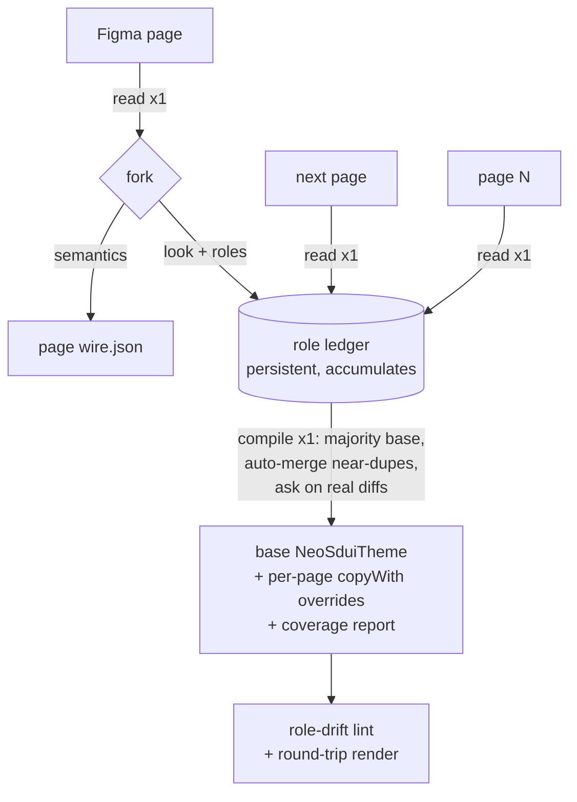
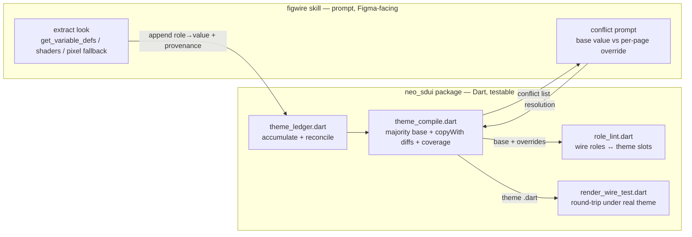

# figwire Theme Companion - Plan

## Goal Capsule

- **Objective:** Extend the `figwire` skill so one Figma read per page yields two projections — the semantic wire JSON (unchanged) and a look projection appended to a cross-screen role ledger — and a terminal compile step turns the accumulated ledger into a paste-in `NeoSduiTheme`: one base theme plus a per-page `copyWith` override for each page that genuinely differs.
- **Product authority:** lay@neosapien.xyz (single maintainer of neo_sdui + figwire).
- **Product Contract preservation:** unchanged — no R-ID was rewritten during planning; all planning work is additive (HOW), the Product Contract (WHAT) stands as written by `ce-brainstorm`.
- **Plan depth:** Standard. Six implementation units, built in dependency order.
- **Open blockers:** None.

---

## Product Contract

### Summary

`figwire` grows a look-half. Each page it reads now also feeds a running *role ledger*; a final compile step reads the whole ledger and emits a paste-in `NeoSduiTheme` — one base theme plus a small `copyWith` override per divergent page. The single Figma read per page is unchanged; the pixels the wire is forbidden to carry go to the theme file instead of being discarded.

### Problem Frame

`figwire` already reads every pixel of a Figma selection and then throws the look away to honor its Iron Rule (no hex/px/font/gradient on the wire). The app therefore has a wire for every screen but no theme to render it against — someone hand-builds the `NeoSduiTheme` by eyeballing Figma a second time. That second pass is manual, error-prone, and spends a read against a hard-capped Figma seat (~6 reads/month). The look figwire discards *is* the theme; keeping it closes the gap without a second navigational pass over the page — though the token/shader reads it adds are metered against the seat and must be budgeted (KTD4). The screens arrive part by part over time, so the theme cannot be produced per screen — it has to accumulate and resolve into one artifact at the end.

### Key Decisions

- **One skill, shared ingestion, two projections.** The theme is produced by the same figwire run that produces the wire, forking after a single read — not by a separate skill that re-reads Figma. The seat cap forbids double-reading, and the wire and theme must stay reconciled on a shared role vocabulary (see R11).
- **Base + per-page overrides, not N standalone themes.** The compile emits one base theme and a `copyWith` override only for pages that diverge. The user copies the base once; matching pages reuse it; outliers carry a small diff. Chosen over N full themes (more to copy, no shared base).
- **Majority look wins as base.** The palette/type the most pages share becomes the base; minority pages become overrides. Minimizes the number and size of overrides emitted.
- **Hybrid conflict resolution.** At compile, near-duplicate values (e.g. `#00F1A0` vs `#00F0A0`) are auto-canonicalized silently; a genuine cross-page difference (amber vs green) pauses and asks the user whether it is a base value or a per-page override. The user adjudicates real design differences only.
- **Token layer is the source of truth.** Extraction reads Figma variables/styles first (`get_variable_defs`, `get_shader_fill`/`get_shader_effect`), and only pixel-scrapes when a file binds no variables.
- **Low-confidence fields are flagged, never silent.** Inferred values (chiefly the type scale) are emitted as a best guess with an inline `// confirm:` marker; roles Figma cannot answer at all are emitted as `// TODO(theme):`. The pasted theme runs, and the user sees exactly what to eyeball.
- **The ledger is a persistent, resumable sidecar.** It survives between runs so screens can be fed part by part. The compile/accumulate flow defaults to continue-accumulating; starting a new theme requires an explicit fresh signal (see R5).

### Requirements

**Two projections per page**

- R1. A figwire run reads each Figma page exactly once and produces both the wire JSON (unchanged in shape and content) and a look projection from that same read.
- R2. No hex, pixel, font, or gradient value ever appears on the wire; every look value extracted goes only to the role ledger / theme artifact.
- R3. The wire-writing behavior of figwire is unchanged — same block classification, same validation gates, same output — with the theme projection added alongside, not woven into the classifier.

**The role ledger**

- R4. The look projection appends role→value observations (color roles, type scale, radius/space scales, card/group/grid surfaces, gradients, named accents, icons) to a persistent cross-screen ledger, tagged by source page.
- R5. The ledger persists between runs and accumulates by default; the user can start a fresh ledger with an explicit signal, so feeding a new guide's screens does not require manually clearing state.
- R6. Extraction fills the ledger from Figma variables/styles when present and degrades to reading exact values (design context / REST), then to screenshot observation, only when no variables are bound — recording per-field which source answered.

**Compile → base + overrides**

- R7. A terminal compile step reads the whole accumulated ledger and emits one base `NeoSduiTheme(...)` literal shaped like the existing `NeoSduiTheme.fallback()` factory, ready to paste into the app.
- R8. The base theme reflects the majority look across accumulated pages; each page that diverges is emitted as a named `base.copyWith(...)` override carrying only its differing fields. Pages matching the base get no override.
- R9. During compile, near-duplicate role values are auto-merged to one canonical value; a genuine cross-page difference pauses and asks the user whether it is a base value or a per-page override.
- R10. Fields the extraction is unsure of are emitted with an inline `// confirm:` marker (chiefly the type scale collapsing many font sizes into `title`/`subtitle`/`body`/`caption`+`mono`); fields Figma cannot supply carry a safe fallback value plus a `// TODO(theme):` marker — a bare comment cannot stand in for a required constructor argument, so the emitted theme still compiles. The compile also emits a coverage report stating, per field, whether it was read from a variable, inferred, or left as a TODO.

**Coupling and verification**

- R11. Every look role the wire names across all accumulated pages (`tone`, `emphasis`, `icon`, named accents) resolves to a slot in the compiled theme, and the compile flags any theme slot that no wire uses — the wire and theme are reconciled against a shared role registry so neither drifts.
- R12. A role-drift lint asserts the R11 coupling and is runnable as a gate; a wire role with no theme slot is a reported issue.
- R13. A round-trip render preview renders an accumulated wire under the compiled theme (reusing figwire's existing structural-preview harness with the real theme) so the user can eyeball it against the Figma screenshot — because a theme fails by rendering *wrong*, not by vanishing, so the wire's existing gates cannot catch a wrong hue.

### Key Flow

- F1. Accumulate then compile
  - **Trigger:** The user hands figwire a Figma page selection, one at a time, over several runs.
  - **Steps:** figwire reads the page once → writes the page's wire JSON → appends the page's raw look observations + named roles to the persistent ledger. When the user signals all pages are in, the compile step clusters near-duplicates over the full set (feeding-order independent) and resolves the ledger (prompting only on genuine cross-page differences), then emits the base theme + per-page overrides + a coverage report, and runs the role-drift lint and round-trip render preview.
  - **Outcome:** One paste-in base `NeoSduiTheme` plus a `copyWith` override per divergent page, with every wire role backed by a theme slot.



### Scope Boundaries

- Rewriting figwire's wire classifier or block vocabulary — out; the wire output is unchanged.
- App-side theme selection (mapping a route/guide to the `NeoSduiTheme` handed to each `NeoSduiView`) — out; that is app wiring, not this skill.
- Pushing anything to Firebase Remote Config — out, unchanged from figwire today (the skill writes reviewable files).
- Changes to `neofig` (look→widget code) — out; this does not touch it.
- An intermediate DTCG / Style-Dictionary token format — out; the compile targets the existing `NeoSduiTheme` class directly.

### Assumptions

- The happy path assumes Figma files bind variables/styles; when they do not, extraction degrades to a manual/expensive path and more fields land as `// TODO(theme):` (R6, R10).
- The compile target is the existing `NeoSduiTheme` immutable class and its `copyWith` — no new theme shape is introduced.
- Feeding pages "part by part" means multiple figwire runs against one persistent ledger, not one run over many selections.

---

## Planning Contract

### Key Technical Decisions

- KTD1. **The theme code lives package-side as env-gated Dart tool entrypoints; the skill orchestrates.** The ledger merge, compile, and role-drift lint are Dart under `packages/neo_sdui/lib/src/authoring/`, exercised by env-gated entrypoints in `packages/neo_sdui/test/tools/` — the exact pattern of `check_wire_test.dart` / `render_wire_test.dart` (gated on an env var so plain `fvm flutter test` skips them and CI stays green; see `docs/solutions/architecture-patterns/authoring-wire-needs-strict-vocabulary-gate.md`). The figwire skill side is prompt work: a new reference plus edits to existing references. Rationale: the risky logic (reconcile, majority base, override diffing) becomes unit-testable Dart, and it reuses the established authoring-gate pattern rather than a one-off unversioned script.
- KTD2. **The ledger is a JSON sidecar keyed by role and source page, accumulated across runs.** Continue-accumulate is the default; a fresh start is an explicit signal. The exact on-disk location and key shape are settled in U1.
- KTD3. **Compile targets the existing `NeoSduiTheme` constructor literal + `copyWith`.** The base is a `NeoSduiTheme(...)` shaped like `NeoSduiTheme.fallback()`; overrides are `base.copyWith(...)`. No new theme type, no intermediate token format.
- KTD4. **Extraction reads the token layer first (skill-side).** `get_variable_defs` for color/number/type variables and bound styles, `get_shader_fill`/`get_shader_effect` for gradients that map onto `cardGradient`/`groupGradient`/`accentGradient`; pixel/screenshot values are the fallback, recorded with lower-confidence provenance. These variable/shader reads are distinct Figma calls metered against the ~6/month seat cap (`ingestion.md`) — token-first is the *fidelity* order, not a free one; on a View seat the screenshot-derived look is the practical default, with token/shader reads used when a Dev/Full seat makes them affordable.
- KTD5. **Base = majority look; overrides = minimal per-page diffs.** Only fields that differ from base appear in a page's `copyWith`. Majority is by observed frequency — a proxy for design intent, not identity; if a lopsided page count picks the wrong palette, the user reassigns via the designate-base escape hatch (see Open Questions).
- KTD6. **Conflict handling splits data from UX, and resolves at compile.** The ledger stores raw per-page observations (U1); near-duplicate values are clustered at compile over the full accumulated set — batch, so the result is feeding-order independent — not incrementally at ingest (U2); the compile emits a conflict list for genuine differences; the skill reads that list and runs the base-value-vs-override prompt (U5).
- KTD7. **Low-confidence provenance drives inline flags.** Per-field provenance (`variable` / `inferred` / `todo`) is carried through the ledger and turned into `// confirm:` / `// TODO(theme):` markers plus a coverage report at compile.

### High-Level Technical Design

The split between the skill (Figma-facing, prompt) and the package (compute + verify, Dart) is the load-bearing shape:



Prose governs on any disagreement with the diagram. The skill never computes the theme; the package never talks to Figma.

### Sequencing

U1 (ledger) → U2 (compile, needs ledger) → then U3 (lint, needs U2's theme) and U4 (render, needs U2's theme) in parallel → U5 (skill wiring, references all tools) → U6 (end-to-end dry-run).

---

## Output Structure

New files (package authoring lib + env-gated tools + one skill reference); existing files edited in place.

```text
packages/neo_sdui/
  lib/src/authoring/
    theme_ledger.dart        # U1  new — ledger model + accumulate/reconcile
    theme_compile.dart       # U2  new — ledger → base + copyWith overrides + coverage
    role_lint.dart           # U3  new — wire roles ↔ theme slots
  test/authoring/
    theme_ledger_test.dart   # U1  new
    theme_compile_test.dart  # U2  new
    role_lint_test.dart      # U3  new
  test/tools/
    compile_theme_test.dart  # U2/U3  new — env-gated entrypoint (compile + lint)
    render_wire_test.dart     # U4  edited — build theme in-process from ledger
    testdata/theme_ledger_fixture.json  # U6  new — reversed from example/mcp_theme.dart
.claude/skills/figwire/
  references/theme-extract.md # U5  new — the look projection + extraction rules
  references/ingestion.md     # U5  edited — add get_variable_defs / shader reads
  references/verify-output.md  # U5  edited — add theme gates
  SKILL.md                     # U5  edited — two-projection + terminal-compile workflow
```

The per-unit `**Files:**` lists are authoritative; the tree is the scope-at-a-glance.

---

## Implementation Units

### U1. Role ledger — schema and accumulate/reconcile

- **Goal:** Define the ledger data model and its accumulate/reconcile operations. The ledger has two sides per page: the **look** side (raw role→value observations, each tagged by source page and provenance `variable`/`inferred`/`todo`) and the **role-usage** side (the look-role names that page's wire emitted — `tone`/`emphasis`/`icon` — the shared registry U3 lints against, recorded here because the skill produces both projections from one read). Pure Dart, no Flutter import.
- **Requirements:** R4, R5, R6, R9 (near-dupe vs conflict, at the data level), R11 (records the wire role-usage registry).
- **Dependencies:** none.
- **Files:** `packages/neo_sdui/lib/src/authoring/theme_ledger.dart`, `packages/neo_sdui/test/authoring/theme_ledger_test.dart`.
- **Approach:** A ledger holds, per role key (e.g. `accent`, `surface`, `radiusLg`, `title`, `accents.brand`, `cardGradient`), the raw observations seen, each with a source-page tag and provenance; and, per page, the set of wire role names used. Reconciliation is a **batch** function over the full observation set (not incremental at ingest): a near-dupe threshold (color distance for colors, exact/tolerance for numbers) clusters near-duplicates to one canonical value and records genuine differences as conflicts — so the outcome is independent of the order pages were fed. `fresh` clears; default appends. Serializes to/from JSON for the sidecar.
- **Patterns to follow:** guarded typed reads and null-defaulting in `packages/neo_sdui/lib/src/model/block_node.dart`; immutability style of `packages/neo_sdui/lib/src/theme/neo_sdui_theme.dart`.
- **Test scenarios:**
  - Adding a never-seen role appends it with its provenance tag; a page's wire role-usage is recorded.
  - Batch reconcile clusters two within-threshold values (`#00F1A0`, `#00F0A0`) to one canonical value, not a conflict.
  - Two values past the threshold (amber vs green) are recorded as a conflict, both retained with their page tags.
  - **Order independence:** feeding the same observations in either order yields the same canonical value and the same conflict set (guards the batch-not-incremental decision, KTD6).
  - Threshold boundary: a value exactly at the cutoff resolves deterministically (documented direction).
  - Provenance survives reconcile (a `variable` observation is not downgraded by a later `inferred` near-dupe).
  - Fresh-vs-continue: `fresh` empties the ledger; default preserves prior entries across a round-trip through JSON.
- **Verification:** `fvm flutter test test/authoring/theme_ledger_test.dart` green.

### U2. Compile — ledger to base theme plus per-page overrides

- **Goal:** Resolve the accumulated ledger into one base `NeoSduiTheme(...)` literal shaped like `NeoSduiTheme.fallback()`, plus a `base.copyWith(...)` per divergent page carrying only differing fields; emit a per-field coverage report and inline confidence markers; surface unresolved conflicts for the skill to prompt on.
- **Requirements:** R7, R8, R10; R9 (emits the conflict list).
- **Dependencies:** U1.
- **Files:** `packages/neo_sdui/lib/src/authoring/theme_compile.dart`, `packages/neo_sdui/test/authoring/theme_compile_test.dart`, `packages/neo_sdui/test/tools/compile_theme_test.dart`.
- **Approach:** Reconcile the ledger (batch, order-independent — U1), then majority-look selection picks the base value per role across pages; a page whose value differs contributes a `copyWith` entry for that field only. Emit the base as `NeoSduiTheme.fallback().copyWith(...)` so the 13 required constructor params are always filled even when a role has no observation — a field with no data gets a fallback value plus a trailing `// TODO(theme):` (never a bare comment, which would not compile); `inferred` fields get `// confirm:`. Also expose an in-process builder returning a live `NeoSduiTheme` from the ledger (for U4's render). The coverage report lists each field with its source; unresolved genuine differences are emitted as a conflict list. `compile_theme_test.dart` is env-gated (reads the ledger path from an env var, mirrors `check_wire_test.dart`'s `skip: wirePath == null` pattern) so plain `fvm flutter test` skips it.
- **Patterns to follow:** env-gated entrypoint shape in `packages/neo_sdui/test/tools/check_wire_test.dart`; the field set and defaults in `packages/neo_sdui/lib/src/theme/neo_sdui_theme.dart` (`.fallback()` and `copyWith`).
- **Test scenarios:**
  - Single-look ledger → one base literal, zero overrides.
  - Three pages share a look, one differs on `accent` → base is the majority value; the outlier emits `base.copyWith(accent: ...)` with only that field.
  - A field tagged `inferred` (a clustered type-scale size) emits with a `// confirm:` marker; an unbound required field emits a fallback value plus `// TODO(theme):`, never a bare comment.
  - Coverage report records the correct source per field (`variable` / `inferred` / `todo`).
  - Emitted base + override text is parseable, compilable Dart — every required constructor param is present (guards the bare-TODO trap).
  - The in-process builder returns a live `NeoSduiTheme` whose roles match the ledger (feeds U4).
  - A ledger with an unresolved conflict surfaces it in the conflict list rather than silently picking one side.
- **Verification:** `fvm flutter test test/authoring/theme_compile_test.dart` green; `NEO_THEME_LEDGER=<ledger> fvm flutter test test/tools/compile_theme_test.dart` emits a theme file + coverage report.

### U3. Role-drift lint — wire roles resolve against the compiled theme

- **Goal:** Collect every look role the accumulated pages' wires named (recorded in the ledger's role-usage registry, R4/R11) and assert each resolves in the compiled theme; flag any theme slot no page uses.
- **Requirements:** R11, R12.
- **Dependencies:** U2.
- **Files:** `packages/neo_sdui/lib/src/authoring/role_lint.dart`, `packages/neo_sdui/test/authoring/role_lint_test.dart`; lint execution folded into `packages/neo_sdui/test/tools/compile_theme_test.dart`.
- **Approach:** Read the role names the wires used from the ledger's recorded role-usage registry (populated in U1 — wire and ledger come from one read, so no separate wire input is plumbed), resolve each against the theme's `accentFor` / `iconFor` semantics, and report unmet roles as issues and unused theme slots as advisories — two severities, same posture as `validateWireVocabulary` (whose traversal shape in `packages/neo_sdui/lib/src/model/validate_vocabulary.dart` the role-collection mirrors).
- **Patterns to follow:** carrier recursion and issue-collection in `packages/neo_sdui/lib/src/model/validate_vocabulary.dart`; role resolution in `NeoSduiTheme.accentFor` / `iconFor`.
- **Test scenarios:**
  - Wire names `tone:"brand"` and the theme has `accents["brand"]` → no issue.
  - Wire names `tone:"brand"` and the theme lacks it → reported issue (would render flat).
  - Built-in `accent` / `critical` always resolve.
  - Wire names `icon:"sparkle"` mapped vs unmapped → resolve vs advisory.
  - A theme accent no wire references → flagged advisory, not an error.
- **Verification:** `fvm flutter test test/authoring/role_lint_test.dart` green; the lint runs inside `compile_theme_test.dart` against the compiled theme.

### U4. Round-trip render preview under the real theme

- **Goal:** Render an accumulated wire under the compiled theme so the user can eyeball it against the Figma screenshot — the theme's analog of the wire preview, because a theme fails by rendering wrong, not by vanishing.
- **Requirements:** R13.
- **Dependencies:** U2.
- **Files:** `packages/neo_sdui/test/tools/render_wire_test.dart` (edited).
- **Approach:** Accept an optional ledger path; when present, build a live `NeoSduiTheme` in-process via `theme_compile`'s builder (U2) — Dart has no runtime eval, so the render builds from the ledger, not from the emitted `.dart` source — and render the wire under it to `.render/preview.png`; when absent, fall back to the current default theme so existing behavior is byte-identical (no golden churn).
- **Patterns to follow:** the existing render harness in `packages/neo_sdui/test/tools/render_wire_test.dart`; theme injection via the scope in `packages/neo_sdui/lib/src/theme/neo_sdui_scope.dart`.
- **Test scenarios:**
  - With a supplied ledger, the render builds the theme in-process and applies its `accent`/`surface` (differs visibly from the default).
  - With no theme supplied, output is byte-identical to the current default render (guards against golden churn on unrelated runs).
  - **Covers R13.** Render completes without throwing on a representative accumulated wire.
- **Verification:** `NEO_WIRE_JSON=<wire> NEO_THEME_LEDGER=<ledger> fvm flutter test --update-goldens test/tools/render_wire_test.dart` writes `packages/neo_sdui/.render/preview.png`.

### U5. figwire skill wiring — two projections, extraction, terminal compile, conflict prompt

- **Goal:** Teach the skill to produce the look projection alongside the wire from one read, extract token-layer-first, append to the ledger with provenance, run the terminal compile, and prompt the user only on genuine cross-page conflicts. Reaffirm the Iron Rule: extracted pixels go only to the ledger/theme, never the wire.
- **Requirements:** R1, R2, R3, R4, R6, R9 (the prompt), R10 (the flags).
- **Dependencies:** U1, U2, U3, U4 (the references cite these tools and commands).
- **Files:** `.claude/skills/figwire/references/theme-extract.md` (new), `.claude/skills/figwire/references/ingestion.md` (add `get_variable_defs` / `get_shader_fill` / `get_shader_effect` to the MCP pass), `.claude/skills/figwire/references/verify-output.md` (add the compile + role-drift + round-trip gates to the tail), `.claude/skills/figwire/SKILL.md` (workflow: per-page look projection → ledger, terminal compile, hybrid conflict prompt, base = majority).
- **Approach:** `theme-extract.md` owns the extraction contract (variable/style/shader sources, pixel fallback, per-field provenance, the `// confirm:` / `// TODO(theme):` flagging) and the conflict-prompt UX (read the compile's conflict list; ask base value vs per-page override). Keep the seat-budget discipline from `ingestion.md` — the look projection rides the same single read, adding no calls beyond the token reads already available in one pass.
- **Execution note:** prose/reference work; validate every command and env var named in the references against the actual tools built in U2–U4 before finalizing.
- **Test expectation:** none — reference/prompt docs; behavior is verified end-to-end in U6.
- **Verification:** the four verify gates in `verify-output.md` now include the theme tail; a reader can follow the two-projection flow and the compile command from the skill alone.

### U6. End-to-end dry-run over a ledger fixture + the example wires

- **Goal:** Exercise the whole flow on representative data — a hand-authored ledger fixture (reversed from `packages/neo_sdui/example/mcp_theme.dart`, the ground-truth hand-built theme) supplies the look, the example wires' recorded role-usage supplies the coupling — through compile + lint + render; confirm a base theme + overrides emit, the role-drift lint is green, and the emitted theme compiles.
- **Requirements:** R7–R13 (the compile/lint/render integration; the fixture supplies the look values the Iron-Rule wires cannot).
- **Dependencies:** U1–U5.
- **Files:** `packages/neo_sdui/test/tools/testdata/theme_ledger_fixture.json` (new — reversed from `packages/neo_sdui/example/mcp_theme.dart`), existing `packages/neo_sdui/example/mcp/` wires (recorded role-usage), and `.claude/skills/figwire/references/verify-output.md` (record the dry-run).
- **Approach:** The wires carry no look values (Iron Rule), so the ledger's look side is seeded from the fixture (representative colors, type, gradients from `mcp_theme.dart`) and its role-usage side from the example wires. Run `compile_theme_test.dart` (compile + lint) and the render preview, and confirm the base + any overrides are sane, the lint is role-drift-clean, and the emitted theme compiles. Shakes out integration seams mocks can't.
- **Execution note:** integration dry-run; fields the fixture doesn't cover emit a fallback value + `// TODO(theme):` — documented behavior, not a failure. (Wires never "bind variables" — variables live in the Figma file; the fixture stands in for that Figma-side look here.)
- **Test expectation:** integration — role-drift lint green; emitted theme compiles; render preview produced.
- **Verification:** dry-run commands run clean end to end; the emitted base theme + overrides review sanely against the guide's look.

---

## Verification Contract

| Gate | Command (from `packages/neo_sdui/`) | Applies to |
|---|---|---|
| Static analysis | `fvm flutter analyze lib/ test/` | all units |
| Authoring unit tests | `fvm flutter test test/authoring/` | U1, U2, U3 |
| Compile + role-drift entrypoint | `NEO_THEME_LEDGER=<ledger> fvm flutter test test/tools/compile_theme_test.dart` | U2, U3, U6 |
| Round-trip render | `NEO_WIRE_JSON=<wire> NEO_THEME_LEDGER=<ledger> fvm flutter test --update-goldens test/tools/render_wire_test.dart` | U4, U6 |
| Full suite stays green | `fvm flutter test` | all — new env-gated tools skip without their env vars, like `check_wire`/`render_wire` |

---

## Definition of Done

- Every unit's tests pass and `fvm flutter analyze lib/ test/` is clean.
- The new env-gated tool entrypoints skip under a plain `fvm flutter test` run (expected skips), so the suite stays green in CI — the pattern proven by `check_wire_test.dart`.
- The U6 dry-run emits a base `NeoSduiTheme` + any per-page overrides from the ledger fixture, the role-drift lint is green, and the emitted theme compiles.
- The figwire SKILL and its references describe the two-projection flow and the terminal compile, and reaffirm the Iron Rule (no pixels on the wire; every extracted pixel goes to the ledger/theme).
- Each of R1–R13 traces to at least one unit; the Product Contract is unchanged.
- No Firebase push, no `neofig` change, no app-side theme-selection code.

---

## Open Questions

**Resolve before / during implementation:**

- **Base-selection escape hatch (touches R8/KTD5).** Majority-by-page-count can pick a lopsided guide's palette as the base (6 muted detail screens outvote 1 canonical hero). Decide whether the conflict prompt also offers *"make this look the base"*, or majority stays the only rule. Additive to the chosen majority default; flagged because it brushes the R8 requirement the Product Contract pinned.

**Deferred to Implementation:**

- Ledger on-disk location, exact key shape, and the `fresh` vs continue signal (U1).
- The near-dupe threshold values (color distance; number tolerance) — pick a sane default in U1, tune against the U6 fixture.
- Whether the export barrel (`packages/neo_sdui/lib/neo_sdui.dart`) exposes the authoring libs, or the tool tests import them another way (the existing tool tests import the barrel `package:neo_sdui/neo_sdui.dart`, not `src/` paths).
- Coverage-report format (plain text vs structured) — decide in U2 against what the skill needs to render for sign-off.
