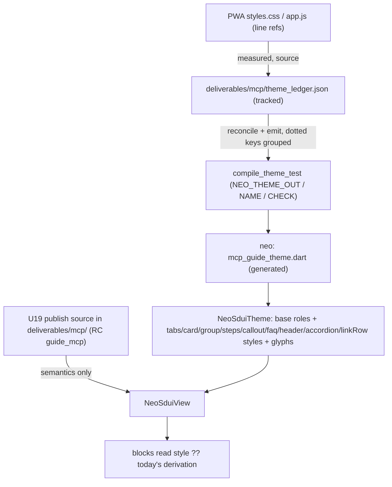
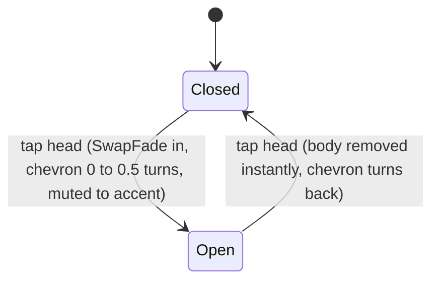
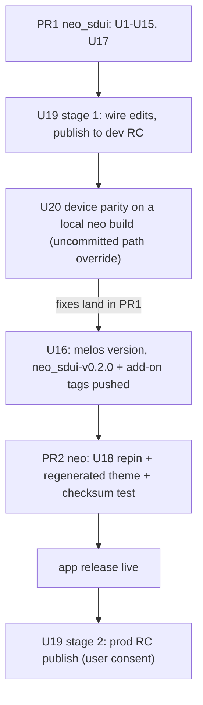

# MCP Guide PWA Restyle and Accordion - Plan

**Target repos:** `neo_sdui` (this repo; paths below are relative to it) and the sibling app `neo` (paths prefixed `neo:`).

---

## Goal Capsule

- **Objective:** A user opening the MCP guide in the neo app sees the same screen the new PWA shows: same tab switcher, cards, steps, callouts, FAQ, spacing and type. Manual setup sits in a collapsible "Advanced" section, and steps can carry a link with a copy button. The app bar and every existing animation stay as they are today.
- **Means:** per-block component styles on `NeoSduiTheme` whose defaults reproduce today's look, fed per value from a tracked role ledger that compiles straight into the app's theme file (KTD1, KTD3, KTD4). Two new widgets: an `accordion` block (KTD7) and a step link row (KTD9).
- **Authority:** the user's constraints (R2-R6) beat this plan. The PWA source (`css/styles.css`, `js/app.js` at PR #2 head `55caf81`) beats the Flutter code on look. `diffs.json` is the row inventory, verified against code during planning. Where it disagrees with code, code wins and the row note says so.
- **Execution profile:** Deep. Two PRs across two repos plus Remote Config. PR1 in `neo_sdui` (U1-U17, U20, then the U16 release) includes the device parity loop, run on a local app build against the dev wire before any tag is cut. PR2 in `neo` (U18) repins and commits the generated theme. The prod RC publish (U19) follows the app release.
- **Stop conditions:** stop and ask if a unit other than U1 would change an existing golden (R6), needs a look value on the wire (R2), or would change a duration, curve, press scale or the app bar (R4, R5). Stop before any RC publish or push to a shared remote until the user says go.
- **Who finishes:** `ce-work` builds PR1 and PR2. The user answers D1-D11, approves the RC publish to prod, and judges taste on the device in U20.

---

## Product Contract

### Summary

Restyle every MCP guide widget to the PWA through the theme. Add per-block style objects with today's values as defaults so no other guide moves. Then port the PWA values into the MCP theme with `measured` provenance and `styles.css` line refs. Add a collapsible accordion block and a step link row with copy. Ship the package, repin the app, republish the wire, and verify on a device.

### Problem Frame

The PWA (`hitesh-neo/neo-mcp-guide` PR #2, live at `guide-v2-updates.neosapien-mcp.pages.dev`) is now the design source for the MCP guide. An audit found 112 verified look differences between it and the neo app. Only 8 are a value change in an existing theme field. The rest land in shared fields that other widgets also read (`body` feeds 8 widgets, `blockSpacing` feeds 5, `cardShadow` feeds 3, `stepCardBorderColor` feeds 5), or in literals inside block code. A shared-field edit moves widgets the PWA did not change, and a literal edit moves how_to too.

The shipped theme also has four copies that disagree. `deliverables/mcp/theme_ledger.json` (the figwire source of record) is gitignored and has drifted from `neo:lib/view/screens/profile/mcp_guide_theme.dart` on `body`, `subtitle`, `calloutBody`, `divider` and `stepCardColor`. `deliverables/mcp/theme.dart` is a third, also drifted. `packages/neo_sdui/example/mcp_theme.dart` is a fourth, older copy that the MCP goldens render under.

The PWA also added two components the app lacks: a collapsible manual-setup section and a direct-link row inside a step card.

### Requirements

**Look parity**

- R1. Every row of `diffs.json` (112) lands in a unit, or is explicitly deferred or decision-blocked (Appendix A).
- R2. The look reaches the app only through `NeoSduiTheme` data. The wire carries no look values, and no widget is specific to one guide.
- R3. Every PWA value enters the ledger as `measured` with a `styles.css:<line>` or `app.js:<line>` source. No `inferred` role ships. Values CSS cannot settle are measured in U20 and recorded with a DOM or screenshot source.
- R4. The app bar is not changed.
- R5. Existing motion is unchanged: durations, curves, press scales, entrance stagger and tab swap.
- R6. The committed goldens in `packages/neo_sdui/test/golden/goldens/` stay byte-identical through PR1. The one exception is U1's re-baseline of `mcp_troubleshooting.png`, which is already stale at HEAD. The port changes the app theme, not the golden fixtures.

**New widgets**

- R7. An accordion block holds any child blocks under a title from the wire. It starts closed. Tapping the head toggles it. When it opens, the chevron turns 180 degrees and takes the accent colour, and the body fades and rises in. Closing is instant. Screen readers hear a button with an expanded or collapsed state.
- R8. A step can carry a link. It renders as a row under the step text: the link label in accent (tap opens the URL externally) and a copy button that copies the URL and gives visible feedback.
- R9. The quick-setup heading renders at the PWA's 20px subheading scale with its sub-line.

**Delivery**

- R10. One source of truth produces the shipped MCP theme, and a check fails when the app file is hand-edited away from it.
- R11. The app depends on pushed `neo_sdui` release refs (all three packages bumped together), never a local path. Release tags are never moved, and `pubspec.lock` records the resolved SHA.

### Scope Boundaries

**Deferred to Follow-Up Work**

- The standalone `code` block restyle (rows 78-80 and 82-85; row 81, the mono family, stays with D5). The live wire has no `code` block, since commands ride step captions as runs.
- Pressed-state tints (tab label 75% white, accordion and list-row 2% fill, link `:active` opacity). These are interaction colour states. `PressScale` already gives press feedback (R5).
- Wire structure changes the PWA made: a second use-case card (row 44) and troubleshooting as FAQ cards (row 94).
- Carded steps without an image (row 52), `<ul>` lists inside captions (row 62) and the warning callout arm (row 77). None occurs in the live wire.

**Considered and not built**

- `copyWith` on the component style classes. The MCP ledger has one page and no per-page overrides. The compile flags a component-key override as unsupported. Add `copyWith` when a second page diverges.
- A per-surface hairline rename (`stepCardBorderColor` to `hairline`) and a `blockSpacing` rename. See KTD2.
- An SVG path-data parser in the core. The app already ships `flutter_svg`, and theme builders already carry app code (KTD5). Revisit if a second app without `flutter_svg` adopts the package.
- A new `bold` run flag on the wire. The existing `tone:"strong"` role carries the same meaning (U12).
- A parity harness that renders and diffs screens. The look is asserted as data, and taste is judged on a device (`docs/solutions/architecture-patterns/sdui-look-is-client-owned.md`).

### Open Questions

These are the user's calls. Units are built so a pending answer blocks only a value, not the code. D1-D10 come from the handoff and planning. D11 came out of review.

| ID | Question | Recommendation | Unblocked by |
|---|---|---|---|
| D1 | Card shadows. The app ships a dark drop shadow on purpose; its comment says the PWA's white glow was invisible on a device. The PWA has no shadow on picker and list cards and a faint glow (`0 0 10px rgba(255,255,255,.04)`, `styles.css:385`) on step cards. | Take the PWA values, then judge on the device in U20. Each surface gets its own field (`card.shadow`, `card.listShadow`, `steps.cardShadow`), so a revert is one ledger line. | Fields land in U6/U7 with today's shadow as the value. |
| D2 | Step label. The app prints "Step 0:" (0-based, colon) to match Figma's cover-as-step-0. The PWA prints "Step 1" (1-based, no colon); its data has no step 0. | PWA. | U7 adds `steps.labelNumberOffset` (default -1) and `steps.labelSuffix` (default `:`). |
| D3 | Bare domains in step text. The app auto-links every URL and domain (accent, underline, tappable). The PWA shows domains as bold white text, with no link. | PWA. The new link row (R8) carries the tappable URL. | U7 adds `steps.autoLinkUrls` (default true). Whatever the answer, a `false` value ships only once the wire carries a `link` on every step whose caption auto-links today, including the existing download steps (`chatgpt.com/download`, `claude.ai/download`). The theme ships in the binary and the links ship by RC, so the order matters. |
| D4 | Hero command card. It exists only in the app (from Figma). The PWA shows the command as bold text in the step. Dropping it removes the guide's only copy button for the `claude mcp add ...` command (Claude Code tab), and the link row cannot replace it because only http/https URLs are copyable (KTD9). | Drop it for 1:1. This is wire-only and reversible: remove `emphasis:"high"` and write the command as a strong run (U12). | Nothing; U19 applies the answer. |
| D5 | Monospace font. The PWA uses `ui-monospace`, which Flutter can't name. | Platform mono with no bundled font: `fontFamilyFallback: ['Menlo', 'monospace']` with no family. This only affects inline command runs, since there is no code block on the wire. | U17 value. |
| D6 | Tab strip blur. PWA blurs 12px under a 90%-opaque track, which is close to invisible. | Skip, and record as an accepted delta. | Nothing. |
| D7 | Callout bullets. PWA warning callouts use browser-default `<ul>` styling (disc, 40px indent) that the CSS does not define. | Keep the 3px dots until U20 measures the disc. Then add bullet fields if the delta is visible. | U20. |
| D8 | Accordion wire home and copy feedback. | A new core block type `accordion` with `title` and `children` (KTD7). Inline feedback for copy: the icon swaps to a check for 2s, matching the hero card's "Copied" (KTD9). | U15 builds the widget either way. Only registration and validation wait. |
| D9 | Section-title emboss. On 2026-07-17 the user overrode Figma and asked for a dark-to-white emboss twice. The PWA title is flat white (`styles.css:152`). | Ask. Matching the PWA reverses an explicit earlier user call. | U17 value (`titleGradient: null`). |
| D10 | Wire adoption of accordion, quick setup and links. In the PWA, the accordion only wraps manual steps under a "Quick setup" flow, and the links sit on quick-setup steps. Both are PR #2 content (new steps and screenshots), which the user scoped out as content. | Adopt the PWA tab structure for ChatGPT and Claude. Quick-setup steps and links are copied verbatim from PR #2, and assets go through the CDN gate. Without this, the two new widgets have no live use. | U19 waits on the answer; PR1 and PR2 do not. |
| D11 | Where the theme drift check runs automatically. Neither repo has CI that runs tests (`neo_sdui` has no workflows, and neo's test workflow is `main.yml.disabled`). So the checksum test U18 adds to neo runs only when someone runs `flutter test` there. | Add that test to a neo PR workflow or pre-commit hook. Without one, R10 holds only as an authoring-time gate. | U2/U18 build the check either way. |

---

## Planning Contract

### Key Technical Decisions

- KTD1. **Adopt per-block component styles, with four changes.** The handoff's shape is right for this code. Today any PWA difference must land in a shared field or a block literal. Adding about 70 flat fields would push `NeoSduiTheme` past 120 constructor params, while one small style object per block (the Flutter `ThemeData` plus `TabBarTheme` pattern) keeps each block's knobs together. Each style field is nullable or has a const default equal to today's literal or derivation (for example `tabs.trackColor` null falls back to `tabTrack`). So how_to and every golden stay identical (R6). The four changes follow as KTD2-KTD4 and the YAGNI rule: style fields exist only for a `diffs.json` row, not for every literal in a block. "Base palette and type" needs no restructure, because `NeoSduiTheme` already is that base. It gains six roles that belong to the theme's text and layout scale rather than to one block's knobs: `rowTitle` (14/500/-0.04em: picker, list rows, use-case titles), `panelTitle` (14/500/-0.02em: callout, FAQ, accordion), `paragraph`, `footnote`, `subheading`, and `sectionSpacing`.
- KTD2. **Additive fallbacks, not renames.** Renaming `blockSpacing` or `stepCardBorderColor` touches the app, ledger, example themes, `kRoleSlots` and `wire-contract.md` without changing a pixel. Instead `sectionSpacing` is nullable and falls back to `blockSpacing` (the view level). `blockSpacing` keeps meaning the inner gap. Per-surface borders and shadows live on component styles and fall back to the shared field.
- KTD3. **One ledger key per style field, grouped at emit.** A whole-object `ValueKind.other` literal (`tabs: NeoTabsStyle(...)`) would put ~15 measured values under one provenance and one source. Instead the ledger records `tabs.trackColor` and similar keys, each with its own kind, provenance and `source`. The compile groups them into `tabs: NeoTabsStyle(...)`, extending the existing `accents.`/`icons.` prefix handling in `theme_compile.dart`. `Observation` gains an optional `source` string pinned to the PWA commit (`neo-mcp-guide@55caf81:css/styles.css:353`), because PR #2 is unmerged and its line numbers will move. `theme_values_test` requires it on every observation (R3).
- KTD4. **The tracked ledger compiles straight into the app file.** `.gitignore` excludes all of `deliverables/`, so the source of record is machine-local today. Un-ignore `deliverables/*/theme_ledger.json` (it holds no secrets or assets). Point `NEO_THEME_OUT` at `neo:lib/view/screens/profile/mcp_guide_theme.dart`. Add `NEO_THEME_NAME` so the emitted variable is `mcpGuideTheme` rather than `base`. Add `NEO_THEME_CHECK=<path>`, which fails when the file differs from a fresh emit. The emit also writes a 64-bit FNV-1a checksum of its body into the header (a few lines, no dependency), so a neo test can catch a hand edit without the ledger or a side-by-side checkout. The app-only `grainOverlay` closure and its import ride the ledger (`imports` gets the `package:neo/...` URI), so nothing is hand-patched after a compile. `deliverables/mcp/theme.dart` stops being produced. The analyze gate moves to the app, which can resolve `google_fonts` and `package:neo`.
- KTD5. **Glyphs are theme-supplied builders, rendered by the app's existing `flutter_svg`.** The PWA icons are SVG strings in `app.js:11-30,193`, and `theme.icons` holds `IconData` only. Add `NeoGlyphBuilder` (a typedef taking size and colour, returning a widget) and a theme map `glyphs` from wire icon name to builder, checked before `icons`. Block affordance glyphs (FAQ plus, list chevron, accordion chevron, copy, check) are builder-typed style fields. The MCP ledger supplies each as an `SvgPicture.string` builder over the verbatim `app.js` SVG. The neo app already depends on `flutter_svg` ^2.0.16, and app-side builders already ride the ledger (`grainOverlay`, KTD4). The core gains no parser and no dependency, and stays `flutter` + `meta`. The two new widgets need defaults when a theme sets nothing, so the package hand-draws three in the `kDrawnIcons` painter style: chevron down, copy and check.
- KTD6. **The CSS angle is a `GradientTransform`.** `Alignment` pairs are box-relative, so 168deg comes out about 115deg on a 358x76 card. A small exported `NeoCssAngle(deg)` transform receives the paint bounds and builds the CSS gradient line (angle plus length `|w·sinθ| + |h·cosθ|`). The ledger literal stays a `LinearGradient` with `begin`/`end`, so `theme_values_test`'s handle check still holds.
- KTD7. **Accordion: a new core block type (recommended, pending D8).** It carries data (a title) and behaviour (open state), which meets the promotion rule in `layout.dart`'s spacer doc and `CONCEPTS.md` "Block vocabulary". A `group` with `collapsed: true` is the wrong home. `buildGroup` already has three render modes and pushes `HeadingScale(compact)` and `CardListed` onto its descendants, so steps or headers inside would shrink or turn into list rows. A flag that selects a different widget is also the anti-pattern in `docs/solutions/architecture-patterns/vary-block-by-render-context-not-wire-flags.md`. Wire shape: `{"type":"accordion","title":<string-or-runs>,"children":[blocks]}`. `children` matches `row`/`column`/`group` and rides the existing `_layoutTypes` recursion. An old app treats the type as unknown and renders the block's `fallback`, so the wire ships a `column` of the same children (always open). The builder takes `(title, children)` and does not care which home D8 picks.
- KTD8. **Accordion motion reuses existing idioms.** The body sits under `SwapFade`, keyed on open state. Opening plays the existing fade plus 12px rise over `swapDuration` on `entranceCurve`, which is the PWA's `fadeRise .34s var(--ease-out)`. `reverseDuration: zero` makes closing instant, as in the PWA (`display:none`). The chevron reuses the FAQ caret's `AnimatedRotation` plus `ColorTween` over `swapDuration`/`motionCurve` (easeOutCubic, the PWA `--ease-soft`). It is extracted from `faq.dart` into `_motion.dart` as a shared widget with identical output. Press feedback is `PressScale(scale: 0.994)`, the FAQ-row depth. `reduceMotion` collapses all three.
- KTD9. **Step link row: `link: {url, label?}` on a steps item,** the same shape as the PWA data (`claude.json:178`). Tapping the label dispatches `ExternalUrl`, which the app already opens through `url_launcher` (`neo:lib/view/screens/profile/mcp_guide_screen.dart` `_launchExternal`). Only `http`/`https` URLs are tappable or copyable. Any other scheme renders the label as plain text, because this is a trust boundary. Copy uses `Clipboard.setData` plus `HapticFeedback.selectionClick`, as `_CommandCardState._copy` does. Feedback is inline (D8): the copy glyph swaps to a check in accent for 2s, with a bounded timer cancelled on dispose. A toast would need a new `NeoAction` and app handling.
- KTD10. **The quick-setup heading comes from render context, not a wire flag.** A `header` inside a tab panel renders on a new `subheading` role (null falls back to `title`, so nothing moves). This extends `HeadingScale`, which already shrinks headers inside a `group`. No live wire header sits inside a tab today, and how_to has no tabs.
- KTD11. **Rollout order: package, then app, then wire.** The new wire uses `accordion`, `link` and more `strong` runs. Old apps degrade safely: the accordion falls back to a column, `link` is ignored, a strong run renders white at the caption weight, and a tab header renders at section scale. Even so, the RC publish waits until the app release is live (U19).

### High-Level Technical Design

How a PWA value reaches the screen after this work:

Accordion state:

Delivery sequence:

### Assumptions

- The PWA checkout at the machine-local path in Sources stays readable through U17. If it is gone, re-clone it as described in the handoff.
- Pipeline run: no scoping confirmation was possible, so these are bets. Quick-setup heading is in scope as part of the accordion screen. The code-block restyle is out. Content flows from PR #2 enter only through D10.
- The neo app has golden infrastructure but no MCP guide goldens, so the generated app theme is verified as data plus device (Verification Contract).

### Risks and Dependencies

| Risk | Mitigation |
|---|---|
| A style default differs from today's literal by one derivation step, and a golden moves. | Every block unit runs the golden suite without `--update-goldens`. A moved golden is a bug in the default, not a regeneration. |
| Carded steps, picker cards and list rows have no golden coverage: `example/mcp_theme.dart` sets no `stepCardColor`. | U6/U7 add widget tests that pump those paths under both default and overridden styles. |
| Ledger port adds a second observation for a role, and reconcile produces a per-page override or conflict. | U17 edits observations in place, one per roleKey on page `base`. The compile's coverage report must show zero conflicts and zero overrides. |
| A glyph builder in the ledger has a typo and draws nothing. | U17's analyze gate type-checks the builders. U20 checks every glyph on the device. |
| The app repin trips pub's git-ref clash between core and add-ons. The add-ons now declare core as `ref: neo_sdui-v0.1.0`, and pub keys git sources by the literal ref string. | `melos version` (with `updateGitTagRefs`) rewrites the add-ons' core ref to `neo_sdui-v0.2.0`. The app pins core by that same tag string and the add-ons by their release SHA (U18). The SHA-for-all-three convention in `neo:pubspec.yaml` predates the tag refs and no longer resolves. |
| `melos version` skips an add-on with no versionable commits, as it did for `0ee09f1`, and its tag is missing. | U16 checks that both add-on tags exist and that their core ref reads `neo_sdui-v0.2.0`. If not, it bumps and tags them by hand, as `0ee09f1` did. |
| An emit bug or a style field that cannot hold a PWA value surfaces only after the tags are pushed, forcing a 0.2.1 release. | U17 analyzes the emitted theme in a neo working copy against the local package before U16 cuts any tag. |
| A decision answered after the app release costs a store release. | The neo repo has a Shorebird patch workflow (`shorebird-patch.yml`), which can ship a theme-value change as a patch. |
| Publishing the wire to prod before the app is live. | KTD11: fallbacks degrade safely, and U19 is gated on release plus explicit consent. Publish only through `tool/publish_guide.py`. |

### Sources and Research

- Evidence (machine-local, may vanish): `/tmp/compound-engineering-501/ce-handoff/neo_sdui-9c79216d6bea/mcp-pwa-restyle-evidence/` (`diffs.json`, `VERIFIED.md`). PWA checkout: `/private/tmp/claude-501/-Users-vaibhavp-code-neosapien-neo-sdui/ec75237b-b259-42b7-853e-a0cb89b9b6e4/scratchpad/pwa/src` (branch `pr2`).
- Verified during planning:
  - `fvm flutter test test/golden` is red at HEAD. `mcp_troubleshooting` differs by 7px at the callout sparkle, because commit `4d40cd8` shrank the glyph without regenerating the golden (U1).
  - `deliverables/` is gitignored (`.gitignore:40`).
  - The app already pins git SHAs (`neo:pubspec.yaml`, `4d40cd8` for all three packages), not a local path. Memory note `sdui-impl-app-integration` is stale on this.
  - The MCP goldens render under `example/mcp_theme.dart`, not the shipped theme.
  - Flutter 3.41.4 `Semantics` supports `expanded`.
- Patterns: `theme_compile.dart` prefix grouping for `accents.`/`icons.`. `role_slots_complete_test.dart` ctor parsing. `baked_type_test.dart` (no `fontSize`/`letterSpacing` `copyWith` over a theme role in blocks). `_CommandCardState` copy flow. `faq.dart` caret. `SwapFade` and `PressScale` in `_motion.dart`.
- Learnings: `docs/solutions/architecture-patterns/sdui-look-is-client-owned.md`, `motion-is-look-client-owned-tokens-package-idiom.md`, `vary-block-by-render-context-not-wire-flags.md`, `docs/solutions/design-patterns/figma-parity-correction-resolves-to-theme-not-new-wire.md`.
- External research: none. The patterns are local and strong, and the one framework fact (`Semantics.expanded`) was checked in the SDK source.

---

## Implementation Units

| U | Title | Key files | Depends on |
|---|---|---|---|
| U1 | Re-baseline stale troubleshooting golden | `test/golden/goldens/mcp_troubleshooting.png` | none |
| U2 | Tracked ledger compiles into the app file | `.gitignore`, `authoring/theme_ledger.dart`, `authoring/theme_compile.dart`, `test/tools/compile_theme_test.dart` | U1 |
| U3 | Glyphs as theme data | `blocks/_icon.dart`, `theme/neo_sdui_theme.dart`, `authoring/theme_compile.dart` | U2 |
| U4 | Component style scaffold | new `theme/neo_sdui_styles.dart`, `theme/neo_sdui_theme.dart`, `authoring/theme_compile.dart` | U3 |
| U5 | Tabs read `NeoTabsStyle` | `blocks/tabs.dart`, `blocks/_neumorphic.dart` | U4 |
| U6 | Picker, list rows, group read styles | `blocks/card.dart`, `blocks/layout.dart` | U4 |
| U7 | Steps read `NeoStepsStyle` | `blocks/steps.dart`, `blocks/_media_frame.dart` | U4 |
| U8 | Header, text, view rhythm, backdrop | `blocks/header.dart`, `blocks/text.dart`, `render/neo_sdui_view.dart` | U4 |
| U9 | Callout reads `NeoCalloutStyle` | `blocks/callout.dart` | U4 |
| U10 | FAQ reads `NeoFaqStyle`; shared caret | `blocks/faq.dart`, `blocks/_motion.dart` | U4 |
| U11 | CSS-angle gradient transform | new `theme/neo_css_angle.dart` | none |
| U12 | Strong runs carry `<b>` weight | `blocks/_gradient_text.dart` | none |
| U13 | Step link row | `blocks/steps.dart`, `model/validate_vocabulary.dart` | U3, U7 |
| U14 | Subheading inside tabs | `blocks/header.dart`, `blocks/tabs.dart` | U8 |
| U15 | Accordion block | new `blocks/accordion.dart`, `default_registry.dart`, `validate_vocabulary.dart` | U3, U4, U10 |
| U16 | Release notes, doc sweep, release cut | `CHANGELOG.md`, `.claude/skills/figwire/**` | U2-U15, U17, U20 |
| U17 | Port PWA values into the ledger | `deliverables/mcp/theme_ledger.json` | U2-U15 |
| U18 | App repin and regenerated theme | `neo:pubspec.yaml`, `neo:lib/view/screens/profile/mcp_guide_theme.dart` | U16 tags |
| U19 | Wire update: dev publish, then prod | one named wire file in `deliverables/mcp/` | U15, U17; prod stage: U18 live, D10 |
| U20 | Device parity before release | ledger, delta list | U17, U19 stage 1 |

Block paths are under `packages/neo_sdui/lib/src/`, tests under `packages/neo_sdui/test/`.

### PR1: neo_sdui package, tooling and ledger

Waits on: nothing.

### U1. Re-baseline the stale troubleshooting golden

- **Goal:** Make the golden suite green at HEAD so "goldens identical" (R6) has a true baseline.
- **Requirements:** R6.
- **Dependencies:** none.
- **Files:** `packages/neo_sdui/test/golden/goldens/mcp_troubleshooting.png`.
- **Approach:** Confirm the isolated diff covers only the callout sparkle (the 7px change from `4d40cd8`). Then regenerate this one golden alone and state why in the commit.
- **Test scenarios:** Test expectation: none -- fixture refresh. The golden suite itself is the proof.
- **Verification:** `fvm flutter test test/golden/` passes with no flag.

### U2. Tracked ledger compiles straight into the app file

- **Goal:** One source of truth for the shipped MCP theme, with per-value line refs (R10, R3).
- **Requirements:** R3, R10. KTD3, KTD4.
- **Dependencies:** U1.
- **Files:**
  - `.gitignore` (un-ignore `deliverables/*/theme_ledger.json`)
  - `deliverables/mcp/theme_ledger.json`
  - `packages/neo_sdui/lib/src/authoring/theme_ledger.dart`
  - `packages/neo_sdui/lib/src/authoring/theme_compile.dart`
  - `packages/neo_sdui/test/tools/compile_theme_test.dart`
  - `packages/neo_sdui/test/authoring/theme_ledger_test.dart`
  - `packages/neo_sdui/test/authoring/theme_compile_test.dart`
  - `packages/neo_sdui/test/authoring/theme_values_test.dart`
  - read-only: `neo:lib/view/screens/profile/mcp_guide_theme.dart` (compared, not written; U18 owns that file)
- **Approach:**
  1. Add optional `source` to `Observation`: JSON round-trip, guarded in `RoleLedger.fromJson`, printed in `coverageReport`.
  2. Reconcile the ledger to the shipped app values (`body`, `subtitle`, `calloutBody`, `divider`, `stepCardColor` and any other drifted role), so the first emit equals what ships today. Add `grainOverlay` with its `package:neo/...` import.
  3. Backfill `source` on every observation: the Figma node for figma-read roles, `shipped:neo@09988643d mcp_guide_theme.dart` for device-tuned ones.
  4. `emitTheme` takes a variable name (default `base`), writes the `ignore_for_file` header the app file carries, and writes the body checksum (KTD4).
  5. In `compile_theme_test`, read `NEO_THEME_NAME`, and add `NEO_THEME_CHECK`, which fails with a diff summary when the file differs from the emit.
- **Patterns to follow:** existing env-var shape in `compile_theme_test.dart`, guarded field reads in `RoleLedger.fromJson`.
- **Test scenarios:**
  - `Observation` with `source` round-trips through JSON. Without `source` it still parses.
  - A malformed `source` (non-string) counts as a malformed observation, not a crash.
  - `emitTheme` with a name emits `final mcpGuideTheme = NeoSduiTheme.fallback().copyWith(`.
  - The check mode passes on an identical file and fails on a one-character edit.
  - The emitted checksum changes when any body line changes and ignores the header itself.
  - `theme_values_test` fails when any observation lacks `source`, and the fixture carries sources.
- **Verification:** emitted to a scratch path, the theme's argument lines equal the current neo file's argument lines, sorted, with only comments lost.

### U3. Glyphs as theme data

- **Goal:** PWA SVG icons render from theme-supplied builders, not Material glyphs (rows 30, 42, 75).
- **Requirements:** R2, R3. KTD5.
- **Dependencies:** U2.
- **Files:**
  - `packages/neo_sdui/lib/src/blocks/_icon.dart`
  - `packages/neo_sdui/lib/src/theme/neo_sdui_theme.dart`
  - `packages/neo_sdui/lib/neo_sdui.dart`
  - `packages/neo_sdui/lib/src/authoring/theme_ledger.dart`, `theme_compile.dart`, `role_lint.dart`
  - `packages/neo_sdui/test/blocks/leaf_blocks_test.dart`
  - `packages/neo_sdui/test/authoring/role_lint_test.dart`, `packages/neo_sdui/test/authoring/theme_compile_test.dart`
- **Approach:**
  1. Export the `NeoGlyphBuilder` typedef (size and colour in, widget out).
  2. Add `glyphs: Map<String, NeoGlyphBuilder>` to the theme (default `{}`). `leadingIcon` resolves glyphs, then `icons`, then `kDrawnIcons`.
  3. Add a `glyphs.` ledger prefix: each value is a verbatim builder literal (`ValueKind.other`), emitted as a map like `icons.`, registered in `kRoleSlotsIntentionallyAbsent` with its reason, and counted as resolvable by `role_lint`.
  4. Hand-draw three package defaults in the `NeoSparkleIcon` painter style: chevron down (accordion), copy and check (link row). FAQ and list carets keep their `›` text when no glyph is set.
- **Patterns to follow:** `grainOverlay` (an app builder carried through the ledger with its import), `NeoSparkleIcon`/`_SparklePainter`.
- **Test scenarios:**
  - A theme `glyphs.help` builder wins over `kDefaultIcons['help']` and receives the requested size and tone colour.
  - With no entry, `help` still renders the Material icon (no golden moves).
  - Each of the three default glyphs paints inside its square and takes the given colour.
  - A ledger `glyphs.help` observation emits inside a `glyphs: {...}` map.
  - `role_lint` treats a wire icon resolved only through `glyphs.<name>` as resolved.
- **Verification:** goldens unchanged, and the new tests green.

### U4. Component style scaffold

- **Goal:** Per-block style objects and the new shared roles exist, read by nothing yet, and compile from dotted ledger keys.
- **Requirements:** R2, R3, R6. KTD1, KTD2, KTD3.
- **Dependencies:** U3 (style classes hold glyph-builder fields).
- **Files:**
  - new `packages/neo_sdui/lib/src/theme/neo_sdui_styles.dart`
  - `packages/neo_sdui/lib/src/theme/neo_sdui_theme.dart`
  - `packages/neo_sdui/lib/neo_sdui.dart`
  - `packages/neo_sdui/lib/src/authoring/theme_compile.dart`
  - `packages/neo_sdui/test/authoring/role_slots_complete_test.dart`
  - `packages/neo_sdui/test/authoring/theme_compile_test.dart`
- **Approach:**
  1. In one file, add `NeoTabsStyle`, `NeoCardStyle`, `NeoGroupStyle`, `NeoStepsStyle`, `NeoCalloutStyle`, `NeoFaqStyle`, `NeoHeaderStyle`, `NeoAccordionStyle` and `NeoLinkRowStyle`. Each has a const constructor whose defaults are today's literals, and nullable fields where today's value derives from the palette. Fields are exactly those Appendix A assigns, plus the new-widget fields in U13/U15.
  2. Add theme params, each with a const default: the nine groups, plus `sectionSpacing`, `viewPadding`, `rowTitle`, `panelTitle`, `paragraph`, `footnote`, `subheading` and `backgroundOverlay`. Nullable roles get resolved getters with today's fallback, as `resolvedCalloutBody` does.
  3. In the compile, a `kStyleGroups` map (prefix to class name) groups `tabs.*` slots into one constructor call. `kRoleSlots` gains one entry per style field with its kind. The group params go in `kRoleSlotsIntentionallyAbsent`. A dotted key in a page override emits an `unsupported` TODO.
  4. `role_slots_complete_test` also parses each style class constructor and requires `<group>.<param>` slots both ways.
- **Patterns to follow:** `calloutBody`/`resolvedCalloutBody`, accents/icons grouping in `_emitRoles`.
- **Test scenarios:**
  - A ledger with `tabs.trackColor` and `tabs.gap` emits one `tabs: NeoTabsStyle(trackColor: Color(...), gap: 4)`.
  - A style field with no slot fails `role_slots_complete_test`. So does a slot with no field.
  - A kind-mismatched dotted value is skipped and flagged, like scalars.
  - `NeoSduiTheme.fallback()` style getters return today's values.
- **Verification:** goldens unchanged, the authoring suite green, analyzer clean.

### U5. Tabs read `NeoTabsStyle`

- **Goal:** The tab switcher can take the PWA's flat segmented look through the theme (rows 1-6, 8-17, 19, 20).
- **Requirements:** R1, R2, R5, R6.
- **Dependencies:** U4.
- **Files:** `packages/neo_sdui/lib/src/blocks/tabs.dart`, `packages/neo_sdui/lib/src/blocks/_neumorphic.dart`, `packages/neo_sdui/test/blocks/structured_blocks_test.dart`, `packages/neo_sdui/test/blocks/tabs_sticky_test.dart`.
- **Approach:**
  1. `_strip` and `_label` read `theme.tabs`.
  2. `neumorphic: false` drops both inset lists and the unselected divider. `neumorphic()` gains an outer `shadows` parameter for `pillShadow`.
  3. The pinned extent formula (68) stays. The PWA strip (51.6 + 2x8) fits it, per VERIFIED claim 10.
  4. `SwapFade`, the strip's tap handling and the pinned delegate are untouched (R5).
- **Test scenarios:**
  - Default style: the strip paints `InsetShadowPainter` with two track insets and the divider between unselected neighbours (characterises today).
  - `neumorphic: false` with `trackBorder` set: no inset painter, a `Border` on the track, no divider widget.
  - `unselectedColor`/`labelStyle` apply to unselected labels. The selected label stays accent w500.
  - `labelMaxLines: 1` ellipsises a long label.
  - `contentGap` sets the gap under both the box and pinned forms.
- **Verification:** goldens unchanged, and the tab-swap motion test (`motion_test.dart`) unchanged and green.

### U6. Picker cards, list rows and plain groups read styles

- **Goal:** Rows 25-39 and 45 have theme homes.
- **Requirements:** R1, R2, R6. KTD1.
- **Dependencies:** U4.
- **Files:** `packages/neo_sdui/lib/src/blocks/card.dart`, `packages/neo_sdui/lib/src/blocks/layout.dart`, `packages/neo_sdui/test/blocks/structured_blocks_test.dart`, `packages/neo_sdui/test/blocks/layout_blocks_test.dart`.
- **Approach:**
  1. In the picker path, read `card.thumbRadius ?? radiusMd`, `card.titleGap`, `card.actionGap` and `card.shadow ?? cardShadow`, with the title on `resolvedRowTitle`.
  2. In `_listedCard`, read `listIconColor`, `listIconGap`, `listCaret` (null keeps the `›` text) and `listCaretGap`. `buildGroup`'s list branch reads `card.listShadow ?? cardShadow` and inserts a `listSeparator` hairline between rows when set.
  3. The plain group reads `group.border`, `group.rowInset ?? spaceMd`, `group.padding ?? spaceMd` and `group.gap ?? blockSpacing`.
- **Test scenarios:**
  - Picker card under default style keeps squircle, `radiusMd` thumb and 8/8 gaps (characterisation).
  - Picker card with `card.shadow: []` paints no shadow while a step card still uses `cardShadow`.
  - A list group with `listSeparator` shows N-1 separators for N rows, none above the first.
  - A list row with `listCaret` set paints the glyph, not `›`.
  - A plain group with `group.border` draws a 1px side, and `group.gap: 16` places rule spacers 16 from each neighbour.
- **Verification:** goldens unchanged, and the new picker and list widget tests green.

### U7. Steps read `NeoStepsStyle`, with decision-ready fields

- **Goal:** Rows 46-59 have theme homes. D1-D3 become values, not code.
- **Requirements:** R1, R2, R6.
- **Dependencies:** U4.
- **Files:** `packages/neo_sdui/lib/src/blocks/steps.dart`, `packages/neo_sdui/lib/src/blocks/_media_frame.dart`, `packages/neo_sdui/test/blocks/structured_blocks_test.dart`.
- **Approach:**
  1. Row strip: `chipGap`, `chipBorder ?? stepCardBorderColor`, `badgeStyle` (null keeps the `// geometry:` caption 11) and `chipLabelStyle ?? body`.
  2. Carded item: `cardGap` (replaces the literal 12), `cardShadow ?? cardShadow`, `labelStyle`, `labelGap`, `instructionStyle` (null keeps body w500 white) and `imageBackdrop` (passed to `neoNetworkImage` as an optional fill).
  3. `labelNumberOffset` (default -1) and `labelSuffix` (default `:`) build the label text. `autoLinkUrls` (default true) gates `_urlRe` in `_LinkedText`.
  4. Text styles come whole from the theme, never `copyWith(fontSize:)` over a role (`baked_type_test`).
- **Test scenarios:**
  - A carded step under default style reads "Step 0:" for the first item, with 12 between cards (characterisation).
  - `labelNumberOffset: 0, labelSuffix: ''` gives "Step 1".
  - `autoLinkUrls: false` renders `claude.ai` with no `TapGestureRecognizer` and no underline.
  - `steps.cardShadow` overrides only the step card.
  - `imageBackdrop` paints behind a transparent image while the shimmer still shows during load.
  - The R8 isolation test still passes with styles set.
- **Verification:** goldens unchanged, `baked_type_test` green.

### U8. Header, text, view rhythm and backdrop

- **Goal:** Rows 40, 41, 97-99 and 102-106 have theme homes.
- **Requirements:** R1, R2, R4, R6. KTD2.
- **Dependencies:** U4.
- **Files:**
  - `packages/neo_sdui/lib/src/blocks/header.dart`
  - `packages/neo_sdui/lib/src/blocks/text.dart`
  - `packages/neo_sdui/lib/src/render/neo_sdui_view.dart`
  - `packages/neo_sdui/test/blocks/leaf_blocks_test.dart`
  - `packages/neo_sdui/test/render/neo_sdui_view_test.dart`
- **Approach:**
  1. Compact header uses `resolvedRowTitle`, `header.compactIconSize ?? base.fontSize` and `header.compactIconGap ?? spaceSm`. Subtitle gap is `header.subtitleGap` (default 4).
  2. Text uses `paragraph` for normal emphasis and `footnote` for `variant:"footnote"`, each null falling back to today.
  3. The view list and tabbed scroll use `viewPadding ?? vertical blockSpacing` for top and bottom, and `resolvedSectionSpacing` between top-level blocks. `tabs.dart`'s in-panel gap stays `blockSpacing`.
  4. `_backdrop` paints `backgroundOverlay` above `backgroundGradient` when set.
  5. App bar code lives in the host and is not touched (R4).
- **Test scenarios:**
  - Default theme: list padding and separators equal `blockSpacing` (characterisation).
  - `sectionSpacing: 36, blockSpacing: 20`: top-level separators 36 while in-tab gaps stay 20.
  - `viewPadding` top 4, bottom 48 applies in both scroll paths.
  - `backgroundOverlay` set: two decorated layers paint. Unset: today's single layer.
  - Footnote with `footnote` role set uses it, unset keeps caption muted.
- **Verification:** goldens unchanged.

### U9. Callout reads `NeoCalloutStyle`

- **Goal:** Rows 66-71 and 73 have theme homes.
- **Requirements:** R1, R2, R6.
- **Dependencies:** U4.
- **Files:** `packages/neo_sdui/lib/src/blocks/callout.dart`, `packages/neo_sdui/test/blocks/structured_blocks_test.dart`.
- **Approach:**
  1. `callout.fill` (non-null replaces surface plus gradient), `toneSurfaces` (map from tone to fill and border, empty by default so only `critical` tints as today), `border`, `radius ?? radiusLg`, `padding ?? cardPadding` and `emphasizeFirstBullet` (default true).
  2. The title is on `resolvedPanelTitle`.
- **Test scenarios:**
  - An accent callout under default style paints no tint (characterisation, `callout.dart:10-12`).
  - With `toneSurfaces['accent']` set, it fills `0x0D00F1A0` and draws a `0x3300F1A0` border.
  - `emphasizeFirstBullet: false` renders all bullets at 70% white.
- **Verification:** goldens unchanged.

### U10. FAQ reads `NeoFaqStyle`, with a shared caret

- **Goal:** Rows 86-93 have theme homes, and the caret becomes reusable for the accordion.
- **Requirements:** R1, R2, R5, R6. KTD8.
- **Dependencies:** U4.
- **Files:** `packages/neo_sdui/lib/src/blocks/faq.dart`, `packages/neo_sdui/lib/src/blocks/_motion.dart`, `packages/neo_sdui/test/blocks/structured_blocks_test.dart`, `packages/neo_sdui/test/blocks/motion_test.dart`.
- **Approach:**
  1. Extract `_caret` into `_motion.dart` as a turning-caret widget (child glyph or text, `turns`, closed and open colours, same duration and curve), with identical output.
  2. Add `itemDecoration` (null keeps flat rows plus divider, set renders separate cards with `itemGap`), `questionPadding`, `caretGlyph` (null keeps `›`), `openTurns` (default 0.25), `caretColor ?? textPrimary`, `answerStyle ?? body` and `answerPadding`. The question uses `resolvedPanelTitle`.
  3. `AnimatedSize` and the answer fade are unchanged (R5).
- **Test scenarios:**
  - Default FAQ: `›` rotates to 0.25 turns on open and tints accent (characterisation of today).
  - `caretGlyph` plus with `openTurns: 0.125` rotates to 45 degrees.
  - `itemDecoration` set: each item is its own decorated box with `itemGap` between them and no divider.
  - `reduceMotion`: the caret and answer settle with zero duration.
- **Verification:** goldens unchanged (`mcp_faq.png` covers the extracted caret).

### U11. CSS-angle gradient transform

- **Goal:** A CSS `linear-gradient(<deg>)` renders at its true angle on any box (rows 21, 108).
- **Requirements:** R2, R3. KTD6.
- **Dependencies:** none.
- **Files:** new `packages/neo_sdui/lib/src/theme/neo_css_angle.dart`, `packages/neo_sdui/lib/neo_sdui.dart`, new `packages/neo_sdui/test/theme/neo_css_angle_test.dart`.
- **Approach:** A `GradientTransform` that, given bounds, rotates and scales the `topCenter` to `bottomCenter` axis onto the CSS gradient line for that angle.
- **Test scenarios:**
  - On a square, 180deg equals plain top-to-bottom.
  - On 358x76, 168deg start and end points match the CSS formula within 0.5px.
  - 90deg maps to left-to-right on any box.
- **Verification:** new tests green, `theme_values_test` handle check still satisfied by a literal using it.

### U12. Strong text runs carry the PWA's `<b>` weight

- **Goal:** The PWA's bold UI labels, domains and commands (`<b>`: white, weight 500) render through an existing wire role, with no new wire field (row 60, and D4 if dropped).
- **Requirements:** R2.
- **Dependencies:** none.
- **Files:** `packages/neo_sdui/lib/src/blocks/_gradient_text.dart`, `packages/neo_sdui/test/blocks/gradient_text_test.dart`, `.claude/skills/figwire/references/wire-contract.md`.
- **Approach:** The wire already has a semantic emphasis role, `tone:"strong"` (white, `accentFor` returns `textPrimary`). A strong run also takes `FontWeight.w500`, the `<strong>` analog. The wire names emphasis, and the client owns the weight. That keeps R2 intact. `fontWeight` is exempt from `baked_type_test`. Today's only strong runs are the use-case subtitles, which already render at w500, and no golden fixture uses `strong`.
- **Test scenarios:**
  - `{"text":"Connectors","tone":"strong"}` inside a muted caption renders white at w500.
  - A strong run inside a `w500` subtitle renders identically to today.
  - A strong run combined with `mono` keeps the mono style.
- **Verification:** new tests green, goldens unchanged.

### U13. Step link row

- **Goal:** R8.
- **Requirements:** R2, R5, R8. KTD9, D8.
- **Dependencies:** U3 (copy and check glyphs), U7.
- **Files:**
  - `packages/neo_sdui/lib/src/blocks/steps.dart`
  - `packages/neo_sdui/lib/src/blocks/layout.dart` (make `_DashedLinePainter` shareable)
  - `packages/neo_sdui/lib/src/model/validate_vocabulary.dart`
  - `packages/neo_sdui/test/blocks/structured_blocks_test.dart`
  - `packages/neo_sdui/test/model/validate_vocabulary_test.dart`
  - `.claude/skills/figwire/references/wire-contract.md`
- **Approach:**
  1. A carded or bare step with a valid `link` appends the row after detail and blocks: dashed top rule in `divider`, then the label expanded and ellipsised, then the 28px copy button.
  2. `NeoLinkRowStyle` defaults are the measured PWA values (`styles.css:445-470`). Colours are null and derive from roles: border `onSurface@.08`, fill `onSurface@.03`, icon `textMuted`. `linkStyle` null falls back to `caption` in accent.
  3. The label shows `label ?? url`. Tap dispatches `ExternalUrl`. The copy button uses `PressScale` at the existing 0.9 depth (the hero copy button's), so no new press scale is invented.
  4. Validation: a `link` that isn't a map with a non-empty `url` warns.
  5. Accessibility, with no visual change: the label is a semantic link. The copy button is a semantic button labelled "Copy link", which reads "Link copied" as a live region during the check state (the PWA's `aria-label`, `app.js:174`). Its hit area extends over the row's 10px top padding and 8px gap, so the 28px look stays 1:1 while the target grows.
- **Test scenarios:**
  - The copy button's semantics label reads "Copy link" before a tap and "Link copied" after.
  - A tap inside the row's top padding above the button still copies.
  - Tapping the label dispatches `ExternalUrl(https://claude.ai/directory/neosapien)`.
  - Tapping copy puts the URL on the clipboard (mock `SystemChannels.platform`), shows the check glyph, and reverts after 2s.
  - Disposing during the 2s window cancels the timer with no setState-after-dispose.
  - A `javascript:` URL renders as plain text with no tap and no copy button.
  - A missing `label` shows the URL.
  - A long label ellipsises on one line.
  - `link: "x"` (not a map) renders the step without a row, and validation warns.
- **Verification:** new tests green, goldens unchanged (no live step has `link`).

### U14. Subheading inside tabs (quick-setup heading)

- **Goal:** R9 (rows 100, 112).
- **Requirements:** R2, R9. KTD10.
- **Dependencies:** U8.
- **Files:**
  - `packages/neo_sdui/lib/src/blocks/header.dart`
  - `packages/neo_sdui/lib/src/blocks/tabs.dart`
  - `packages/neo_sdui/test/blocks/structured_blocks_test.dart`
  - `.claude/skills/figwire/references/wire-contract.md` (trigger index row)
- **Approach:**
  1. Tab content wraps in a heading-level scope: `HeadingScale` grows from a bool to a level.
  2. A header at that level uses `resolvedSubheading` (null falls back to `title`), with `header.subheadingGap` (null falls back to `subtitleGap`) and `header.subheadingTopInset` (default 0).
  3. A header inside a group inside a tab stays compact, so the innermost scope wins.
- **Test scenarios:**
  - A header in a tab with `subheading` set renders at 20/500.
  - The same header with no `subheading` matches a top-level header.
  - A header in a group in a tab is compact.
  - The subtitle gap reads `subheadingGap`.
- **Verification:** goldens unchanged (no header sits in a tab in any fixture).

### U15. Accordion block

- **Goal:** R7.
- **Requirements:** R2, R5, R7. KTD7, KTD8, D8.
- **Dependencies:** U3, U4, U10 (shared caret).
- **Files:**
  - new `packages/neo_sdui/lib/src/blocks/accordion.dart`
  - `packages/neo_sdui/lib/src/blocks/default_registry.dart`
  - `packages/neo_sdui/lib/src/model/validate_vocabulary.dart`
  - `packages/neo_sdui/test/blocks/structured_blocks_test.dart`
  - `packages/neo_sdui/test/model/validate_vocabulary_test.dart`
  - `packages/neo_sdui/test/registry/block_registry_test.dart`
  - new `packages/neo_sdui/test/golden/mcp_accordion_test.dart` (builds its own small document; adding the accordion to `example/mcp/mcp_document.dart` would move the `mcp_intro` golden)
  - `.claude/skills/figwire/references/wire-contract.md`, `.claude/skills/figwire/SKILL.md`
- **Approach:**
  1. Stateful widget, closed by default. Its container uses existing roles: `cardGradient ?? surface` fill, `stepCardBorderColor` 1px side, `radiusLg`, clip.
  2. Head: `PressScale(0.994)` around a row of title (`resolvedPanelTitle`, string-or-runs through `neoText`) and the chevron (shared caret, `accordion.chevron` glyph at `chevronSize`, 0 to 0.5 turns, `textMuted` to `accent`). Padding is `accordion.headPadding` (18/20) and the gap `accordion.headGap` (12).
  3. Body: `SwapFade` over `open ? column-of-children : SizedBox.shrink`, keyed on `open`. Padding is `accordion.bodyPadding` (4/16/20). Children are separated by `blockSpacing` and built through `scope.buildBlocks`, so they get per-block resilience.
  4. `Semantics(button: true, expanded: open, label: <title text>)` on the head. The body is excluded from semantics while closed, because it is not built.
  5. Registration and vocabulary, pending D8: add `accordion` to `kCoreBlockTypes` and `_layoutTypes`. It requires a `title` and non-empty `children` (warn). Update the "14 types" wording in `wire-contract.md` and `SKILL.md`.
- **Test scenarios:**
  - It starts closed: the title is visible and the children are not built.
  - A tap shows the children, the caret reaches 0.5 turns, and the caret colour is accent.
  - A second tap removes the children in the same frame (zero reverse duration).
  - `reduceMotion`: open shows the children with no animation frames pending.
  - Semantics reports `isButton` and `hasExpandedState`, with `isExpanded` false then true.
  - A child that throws is isolated and its siblings render.
  - A nested steps block inside the body keeps carded rendering (no `CardListed` or compact leak).
  - Validation: an empty `children` warns, an unknown child type blocks, and `fallback` is recursed.
  - An unknown-type path on an old registry renders the `fallback` column.
  - Golden: new `mcp_accordion` golden, closed and open, under `example/mcp_theme.dart`.
- **Verification:** new tests and the new golden green. Existing goldens unchanged.

### U16. Release notes, figwire doc sweep and release cut

- **Goal:** References and the changelog match the new contract before release.
- **Requirements:** R3, R10.
- **Dependencies:** U2-U15, U17, U20 (parity fixes land before any tag).
- **Files:**
  - `packages/neo_sdui/CHANGELOG.md`, `CHANGELOG.md`
  - `.claude/skills/figwire/references/theme-extract.md` (dotted keys, `source`, `glyphs.`)
  - `.claude/skills/figwire/references/verify-output.md` (gate 2 output path and `NEO_THEME_CHECK`, gate 3 analyze moves to the app)
  - `.claude/skills/figwire/references/deliverables-and-assets.md` (ledger now tracked)
  - `CONCEPTS.md` (Block vocabulary gains `accordion`)
- **Approach:** Docs follow the units. Replace text rather than adding prose, per `docs/solutions` and the figwire memory rule. Then cut the release with `melos version` (per-package tags, `updateGitTagRefs`) and push the tags once the user approves.
- **Test scenarios:** Test expectation: none -- docs and release metadata. `contract_drift_test` guards `wire-contract.md`.
- **Verification:** `fvm flutter test test/authoring/` green. Tags `neo_sdui-v0.2.0` and both add-on tags exist on the remote, and each add-on's core ref reads `neo_sdui-v0.2.0`. If `melos version` skipped an add-on, bump and tag it by hand.

### U17. Port PWA values into the ledger

- **Goal:** The MCP theme carries every PWA value that is not decision-blocked, each `measured` with a source line.
- **Requirements:** R1, R3. KTD3.
- **Dependencies:** U2-U15.
- **Files:** `deliverables/mcp/theme_ledger.json`.
- **Approach:**
  1. For each landed row in Appendix A, edit or add one observation on page `base` with `provenance: measured`, `kind`, the CSS-derived value (alpha math per VERIFIED claim 34) and `source: neo-mcp-guide@55caf81:css/styles.css:<line>` (or `js/app.js:<line>` for glyph builders).
  2. Existing-field values: `cardShape` rounded radiusLg, `backdropBlur: 0`, `subtitle` 13/18, `calloutBody` 13/19, `warning: 0xFFFFC454`, `contentPadding` 16, `blockSpacing` 20, `cardGradient` with `NeoCssAngle(168)`.
  3. Decision-blocked rows keep today's value until answered, then become a one-observation change: D1 shadows, D2 label, D3 auto-link (sequenced as D3 states), D5 mono, D9 title gradient.
  4. `line-height: normal` roles use `height: null` (VERIFIED §2). U20 confirms them.
- **Execution note:** Work row by row from Appendix A. Read each value from `styles.css` at the cited line, not from `diffs.json`'s `pwa` column.
- **Test scenarios:**
  - `theme_values_test` passes on the real ledger: families bound, gradients carry handles, every observation sourced.
  - The compile gate passes with zero `inferred`, zero conflicts and zero page overrides.
- **Verification:**
  - The coverage report lists every Appendix A "U17 value" row as `measured` with a source.
  - The theme compiles against the new API before any tag exists: emit into a neo working copy, add a temporary uncommitted `dependency_overrides` pointing all three packages at this checkout, run `fvm flutter analyze` there, then revert the override (R11 governs what gets committed).

### PR2: neo app

Waits on: PR1 merged and release tags pushed (needed before start, since the repin needs the tags). This is a separate PR because it is a separate repo.

### U18. App repin and regenerated theme

- **Goal:** The app ships the new package and the PWA theme (R11, R10).
- **Requirements:** R4, R10, R11.
- **Dependencies:** U16 tags pushed.
- **Files:**
  - `neo:pubspec.yaml`, `neo:pubspec.lock`
  - `neo:lib/view/screens/profile/mcp_guide_theme.dart` (generated)
  - new `neo:test/view/screens/profile/mcp_guide_theme_drift_test.dart`
- **Approach:**
  1. Pin `neo_sdui` by the literal tag string `neo_sdui-v0.2.0`, which must match the add-ons' rewritten core ref (pub keys git sources by ref string). Pin `neo_sdui_media` and `neo_sdui_syntax` by their release-commit SHAs. Rewrite the pubspec comment, since its "bump all three SHAs" advice predates the tag refs.
  2. Regenerate the theme with `NEO_THEME_OUT`/`NEO_THEME_NAME`. This is the only unit that writes the neo theme file.
  3. Add the drift test: it recomputes the FNV-1a checksum of the theme file body and compares it with the header (KTD4). Where it runs automatically is D11.
  4. Leave `mcp_guide_screen.dart` (host and app bar) untouched.
- **Test scenarios:**
  - The drift test passes on the generated file.
  - The drift test fails when one value in the body is edited by hand.
- **Verification:**
  - `pub get` resolves, and `pubspec.lock` records the release SHA for all three packages.
  - `NEO_THEME_CHECK` passes against the committed app file.
  - `fvm flutter analyze` is clean in `neo`.
  - A cold rebuild on a device shows the restyled guide.

### Remote Config and device steps (not PRs)

### U19. Wire update: dev publish, then prod

- **Goal:** The live wire uses the new widgets and the look-only wire edits.
- **Requirements:** R1, R2, R7, R8. KTD7, KTD11.
- **Dependencies:** Stage 1 (dev): U15, U17, D4 and D10 answered. Stage 2 (prod): U18 released and live, plus explicit user consent.
- **Files:** one publish source in `deliverables/mcp/`. Today `mcp.json` and `mcp_alpha.json` differ, and `tool/publish_guide.py` defaults to `mcp_alpha.json`. Pick the one that matches live `guide_mcp` (`tool/publish_guide.py dev --dry-run` shows the diff), and make every gate and publish use that file.
- **Approach:**
  1. Look-only edits: a rule spacer between every use-case row (row 43), use-case icon names for the PWA glyphs (row 42), and strong runs for UI labels, domains and commands (row 60).
  2. Apply the D4 answer.
  3. With D10 yes: in ChatGPT and Claude tabs, a quick-setup `header` with subtitle, then a quick-setup `steps` (with `link` on the PR #2 steps that have one), then an `accordion` titled from `manualLabel` holding today's manual steps. The accordion carries a `fallback` column. Assets go through the CDN upload and URL-probe gates.
  4. Check that step `ratio` values match asset aspect ratios (the PWA now shows images uncropped).
  5. Stage 1 publishes to dev with `--wire <file>`. Stage 2 publishes the same file to prod with `prod --yes --wire <file>`.
- **Test scenarios:** Test expectation: none -- content. Gated by `check_wire_test` and the figwire gate ladder.
- **Verification:**
  - `check_wire_test` and `role_lint` pass on the publish source itself, with no `block` issues and no unresolved icon names.
  - After stage 2, a released app shows the accordion and links. An old app shows the fallback column.

### U20. Device parity before release

- **Goal:** The built screen matches the PWA, or the remaining differences are a named, accepted delta list, all before any tag is cut.
- **Requirements:** R1, R3, R4, R5.
- **Dependencies:** U17, U19 stage 1.
- **Files:** `deliverables/mcp/theme_ledger.json` (DOM- and screenshot-measured values), package code only where a measured delta needs it, and the delta list in the PR1 description.
- **Approach:**
  1. Build neo on the device from a working copy with the same temporary, uncommitted `dependency_overrides` as U17, the emitted theme, and the dev RC wire.
  2. Capture the live PWA at 390 logical width and DPR 3 with Chrome device emulation (claude-in-chrome) or REA `capture_web_screenshot`. Capture the same screens on the CMF Phone (A015) with `adb exec-out screencap`, converted to logical px with `wm density`/160.
  3. Settle the CSS-unreadable items by measurement:
     - `line-height: normal` on the 14px titles, the 15px tab label and the 20px heading: read `getBoundingClientRect().height` in the page via the JS tool, and compare with the Flutter line box on the device.
     - Unsized SVGs (code copy icon, list-row chevron): read the rendered `svg` box via the JS tool.
     - UA dashed pattern (`.usecase + .usecase`, `.step-link`): count dashes across a known width on the DPR 3 capture. If it differs visibly from `_DashedLinePainter`'s 3/2.5, the fix is package code and a deliberate golden regeneration in PR1. Otherwise record it as an accepted delta.
     - UA `<ul>` disc in warning callouts (D7): measure marker size and indent on the capture.
     - The 1.2px borders: confirm they render as 3 device px (1 logical) at DPR 3.
     - The 168deg gradient on short cards: sample corner colours on both captures after U11.
     - Work Sans metrics: overlay text baselines of the same string.
  4. Record each measured value in the ledger as `measured` with `source: pwa-dom:<selector>` or `pwa-shot:<file>`. Re-emit, rebuild and repeat until the delta list is empty or accepted by the user.
  5. Verify motion by eye against the PWA zip reference (memory `transitions-source-and-fix`): tab swap, entrance stagger and press scale unchanged, accordion open and close as R7.
- **Test scenarios:** Test expectation: none -- manual parity check. Its outputs are ledger values and the delta list.
- **Verification:** The user signs off on the device, or on the written delta list, before U16.

---

## Verification Contract

Run from `packages/neo_sdui/` unless prefixed `neo:`. Gates follow figwire's ladder (`.claude/skills/figwire/references/verify-output.md`).

| Gate | Command | Applies to | Done signal |
|---|---|---|---|
| Theme values (look as data) | `NEO_THEME_LEDGER=../../deliverables/mcp/theme_ledger.json fvm flutter test test/authoring/theme_values_test.dart` | U2, U17, U20 | green, and the run prints that it graded the real ledger |
| Provenance and emit | `NEO_THEME_LEDGER=... NEO_THEME_OUT=<neo theme path> NEO_THEME_NAME=mcpGuideTheme fvm flutter test test/tools/compile_theme_test.dart` | U2, U17, U18 | zero `inferred`, no `TODO(theme)` lines, zero conflicts |
| App file is the emit | same with `NEO_THEME_CHECK=<neo theme path>`, plus the neo checksum test | U18 | green |
| Theme compiles | `neo: fvm flutter analyze` (U17/U20 with a temporary uncommitted path override) | U17, U18, U20 | no issues |
| Reference drift | `fvm flutter test test/authoring/` | U3, U4, U12-U16 | green (`contract_drift_test`, `role_slots_complete_test`, `baked_type_test`) |
| Wire validate | `NEO_WIRE_JSON=<U19 publish source> fvm flutter test test/tools/check_wire_test.dart` | U13, U15, U19 | no blocking VOCAB/STRUCT lines |
| Regression goldens | `fvm flutter test test/golden/` (no flag) | every unit in PR1 | green. Only U1 regenerates an existing golden, and only U15 adds one |
| Full suite | `melos run test` and `melos run analyze` | PR1 | green |
| Device parity | U20 procedure | U20 (before U16) | user sign-off or accepted delta list |

Lever per unit: U1-U17 reach users only through a **package release plus app rebuild** (U16, U18). U20 previews them on a local build first. U19 is an **RC republish** through `tool/publish_guide.py` (dev in stage 1, prod with consent in stage 2). New CDN assets for D10 need a **CDN upload** before U19.

---

## Definition of Done

- Every Appendix A row shows its disposition landed, or is listed as deferred or decision-blocked with the decision still open.
- Through PR1, the existing goldens are byte-identical except U1's documented re-baseline (and a U20 dash-pattern fix, if the user accepts one). Only `mcp_accordion.png` is new.
- `deliverables/mcp/theme_ledger.json` is tracked. Every observation has `provenance` `measured` or `variable` and a `source`.
- The app theme file equals a fresh emit (`NEO_THEME_CHECK`). `deliverables/mcp/theme.dart` is no longer produced.
- The app pins core by the `neo_sdui-v0.2.0` tag and the add-ons by their release SHA, with no path override committed. The host and app bar code are unchanged.
- No duration, curve, press scale or entrance and swap code changed, except the motion-neutral caret extraction (U10).
- Answered decisions are applied as ledger or wire values. Unanswered ones are listed in the PR description.
- No dead code from abandoned approaches remains in the diff.

Per-unit done signals are each unit's Verification line.

---

## Appendix

### Appendix A: diffs.json coverage (112 rows)

Disposition key: `U<n> field` lands the mechanism in that unit, and U17 sets the MCP value. "U17 value" means an existing field only needs the MCP value. Deferred and decision rows cite the Scope Boundaries and Open Questions entries. Totals: 89 land in units (one of them, row 107, waits on D8 for its wire home), 10 are decision-blocked, 13 are deferred.

| # | Bucket | Widget | Property | PWA source | Disposition |
|---|---|---|---|---|---|
| 1 | B | tabs | track fill | `styles.css:353` | U5 `tabs.trackColor` |
| 2 | B | tabs | track border | `styles.css:356` | U5 `tabs.trackBorder` |
| 3 | C | tabs | track radius | `styles.css:357` | U5 `tabs.trackRadius` |
| 4 | C | tabs | track padding | `styles.css:352` | U5 `tabs.trackPadding` |
| 5 | C | tabs | gap between tabs | `styles.css:351` | U5 `tabs.gap` |
| 6 | B | tabs | track inset shadows | `styles.css:346` | U5 `tabs.neumorphic: false` drops track insets |
| 7 | E | tabs | track backdrop blur | `styles.css:354` | Decision D6 |
| 8 | B | tabs | pill fill | `styles.css:371` | U5 `tabs.pillColor` |
| 9 | B | tabs | pill outer shadow | `styles.css:373` | U5 `tabs.pillShadow` |
| 10 | B | tabs | pill inset | `styles.css:373` | U5 `tabs.pillBorder` (+ `neumorphic: false` drops pill insets) |
| 11 | C | tabs | divider between unselected tabs | `styles.css:351` | U5 `tabs.neumorphic: false` drops divider |
| 12 | B | tabs | label font size | `styles.css:366` | U5 `tabs.labelStyle` |
| 13 | B | tabs | label letter-spacing | `styles.css:366` | U5 `tabs.labelStyle` |
| 14 | C | tabs | label weight (unselected) | `styles.css:366` | U5 `tabs.unselectedWeight` |
| 15 | B | tabs | label line-height | `styles.css:366` | U5 `tabs.labelStyle` (height null) |
| 16 | C | tabs | label vertical padding | `styles.css:361` | U5 `tabs.labelPadding` |
| 17 | C | tabs | label colour (unselected) | `styles.css:364` | U5 `tabs.unselectedColor` |
| 18 | C | tabs | label pressed colour (unselected) | `styles.css:375` | Deferred: pressed-state tint (interaction colour, see Scope) |
| 19 | C | tabs | label overflow | `styles.css:368` | U5 `tabs.labelMaxLines` |
| 20 | B | tabs | strip to content gap | `styles.css:343` | U5 `tabs.contentGap` |
| 21 | B | picker card | fill gradient angle | `styles.css:30` | U11 `NeoCssAngle` in `cardGradient`; value U17 |
| 22 | A | picker card | corner shape | `styles.css:272` | U17 value (`cardShape` rounded, existing field) |
| 23 | E | picker card | drop shadow | `styles.css:268` | Decision D1 (field `card.shadow` lands in U6) |
| 24 | A | picker card | backdrop blur | `styles.css:268` | U17 value (`backdropBlur: 0`) |
| 25 | C | picker card | thumb radius | `styles.css:280` | U6 `card.thumbRadius` |
| 26 | B | picker card | name/desc font | `styles.css:284` | U4 base `rowTitle` role, read in U6 |
| 27 | C | picker card | name to desc gap | `styles.css:283` | U6 `card.titleGap` |
| 28 | C | picker card | gap copy to CTA | `styles.css:269` | U6 `card.actionGap` |
| 29 | C | list rows | row separator | `styles.css:334` | U6 `card.listSeparator` |
| 30 | C | list rows | icon glyph | `styles.css:335` | U3 `glyphs.help` / `glyphs.chat` theme data; value U17 |
| 31 | C | list rows | icon colour | `styles.css:335` | U6 `card.listIconColor` |
| 32 | C | list rows | icon to label gap | `styles.css:331` | U6 `card.listIconGap` |
| 33 | B | list rows | label font | `styles.css:336` | U4 `rowTitle`, read in U6 |
| 34 | C | list rows | caret glyph | `styles.css:337` | U6 `card.listCaret` (glyph builder) |
| 35 | C | list rows | label to caret gap | `styles.css:331` | U6 `card.listCaretGap` |
| 36 | E | list rows | group shadow | `styles.css:324` | Decision D1 (field `card.listShadow` lands in U6) |
| 37 | C | use-cases card | card border | `styles.css:300` | U6 `group.border` |
| 38 | C | use-cases card | row horizontal inset | `styles.css:306` | U6 `group.rowInset` |
| 39 | C | use-cases card | card vertical padding / row rhythm | `styles.css:306` | U6 `group.padding` + `group.gap` |
| 40 | B | use-cases card | title font | `styles.css:311` | U8 compact header reads `rowTitle` |
| 41 | C | use-cases card | leading icon size and gap | `styles.css:315` | U8 `header.compactIconSize` / `header.compactIconGap` |
| 42 | C | use-cases card | leading icons | `styles.css:314` | U3 glyph data (7 Phosphor paths) + U19 wire icon names |
| 43 | D | use-cases card | dashed dividers | `styles.css:308` | U19 wire: rule spacer between every use-case row |
| 44 | D | use-cases card | second use-case group | `styles.css:308` | Deferred: wire structure change (second use-case card) |
| 45 | C | divider | vertical space around rule | `styles.css:306` | U6 `group.gap` (same field as #39) |
| 46 | C | step chips | row gap | `styles.css:246` | U7 `steps.chipGap` |
| 47 | B | step chips | cell border colour | `styles.css:250` | U7 `steps.chipBorder` |
| 48 | C | step chips | badge digit size | `styles.css:259` | U7 `steps.badgeStyle` |
| 49 | C | step chips | badge digit letter-spacing | `styles.css:255` | U7 `steps.badgeStyle` |
| 50 | B | step chips | label style | `styles.css:263` | U7 `steps.chipLabelStyle` |
| 51 | E | step card | card shadow | `styles.css:385` | Decision D1 (field `steps.cardShadow` lands in U7) |
| 52 | C | step card | no-image card fill | `styles.css:388` | Deferred: no-image carded step is unreachable on the live wire |
| 53 | C | step card | gap between cards | `styles.css:378` | U7 `steps.cardGap` |
| 54 | B | step card | image container fill | `styles.css:390` | U7 `steps.imageBackdrop` |
| 55 | E | step card | label text | `styles.css:398` | Decision D2 (fields `steps.labelNumberOffset` / `steps.labelSuffix` land in U7) |
| 56 | B | step card | label line-height | `styles.css:398` | U7 `steps.labelStyle` |
| 57 | C | step card | label to instruction gap | `styles.css:396` | U7 `steps.labelGap` |
| 58 | C | step card | instruction weight | `styles.css:403` | U7 `steps.instructionStyle` |
| 59 | B | step card | instruction line-height | `styles.css:403` | U7 `steps.instructionStyle` |
| 60 | C | step card | bold run (<b>) | `styles.css:404` | U12 strong runs take w500 + U19 wire runs |
| 61 | E | step card | URL treatment in caption | `styles.css:405` | Decision D3 (field `steps.autoLinkUrls` lands in U7) |
| 62 | C | step card | unordered list in caption | `styles.css:407` | Deferred: no list markup in live captions (PR #2 content) |
| 63 | E | step card | inline command echo / hero command card | `styles.css:404` | Decision D4 (wire-only either way) |
| 64 | C | step link row | whole link row | `styles.css:445` | U13 step link row |
| 65 | B | step link row | copy button | `styles.css:459` | U13 `linkRow.*` copy-button fields |
| 66 | B | callout | fill | `styles.css:489` | U9 `callout.fill` |
| 67 | B | callout | accent-tone tint | `styles.css:495` | U9 `callout.toneSurfaces` |
| 68 | B | callout | border | `styles.css:488` | U9 `callout.border` |
| 69 | C | callout | radius | `styles.css:484` | U9 `callout.radius` |
| 70 | B | callout | padding | `styles.css:485` | U9 `callout.padding` |
| 71 | B | callout | title font | `styles.css:491` | U4 base `panelTitle`, read in U9 |
| 72 | A | callout | body font | `styles.css:487` | U17 value (`calloutBody`, existing field) |
| 73 | C | callout | first bullet emphasis | `styles.css:494` | U9 `callout.emphasizeFirstBullet` |
| 74 | E | callout | bullet markers | `styles.css:494` | Decision D7 |
| 75 | C | callout | icon glyph | `styles.css:492` | U3 `glyphs.sparkle` theme data; value U17 |
| 76 | A | callout | warning colour | `styles.css:498` | U17 value (`warning`, existing field) |
| 77 | B | callout | warning title / surface / border | `styles.css:497` | Deferred: warning callout arm (no wire use) |
| 78 | D | code | block on live wire | `styles.css:503` | Deferred: no `code` block on the live wire |
| 79 | B | code | fill / border | `styles.css:505` | Deferred: conditional on #78 |
| 80 | C | code | padding | `styles.css:508` | Deferred: conditional on #78 |
| 81 | A | code | mono font | `styles.css:509` | Decision D5 (mono feeds inline command runs too) |
| 82 | B | code | text colour | `styles.css:512` | Deferred: conditional on #78 |
| 83 | C | code | wrap | `styles.css:513` | Deferred: conditional on #78 |
| 84 | C | code | copy control | `styles.css:516` | Deferred: conditional on #78 |
| 85 | E | code | syntax token colours + language badge | `styles.css:512` | Deferred: conditional on #78; no PWA token truth |
| 86 | C | faq | item container | `styles.css:531` | U10 `faq.itemDecoration` + `faq.itemGap` |
| 87 | B | faq | question font | `styles.css:540` | U4 `panelTitle`, read in U10 |
| 88 | C | faq | question padding | `styles.css:541` | U10 `faq.questionPadding` |
| 89 | C | faq | caret glyph | `styles.css:544` | U10 `faq.caretGlyph` |
| 90 | C | faq | caret rotation (open) | `styles.css:546` | U10 `faq.openTurns` |
| 91 | C | faq | caret colour (closed) | `styles.css:544` | U10 `faq.caretColor` |
| 92 | B | faq | answer font and colour | `styles.css:550` | U10 `faq.answerStyle` |
| 93 | C | faq | answer padding and gap | `styles.css:552` | U10 `faq.answerPadding` |
| 94 | D | faq | troubleshooting screen | `styles.css:530` | Deferred: wire structure change |
| 95 | A | header/text roles | section title fill | `styles.css:152` | Decision D9 (`titleGradient: null` is a U17 value once decided) |
| 96 | A | header/text roles | subtitle font | `styles.css:155` | U17 value (`subtitle`, existing field) |
| 97 | C | header/text roles | title to subtitle gap | `styles.css:161` | U8 `header.subtitleGap` |
| 98 | B | header/text roles | text block default | `styles.css:403` | U8 base `paragraph` role |
| 99 | B | header/text roles | footnote | `styles.css:292` | U8 base `footnote` role |
| 100 | B | header/text roles | 20px heading role (qs-title) | `styles.css:415` | U14 base `subheading` role |
| 101 | A | layout rhythm | side gutter | `styles.css:138` | U17 value (`contentPadding`, existing field) |
| 102 | B | layout rhythm | view top padding | `styles.css:138` | U8 `viewPadding` |
| 103 | B | layout rhythm | view bottom padding | `styles.css:138` | U8 `viewPadding` (SafeArea keeps safe-bottom) |
| 104 | B | layout rhythm | top-level block gap | `styles.css:141` | U8 `sectionSpacing` |
| 105 | B | layout rhythm | in-tab / in-screen block gap | `styles.css:376` | U17 value (`blockSpacing: 20`, existing field) |
| 106 | B | layout rhythm | page background | `styles.css:76` | U8 `backgroundOverlay` |
| 107 | C | accordion (new) | block | `styles.css:423` | U15 accordion block (wire home: Decision D8) |
| 108 | B | accordion (new) | container | `styles.css:424` | U15 container from existing roles + U11 angle |
| 109 | B | accordion (new) | head | `styles.css:429` | U15 head (`accordion.*`, `panelTitle`) |
| 110 | C | accordion (new) | chevron | `styles.css:438` | U15 chevron (`accordion.chevron`) |
| 111 | C | accordion (new) | body padding | `styles.css:440` | U15 `accordion.bodyPadding` |
| 112 | C | quick-setup heading (new) | block | `styles.css:410` | U14 subheading-in-tab render context + `header.subheadingGap` |
